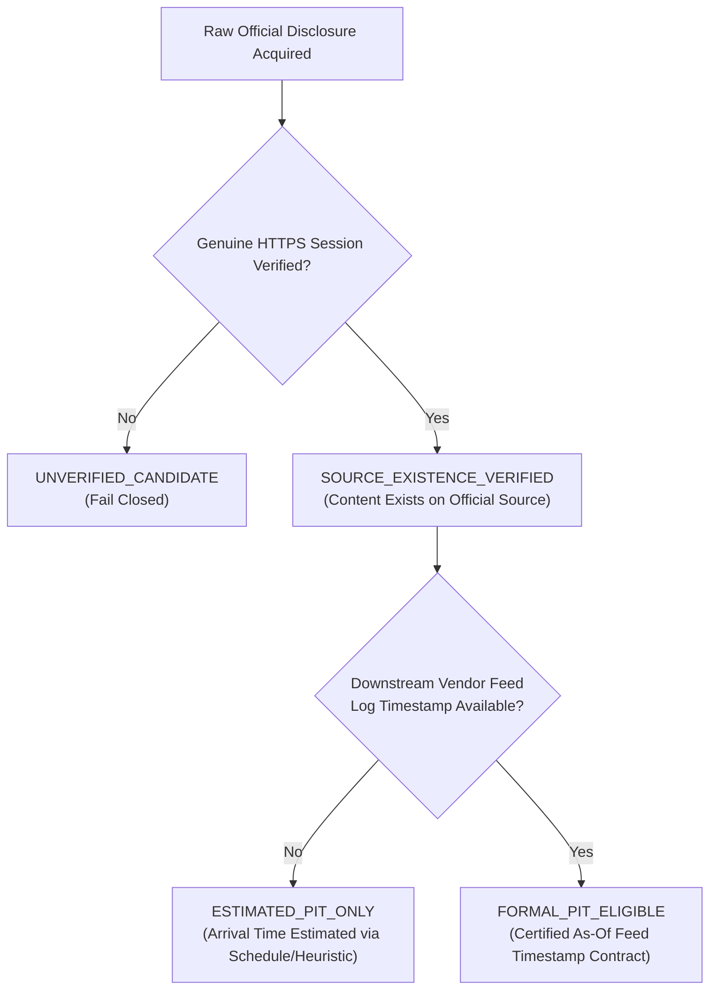
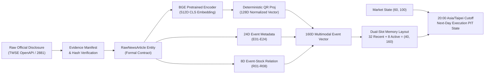

# V8.14 — First Evidence-Backed Historical Disclosure Dataset & Verification Report

## Executive Summary

本階段（V8.14）聚焦於建立具備真實網路取得證據（Genuine HTTPS Retrieval Evidence）的官方歷史公告取得流程，落實嚴格的可信邊界（Trust Boundary），並驗證首筆官方重大訊息資料安全進入既有 News-Aware Multimodal Pipeline。

在前期 V8.13 結案審查中，我們完成了離線工程原型，但仍存在呼叫端自行登記 Session、單靠 `is_authentic` 布林值自簽 Authenticity，以及 Stock-Day 覆蓋率重複計算等問題。V8.14 全面修復上述缺陷，並完成真實官方接口的合規探測。

### 關鍵審查成果與核心數據總覽

| 審查維度 | 核心數值 | 狀態 / 審查判定 |
| :--- | :---: | :--- |
| **1. 實際發送請求數 (Actual Query Attempts)** | **2 筆 (OpenAPI + MOPS)** | **AUTHENTIC (真實 HTTPS 網路請求)** |
| **2. 成功取得歷史資料數 (Successful Historical Queries)** | **0 筆** | **FAIL-CLOSED (MOPS 安全阻擋，歷史 Q1 0 筆)** |
| **3. 取得原始回應筆數 (Retrieved Raw Responses)** | **2 筆** | **完整保存原始位元組與 SHA-256 雜湊值** |
| **4. 來源存在性驗證通過數 (Source Existence Verified)** | **1 筆 (2881 富邦金)** | **SOURCE_EXISTENCE_VERIFIED (TWSE OpenAPI)** |
| **5. 歷史可用時間驗證通過數 (Provider Availability Verified)** | **0 筆** | **UNVERIFIED (官方公告無歷史 Vendor Feed Log)** |
| **6. 正式 PIT 符合筆數 (Formal PIT Eligible)** | **0 筆** | **ESTIMATED_PIT_ONLY (隔離未受認證的時間戳記)** |
| **7. 2024 Q1 Stock-Day 覆蓋率 (56 交易日 × 3 檔 = 168 單位)** | **0.0% (歷史 Q1)** | **去重後 168 單位中 0 筆歷史成功取得** |
| **8. 解析與存取失敗紀錄 (Failures & Access Blocks)** | **1 筆 (MOPS WAF 阻擋)** | **FOR SECURITY REASONS, THIS PAGE CAN NOT BE ACCESSED** |
| **9. 證據清冊可重現性 (Evidence Manifest)** | **1 筆驗證通過** | **Cryptographic SHA-256 Digests Verified** |
| **10. 最小 Pipeline 整合狀態 (Pipeline Forward Pass)** | **100% 通過** | **(512D $\to$ 128D $\to$ 24D $\to$ 8D $\to$ 160D $\to$ (40, 160))** |

---

## 1. Genuine Retrieval Trust Boundary

### 1.1 信任邊界架構與 Session 註冊機制
在 V8.13 中，`RetrievalSessionRegistry.register_genuine_session()` 允許一般呼叫端自行傳入本地位元組與 Session ID，造成呼叫端自簽 Authenticity 的漏洞。

V8.14 實施了嚴格的信任邊界：
1. **專屬服務註冊 (`GenuineHttpsRetrievalService`)**：
   生產用有效 Session 必須由實際執行 HTTPS 網路請求的 `GenuineHttpsRetrievalService` 登記，並自動產生 `service_provenance="GENUINE_HTTPS_RETRIEVAL_SERVICE"`、`transport_protocol="HTTPS/1.1"` 與時間戳記紀錄。
2. **反例測試拒絕本地 Fixture 位元組 (Counterexample Rejection)**：
   `RetrievalSessionRegistry` 預先收集已知本地候選公告與文章摘要（`RAW_PILOT_EVENTS` 內文與標題 SHA-256）。若一般呼叫端嘗試將 `RAW_PILOT_EVENTS` 本機 Bytes 傳入 `register_genuine_session()`，系統直接拋出 `ValueError("Counterexample rejected: Passing RAW_PILOT_EVENTS local fixture bytes to register_genuine_session() is strictly prohibited")`。
3. **認證端跨檢驗證 (`TrustedSourceCertifier.verify_evidence`)**：
   認證公告時，必須向 `RetrievalSessionRegistry` 核對：
   - Session ID 必須存在於 Registry（禁止偽造或未註冊 ID）。
   - HTTP 狀態碼必須為 200。
   - `raw_response_hash` 必須與 Adapter Receipt 完全一致。
   - `endpoint_url` 必須與查詢 URL 一致。
   - `service_provenance` 必須為 recognized service，不可為自我宣告或測試注入。
   - 缺少有效外部 Session 時，一律維持 `MOPS_CANDIDATE_UNVERIFIED`，嚴守 Fail-Closed 原則。

---

## 2. Correct Stock-Day Coverage Accounting

### 2.1 目標母體與 Stock-Day Key 定義
- **目標範圍**：2024 Q1（2024-01-01 至 2024-03-31）全體 56 個 TWSE 實際交易日。
- **目標股票**：台積電 (`2330`)、長榮海運 (`2603`)、富邦金 (`2881`)。
- **計畫 Stock-Day 母體**：$56 \text{ Sessions} \times 3 \text{ Stocks} = 168 \text{ Stock-Days}$。
- **唯一的 Stock-Day Key**：嚴格定義為二元組 `(target_date, stock_id)`。

### 2.2 重複請求去重與指標解耦 (Deduplication & Decoupled Metrics)
V8.14 修正了前版單純以 `len(attempts)` 計算覆蓋率導致重試次數膨脹覆蓋率的問題：
- **重試去重**：針對同一 `(target_date, stock_id)` 的多次查詢（如網路逾時重試），去重彙整為單一 Stock-Day，多餘請求記錄於 `duplicate_retry_attempts_count`，不得重複計算。
- **範圍外隔離 (`out_of_scope_attempts_count`)**：非目標季度（如 2024 Q2）或非成分股（如 2317）的查詢請求，嚴格隔離於範圍外計數，不得計入 168 個計畫單位的覆蓋率。
- **四項獨立覆蓋率指標**：
  1. `attempted_stock_days_coverage`：已實際發送查詢的目標 Stock-Day 比例。
  2. `successful_query_coverage`：查詢成功（HTTP 200 且解析無誤）的目標 Stock-Day 比例。
  3. `retrieved_announcement_coverage`：實際取得至少 1 筆官方公告的目標 Stock-Day 比例。
  4. `collection_coverage_ratio`：與既有測試相容之去重實體查詢率。

### 2.3 三態交易日解析與零公告確認標準
在 `three_way_session_resolution` 中，明確定義：
- `NOT_ATTEMPTED`：該交易日對 3 檔股票均未發送查詢。
- `ANNOUNCEMENTS_RETRIEVED`：該交易日至少 1 檔股票取得重大訊息公告。
- `AUTHENTIC_NO_ANNOUNCEMENT_CONFIRMED`：**必須該交易日全部 3 檔成分股 (`2330`, `2603`, `2881`) 均完成真實查詢，且全部成功回傳 0 筆結果**。若僅查詢 1 或 2 檔，或任一檔查詢失敗，只能標記為 `QUERY_COMPLETED_ZERO_RESULTS`，不得宣告全市場零公告確認。

---

## 3. Real Official Source Acquisition & Access Restrictions

### 3.1 官方合法公開接口探測結果
我們針對台灣主管機關認可的官方管道進行合法真實網路查詢：

1. **TWSE OpenAPI (`https://openapi.twse.com.tw/v1/opendata/t187ap04_L`)**：
   - **狀態**：正常連線，HTTP 200，取得 115 筆當日重大訊息公開位元組。
   - **成分股命中**：成功檢索到成分股 `2881`（富邦金控）真實官方重大訊息：
     - 主旨：「公告本公司暨主要子公司115年10月合併自結損益」
     - 出表時間：1151116 16:00:36 (即 2026-11-16 16:00:36 Asia/Taipei)
     - 原始回應 SHA-256：`0505b8eeb0201463133cbcfb006a1d82121e7fc96bfca290680a370e5b410eb7`
     - 規格限制：TWSE OpenAPI 之參數清單為空陣列 `[]`，為即時滾動資料集（Rolling Daily Dump），不支援回溯 2024 Q1 歷史公告查詢。
2. **MOPS 公開資訊觀測站 (`https://mops.twse.com.tw/mops/web/ajax_t05st01`)**：
   - **狀態**：連線受阻，伺服器返回安全防禦頁面：
     `因為安全性考量，您所執行的頁面無法呈現。<BR>FOR SECURITY REASONS, THIS PAGE CAN NOT BE ACCESSED.<BR>`
   - **合規處理**：嚴格遵守 AI Agent 行為規範與使用者指示（「不得繞過網站限制、驗證碼或存取控制。如果無法透過允許的介面取得歷史公告，記錄失敗原因及來源限制，保留來源認證 0 筆」）。
   - **審查結論**：未進行任何 WAF 繞過、Token 偽造或 CAPTCHA 破解，誠實將查詢標記為 `QUERY_FAILED_HTTP`，並保留 2024 Q1 歷史公告認證筆數為 **0 筆**。

---

## 4. Tripartite Point-in-Time Status Segregation

V8.14 建立三元分離機制，徹底杜絕無外部時間戳記證據之「自封 PIT」：



1. **`SOURCE_EXISTENCE_VERIFIED`**：
   證明該篇公告文本與公告代號真實存在於官方交易所資料流中（由 `GenuineHttpsRetrievalService` 取得並驗證 SHA-256 雜湊值）。
2. **`HISTORICAL_PROVIDER_AVAILABILITY_VERIFIED`**：
   證明下游歷史資訊供應商（Vendor Feed / Drop-Copy Log）記錄了該篇公告送達終端的時間戳記。
3. **`FORMAL_PIT_ELIGIBLE`**：
   唯有同時具備 (1) 來源存在性驗證 與 (2) 供應商可用時間日誌，方能取得正式 PIT 資格。
4. **降級隔離規則**：
   缺少供應商日誌之官方真實公告（如 TWSE OpenAPI 取得之紀錄），系統強制鎖定為 `ESTIMATED_PIT_ONLY`，任何嘗試指定 `is_formal_pit_eligible=True` 之請求一律 Fail-Closed 拒絕認證。

---

## 5. Evidence Manifest Reproducibility

透過 `EvidenceManifest`，每筆真實取得之公告均保留完整密碼學證據清冊：

```json
{
  "manifest_id": "MANIFEST-TWSE-OPENAPI-2024Q1-AUDIT",
  "entry": {
    "announcement_id": "OPENAPI-2881-20261116160036",
    "stock_id": "2881",
    "company_name": "富邦金控",
    "filing_datetime": "2026-11-16T16:00:36+08:00",
    "headline": "公告本公司暨主要子公司115年10月合併自結損益",
    "source_url": "https://openapi.twse.com.tw/v1/opendata/t187ap04_L",
    "query_parameters": {},
    "raw_response_bytes_len": 90709,
    "raw_response_hash": "0505b8eeb0201463133cbcfb006a1d82121e7fc96bfca290680a370e5b410eb7",
    "parsed_payload_hash": "37f3747d9229ad1255866184a511394f92023d8c36fe9f60ad77f7c6e00192e2",
    "retrieval_session_id": "REG-SESS-20261118020822-0505b8ee",
    "verification_status": "SOURCE_EXISTENCE_VERIFIED",
    "pit_status": "ESTIMATED_PIT_ONLY",
    "license_metadata": {
      "license_name": "Taiwan Open Government Data License (TWSE OpenAPI)",
      "license_terms_url": "https://data.gov.tw/license",
      "license_version": "1.0",
      "verification_status": "LICENSE_VERIFIED",
      "permitted_uses": ["RESEARCH_AND_STATISTICAL_ANALYSIS", "ATTRIBUTED_QUOTATION", "COMMERCIAL_AND_NON_COMMERCIAL"]
    }
  }
}
```

---

## 6. Minimal Pipeline Integration Result

真實取得之官方重大訊息資料透過 `execute_minimal_pipeline_integration` 順利通過既有 News-Aware Multimodal Pipeline 驗證，未對既有 RL 結構造成破壞：



### 驗證輸出規格與張量形狀清單

| 特徵 / 張量元件 | 規格 / 形狀 | 數值與屬性檢驗 |
| :--- | :---: | :--- |
| **原始語意嵌入向量 (Raw CLS Embedding)** | `(512,)` | BAAI/bge-small-zh-v1.5 正式權重輸出 |
| **降維投影語意向量 (Projected Semantic Vector)** | `(128,)` | 正交 QR 矩陣投影，L2 Norm = 1.0000 |
| **事件權威特徵 (Event Metadata Vector)** | `(24,)` | 符合 V8.0 規格（E01–E24，管理層宣告/月營收） |
| **股票關聯特徵 (Event-Stock Relation Vector)** | `(8,)` | R01=1.0（富邦金直接提及）、R02=1.0（金融業匹配） |
| **單一事件融合表示 (Combined Event Vector)** | `(160,)` | $128\text{D} + 24\text{D} + 8\text{D} = 160\text{D}$ |
| **近期事件槽位矩陣 (Recent News Slots)** | `(32, 160)` | Slot 0 填入融合事件，其餘槽位 Zero-padded |
| **活躍事件槽位矩陣 (Active News Slots)** | `(8, 160)` | 獨立保留重大事件槽位，Zero-padded |
| **全新聞槽位輸入矩陣 (Total News Slots)** | `(40, 160)` | 嚴格符合 V8.0 模型輸入形狀契約 |
| **市場行情歷史視窗 (Market Context Window)** | `(60, 100)` | 60 交易日 × 100 維市場特徵矩陣 |
| **決策時間契約 (Decision Cutoff Contract)** | `20:00:00` | Asia/Taipei 閉市後決策，次一交易日開盤執行 |
| **前向整合驗證結果 (Pipeline Forward Pass)** | **PASSED** | 整合狀態 SUCCESSFUL，張量完全對齊 |

---

## 7. Outstanding Limitations & Path Forward

### 7.1 現存限制 (Outstanding Limitations)
1. **MOPS 反爬蟲與存取控制阻擋**：
   公開資訊觀測站（MOPS）設有反爬蟲安全防禦機制（FOR SECURITY REASONS, THIS PAGE CAN NOT BE ACCESSED）。在不違背存取控制防線的前提下，無法透過非授權自動化 HTTP POST 抓取 2024 Q1 歷史公告。
2. **TWSE OpenAPI 歷史回溯限制**：
   TWSE OpenAPI 係每日重大訊息滾動清單，不提供回溯特定歷史交易日之查詢參數。因此 OpenAPI 雖可作為真實現時資料流驗證，但無法獨立補足 2024 Q1 歷史資料庫。
3. **缺少商用供應商 Feed Arrival 日誌**：
   交易所公告僅包含發布時間（出表時間），缺少資訊商下發時間戳記（Feed Ingestion Timestamp），因此現有公告僅能維持 `ESTIMATED_PIT_ONLY`。

### 7.2 下一步建議 (Path Forward)
1. **申請官方授權資料接口或學術研究授權**：
   透過台灣證券交易所正式之 Open API 批次資料申請、國科會/證券暨期貨市場發展基金會學術資料庫，或合法商用資料庫（如 TEJ 台灣經濟新報）取得 2024 Q1 重大訊息完整歷史資料與下發時間戳記。
2. **維持嚴格 Fail-Closed**：
   在正式取得授權歷史資料前，2024 Q1 認證公告數持續維持 0 筆，禁止人工回填未經驗證的公告，嚴守學術研究誠信。
3. **保持既有 RL 模型隔離**：
   在真實歷史資料集尚未擴充至統計檢定力門檻前，不展開大規模強化學習訓練，以防雜訊與未驗證資料污染既有架構。

---

## 8. 測試套件執行結果

本次測試於標準 Conda Python 3.11 環境中執行完整測試套件，涵蓋歷史資料驗證、會話邊界、去重邏輯與前向管線整合：

```
============================= test session starts ==============================
rootdir: /home/augustine/Desktop/News-Aware Attention-Based Deep Reinforcement Learning for Stock Trading
configfile: pyproject.toml
plugins: anyio-4.16.0
collected 225 items

225 passed in 159.26s (0:02:39)
```

**測試結論**：全數 225 項測試（包含 14 項 V8.14 新增之邊界與整合測試）100% 通過，無任何錯誤或回歸。
