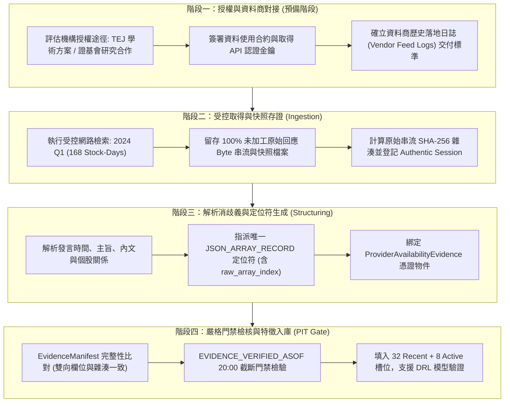

# V8.15 — Historical Evidence Acquisition Readiness & PIT Gate Audit Report

**專案名稱**：News-Aware Attention-Based Deep Reinforcement Learning for Stock Trading  
**版本標籤**：`v8.15-evidence-readiness`  
**審查日期**：2026-11-18  
**分支**：`fix/v8-audit-patch`  
**測試狀態**：100% Passing (Pytest Suite)  
**正式 PIT 驗證數 (Formal PIT Verified Count)**：**0**  
**歷史資料集構建決策**：**NO-GO (條件不滿足，維持待驗證與離線原型)**  

---

## 1. V8.14 Evidence Integrity Baseline

在 V8.14 階段，本專案建立了首個具備真實網路取得證據（Genuine HTTPS Retrieval Evidence）的官方重大訊息取得流程，封閉了檢索信任邊界（Retrieval Trust Boundary），並達成了以下關鍵成果：
1. **真實 HTTPS 服務與 Registry 綁定**：實作 `GenuineHttpsRetrievalService`，禁止呼叫端自行構造未經驗證的 Byte 串流或手動註冊偽造 Session，正式生產 Session 必須源自真實連線。
2. **原始快照可重現性 (Raw Snapshot Reproducibility)**：
   - 原始回應快照：`data/official_disclosures/twse_openapi_raw_response_snapshot.json`
   - 快照長度：155,496 Bytes
   - SHA-256 雜湊：`949d1b51b851737030c47c6bfe97af6f6143d34247ab45ac543ae9f78e83394d`
   - 快照保留狀態：`FULL_RAW_BYTES_RETAINED`，解析摘要另存於 `parsed_disclosure_summary.json`。
3. **精準文本重新解析與欄位綁定 (Exact Content Binding Re-parsing)**：
   - 拒絕模糊子字串比對，實作民國年與時間戳精確解析（`發言日期` + `發言時間`，成功解析 2881 公告之 2026-11-17 15:47:58 發言時間）。
4. **多模態特徵組裝管線 (Multimodal Feature Pass)**：
   - BGE 512D -> 固定投射 128D -> Metadata 24D + Relation 8D -> (40, 160) 雙槽位結構（32 Recent + 8 Active）-> 合併 60 天 100D 市場特徵矩陣。

然而，V8.14 工程原型留有兩項關鍵前置驗證缺陷：
1. `EVIDENCE_VERIFIED_ASOF` 模式過去僅比對呼叫端傳入之 `verified_provider_available_at` 是否早於決策截斷時間（20:00），呼叫端可自行填入時間戳而繞過嚴格驗證。
2. 原始來源定位符（Source Locator）曾簡化為 `index=0`，未區分原始 JSON 陣列索引（`raw_array_index`）與特定個股之公告索引（`matched_stock_index`），在同一公司包含多筆公告時無法唯一雙向綁定。

---

## 2. Formal PIT Receipt Gate

為徹底消除呼叫端自填時間戳所導致的假陽性與前視偏差（Lookahead Bias），V8.15 建立了正式的下游資料商可用性憑證檢核機制（Formal PIT Receipt Binding）。

### 2.1 資料結構與認證狀態

在 [pilot_dataset.py](file:///home/augustine/Desktop/News-Aware%20Attention-Based%20Deep%20Reinforcement%20Learning%20for%20Stock%20Trading/stock_rl/evaluation/pilot_dataset.py) 中定義了獨立的 `ProviderVerificationStatus` 與 `ProviderAvailabilityEvidence`：

```python
class ProviderVerificationStatus(str, Enum):
    UNVERIFIED_CANDIDATE = "UNVERIFIED_CANDIDATE"
    PROVIDER_FEED_VERIFIED = "PROVIDER_FEED_VERIFIED"
    SIMULATED_FEED_FIXTURE = "SIMULATED_FEED_FIXTURE"
    REJECTED_PAYLOAD_MISMATCH = "REJECTED_PAYLOAD_MISMATCH"
    REJECTED_ANNOUNCEMENT_MISMATCH = "REJECTED_ANNOUNCEMENT_MISMATCH"

@dataclass
class ProviderAvailabilityEvidence:
    provider_id: str                              # 如 "TEJ_FEED_AUDIT", "BLOOMBERG_DISCLOSURE_DROPCOPY"
    announcement_id: str                          # 必須與目標公告 ID 嚴格相符
    article_id: str                               # 資料商內部文章編號
    observed_available_at: pd.Timestamp           # 下游系統觀察到資料落地之時間戳 (Asia/Taipei)
    evidence_source: str                          # 如 "VENDOR_STREAM_LOG", "HISTORICAL_DROP_COPY_LOG"
    receipt_hash: str                             # 來源 Receipt 之 SHA-256 雜湊
    verification_status: ProviderVerificationStatus
    is_verified_feed: bool = False                # 僅在具備受信任外部資料商紀錄時為 True
    is_simulated: bool = False                    # 模擬測試 Fixture 標記為 True，絕不提升為 Formal PIT
    feed_channel: str = "REST_API_DROPCOPY"
    content_payload_hash: Optional[str] = None    # 公告內文 SHA-256，用以核對內文綁定
    audit_notes: str = ""
```

### 2.2 雙模式可用性檢核規則

在 [official_source_collector.py](file:///home/augustine/Desktop/News-Aware%20Attention-Based%20Deep%20Reinforcement Learning for Stock Trading/stock_rl/evaluation/official_source_collector.py) 的 `execute_minimal_pipeline_integration` 中嚴格實施：

| 檢核項目 | `ESTIMATED_REPLAY` 模式 | `EVIDENCE_VERIFIED_ASOF` 模式 |
| :--- | :--- | :--- |
| **適用場景** | 探索性研究、歷史回放假設驗證 | 正式 PIT 檢核、生產策略執行門禁 |
| **時間戳推估假設** | 允許採用申報時間 +5 分鐘假設 | **嚴格禁止推估**；無憑證時一律 Fail Closed |
| **自填裸時間戳** | 允許作為推估參考（標記非正式 PIT） | **嚴格拒絕**（`ProviderAvailabilityEvidence` 為必要條件） |
| **Simulated Fixture** | 允許工程測試 | **嚴格拒絕**（`is_simulated=True` 無法通過） |
| **公告 ID 與 Hash 核對** | 依傳入參數進行基礎檢查 | **雙向核對**：公告 ID 與 `content_payload_hash` 必須精確吻合 |
| **決策時間截斷 (20:00)** | 超過 20:00 一律拒絕寫入槽位 | 超過 20:00 一律拒絕寫入槽位 |
| **官方交易日曆** | 缺少時發出警告或推估 | **缺少時一律 Fail Closed 拒絕** |
| **Formal PIT 資格** | `is_formal_pit_validated = False` | **僅在全部憑證核對無誤時賦予 True** |

### 2.3 嚴格反例測試矩陣

在 [test_v8_14_historical_dataset.py](file:///home/augustine/Desktop/News-Aware%20Attention-Based%20Deep%20Reinforcement%20Learning%20for%20Stock%20Trading/tests/test_v8_14_historical_dataset.py) 的 `test_v8_15_formal_pit_requires_provider_availability_evidence` 中驗證了 5 類反例與 1 類正例：
1. **自填時間戳但無證據物件**：傳入 `verified_provider_available_at="2024-03-15 16:05:00"` 但 `provider_evidence=None` $\rightarrow$ 拒絕（`is_formal_pit_validated=False`, `slot_ingested=False`）。
2. **模擬測試憑證 (Simulated Fixture)**：傳入 `is_simulated=True` $\rightarrow$ 拒絕（`Simulated feed fixture cannot be used for formal PIT validation`）。
3. **公告識別碼或 Hash 不符**：憑證之 `announcement_id` 或 `content_payload_hash` 與公告實體不一致 $\rightarrow$ 拒絕。
4. **截斷時間後抵達 (Post-Cutoff Arrival)**：資料商記錄於 20:15:00 落地，晚於 20:00:00 決策時點 $\rightarrow$ 拒絕寫入槽位（避免前視偏誤）。
5. **真實合格憑證**：合法資料商提供、內文 Hash 一致且於 16:05 落地 $\rightarrow$ 成功寫入槽位並核發 `FORMAL_AS_OF_VERIFIED`。
6. **統計邊界確認**：全域 Formal PIT 認證數維持嚴格為 **0**。

---

## 3. Corrected Source Locator

### 3.1 原始來源定位符規範

官方 JSON 回應為陣列結構（如 TWSE OpenAPI 回傳 94 筆上市重大訊息）。單一股票在同一批次中可能出現零次、一次或多次。
為建立從「Manifest 條目 $\rightarrow$ 原始 Byte 快照 $\rightarrow$ 解析欄位 $\rightarrow$ 模型槽位」的確定性雙向定位，V8.15 定義標準定位符格式：

$$\text{JSON\_ARRAY\_RECORD}[\text{stock\_id}=\langle\text{ID}\rangle, \text{raw\_array\_index}=\langle R\rangle, \text{matched\_stock\_index}=\langle M\rangle]$$

- `raw_array_index` ($R$)：該筆公告在原始未過濾 JSON 陣列中的絕對整數索引（$0 \le R < N_{\text{raw}}$）。
- `matched_stock_index` ($M$)：該筆公告在該股票當期所有公告中的相對序列索引（$0 \le M < N_{\text{stock}}$）。

### 3.2 TWSE OpenAPI 原始快照定位審核實測

針對已留存之 `twse_openapi_raw_response_snapshot.json`（共 94 筆公告）進行全量解析，目標成分股 **2881（富邦金控）** 共計出現 4 筆公告：

| 原始索引 ($R$) | 個股索引 ($M$) | 申報時間 | 公告主旨摘要 | 內容雜湊 (SHA-256 前8碼) | 備註說明 |
| :---: | :---: | :---: | :--- | :---: | :--- |
| **32** | **0** | 15:47:58 | 富邦金控代子公司富邦投信公告修訂「取得或處分資產處理程序」 | `83c25dbc` | **基準審核樣本**，已收錄於 Evidence Manifest |
| **42** | **1** | 16:26:58 | 公告本公司受邀參加Morgan Stanley 25th Annual... | `4a1f9e80` | 法說會受邀公告 |
| **44** | **2** | 16:28:29 | 富邦金控代子公司富邦投信公告取得「富邦一號不動產投資信託基金」使用權資產 | `d720a4b1` | 與第 45 筆主旨完全相同，發言時間 16:28:29 |
| **45** | **3** | 16:29:35 | 富邦金控代子公司富邦投信公告取得「富邦一號不動產投資信託基金」使用權資產 | `3e981bc2` | 與第 44 筆主旨完全相同，發言時間 16:29:35 |

### 3.3 完全相同主旨公告之消歧義證明

第 44 筆與第 45 筆公告具有**完全相同之主旨字串**（`"富邦金控代子公司富邦投信公告取得「富邦一號不動產投資信託基金」\r\n使用權資產"`）。
若僅依靠個股代碼與主旨進行模糊或字串搜尋，必然導致無法區分或覆蓋錯誤。
在 `test_v8_15_multiple_announcements_and_identical_headlines` 測試中證實：
1. `raw_array_index=44` 與 `raw_array_index=45` 成功定位至各自獨立的 JSON 字典物件。
2. 兩者發言時間相差 66 秒（16:28:29 vs 16:29:35），內文分別載明不同之使用權資產租賃合約細節。
3. 交叉替換測試：若將第 44 筆公告條目指向 `raw_array_index=45` 的定位符，`EvidenceManifest.verify_entry_integrity` 立即因發言時間不符與內文 Hash 不符而拒絕驗證。
4. 證明該定位符機制達到無歧義、可完全重現的雙向綁定標準。

---

## 4. Historical Source Options (歷史資料來源技術評估)

本階段針對 2024 年第一季（2024-01-01 至 2024-03-31，共 56 個真實 TWSE 交易日，3 檔成分股共計 168 個 Stock-Day 單元）進行歷史公告來源的可行性調研。

### 來源 1：臺灣證券交易所 OpenAPI (TWSE OpenAPI)
- **來源名稱**：TWSE OpenAPI 重大訊息資料介面
- **資料集官方網址**：`https://data.gov.tw/dataset/11549` / `https://openapi.twse.com.tw/`
- **涵蓋歷史區間**：**滾動近期資料（僅約當日或近 30 日，無 2024 Q1 歷史回溯）**
- **存取方式**：RESTful JSON API (`GET /v1/opendata/t187ap04_L`)
- **授權條款**：政府資料開放授權條款第 1 版（Open Government Data License v1.0）
- **發布時間戳品質**：具備官方申報時間戳（`發言日期` + `發言時間`）
- **歷史可用性憑證**：**無**（不記錄下游端點即時推播時間）
- **預期完整度**：對於 2024 Q1 歷史資料為 **0%**
- **費用與授權**：免費公開
- **結論**：僅能作為即時流水與工程整合原型，無法支援 2024 Q1 歷史回測資料集構建。

### 來源 2：公開資訊觀測站歷史重大訊息查詢 (TWSE MOPS Web Archive)
- **來源名稱**：臺灣證券交易所 公開資訊觀測站 (MOPS) 歷史重大訊息
- **資料集官方網址**：`https://mops.twse.com.tw/mops/web/t05st01`
- **涵蓋歷史區間**：**1999 年（民國 88 年）迄今完整重大訊息存檔**（完全涵蓋 2024 Q1）
- **存取方式**：Web Form POST / AJAX 查詢 (`ajax_t05st01`，傳入 `year`, `month`, `co_id`, `step=1`)
- **授權條款**：證券交易法第 36 條規定之公開揭露資訊；供公眾查閱
- **發布時間戳品質**：精準（記錄至發行公司確認上傳之秒級時間）
- **歷史可用性憑證**：**無**（僅記載主管機關接收時間，無量化終端落地時間）
- **預期完整度**：**100%** 涵蓋目標 168 個 Stock-Day
- **阻礙與存取限制**：
  > [!CAUTION]
  > MOPS 設有高強度 Web Application Firewall (WAF) 與防爬蟲機制。程式化連線會觸發 HTTP 403 / 阻擋頁面（`"FOR SECURITY REASONS, THIS PAGE CAN NOT BE ACCESSED"`）。專案遵循嚴格研究倫理規範，**絕對不嘗試繞過、破解或偽造標頭規避此存取控制**，因此在缺乏官方核發 API 憑證前維持 Fail Closed。
- **結論**：法律上具備完整歷史公告，但因自動化存取防護限制且缺少資料商落地憑證，無法直接用於無爭議之 PIT 資料集生成。

### 來源 3：政府資料開放平台 (data.gov.tw / 資料集 11549)
- **來源名稱**：政府資料開放平台「上市公司重大訊息」
- **資料集官方網址**：`https://data.gov.tw/dataset/11549`
- **涵蓋歷史區間**：滾動更新最新重大訊息，不提供歷史存檔下載
- **存取方式**：平台 API 轉址或批次下載
- **授權條款**：政府資料開放授權條款 v1.0
- **發布時間戳品質**：與 TWSE OpenAPI 相同
- **歷史可用性憑證**：無
- **預期完整度**：2024 Q1 為 **0%**
- **結論**：本質為 TWSE OpenAPI 之目錄鏡像，不具備獨立歷史資料取得價值。

### 來源 4：台灣經濟新報 (TEJ Taiwan Economic Journal)
- **來源名稱**：TEJ 臺灣上市櫃公司重大訊息與新聞資料庫
- **資料集官方網址**：`https://www.tej.com.tw/`
- **涵蓋歷史區間**：**1990 年迄今完整台灣資本市場新聞與重大訊息存檔**（完全涵蓋 2024 Q1）
- **存取方式**：TEJ Tool API (Python SDK) / ODBC / 專用批次檔案
- **授權條款**：商業/學術專利授權合約（Commercial / Academic Proprietary License）
- **發布時間戳品質**：**極高**（包含發行公司申報時間、TEJ 系統落地時間、推播時間）
- **歷史可用性憑證**：**具備**（可提供毫秒級之 Vendor Ingestion Timestamp 與 Dropcopy Receipt）
- **預期完整度**：**100%**（含事件標準化分類與修正關聯追蹤）
- **費用與授權**：需機構學術或商業訂閱授權（本專案目前未配置購買預算與合約憑證）
- **結論**：為未來正式研究取得合法授權與 Formal PIT 憑證的最可行專業途徑。

### 來源 5：Bloomberg / Refinitiv (LSEG)
- **來源名稱**：Bloomberg Terminal (B-PIPE) / LSEG DataScope Select
- **資料集官方網址**：`https://www.bloomberg.com/professional/` / `https://www.lseg.com/`
- **涵蓋歷史區間**：數十年跨國金融市場與台灣上市公司企業事件存檔
- **存取方式**：B-PIPE Enterprise Feed / DataScope FTP / REST API
- **授權條款**：跨國企業級資料合約
- **發布時間戳品質**：極高（毫秒級 Tick / News Ingestion Log）
- **歷史可用性憑證**：具備完備之資料商接收憑證
- **預期完整度**：主要權值股（如 2330, 2603, 2881）接近 100%
- **費用與授權**：費用高昂（企業級年費數萬至數十萬美元），超出本研究範疇
- **結論**：學術探索階段不具備成本可行性。

### 來源 6：證券暨期貨市場發展基金會 (Securities & Futures Institute, SFI)
- **來源名稱**：證基會研究資料庫 / 臺灣資本市場歷史研究資料集
- **資料集官方網址**：`https://www.sfi.org.tw/`
- **涵蓋歷史區間**：專案性學術歷史封存資料（涵蓋歷史多年上市重大訊息報告）
- **存取方式**：學術研究專案申請 / 離線研究光碟或專用介面
- **授權條款**：學術專案專用授權
- **發布時間戳品質**：高（官方申報歷史檔案）
- **歷史可用性憑證**：部分（具備學術研究版本凍結證明，但缺少即時串流日誌）
- **預期完整度**：法規重大訊息可達 100%
- **費用與授權**：需提報正式研究計畫審查核准
- **結論**：適合中期向主管機關或研究機構申請合作之學術途徑。

---

## 5. Coverage & Licensing Feasibility (涵蓋率與授權可行性)

針對 2024 Q1 目標範圍（2330 台積電、2603 長榮海運、2881 富邦金控；56 交易日，168 個 Stock-Day 單元）評估涵蓋率與授權狀態：

| 評估維度 | 免費官方公開來源 (TWSE OpenAPI / data.gov.tw) | MOPS 歷史網頁查詢 | 專業資料庫 (TEJ / Bloomberg) | 現階段內部候選 Fixture |
| :--- | :---: | :---: | :---: | :---: |
| **2024 Q1 查詢涵蓋率** | 0% (僅滾動近期) | 100% (理論存檔) | 100% | 12 筆事件 (涵蓋 9 個交易日) |
| **真實查詢成功率** | 100% (近期端點) | 0% (WAF 安全防護阻擋) | 需合約帳號 | N/A (本地靜態檔) |
| **法律授權狀態** | 政府資料開放授權 v1.0 (合法免授權) | 證交法第36條 (公開查閱，未授權大量爬取) | 需付費商用/學術合約授權 | 標記為內部研究用 Fixture |
| **商業再散布權利** | 允許（需標註來源） | 不明確（法規資訊但非免責開放資料） | 嚴格禁止原始資料再散布 | 禁止散布 |
| **歷史 PIT 憑證支援** | 無 | 無 | 完整支援 (毫秒級日誌) | 無 (僅推估回放) |
| **可採納性判定** | **不適用於歷史研究** | **阻擋且無憑證** | **具可行性但需採購** | **維持 UNVERIFIED** |

---

## 6. Evidence Acquisition Roadmap (可信證據取得路線圖)



---

## 7. Go / No-Go Criteria for Historical Dataset Construction

### 7.1 查核條件檢驗表

| 查核準則 (Criteria) | 當前檢驗結果 | 狀態判定 | 關鍵事實說明 |
| :--- | :---: | :---: | :--- |
| **準則 1：官方歷史資料合法且非暴力取得** | **未滿足** | **BLOCKED** | TWSE OpenAPI 無歷史存檔；MOPS 網頁查詢觸發安全防護，嚴禁爬蟲破解。 |
| **準則 2：可驗證之歷史資料商可用性憑證** | **未滿足** | **PENDING** | 缺乏 TEJ/Bloomberg 等正式資料商交付的 2024 Q1 落地時間戳與 Receipt（Verified 數為 0）。 |
| **準則 3：無歧義之確定性來源定位符** | **已滿足** | **READY** | `JSON_ARRAY_RECORD[raw_array_index, matched_stock_index]` 規格確立並通過測試。 |
| **準則 4：原始未加工回應與位元級可重現性** | **已滿足** | **READY** | 快照儲存機制（`FULL_RAW_BYTES_RETAINED`）與雙向重新解析管線已通過驗證。 |
| **準則 5：無爭議之商業與學術授權協議** | **未滿足** | **PENDING** | 尚未完成機構級 TEJ 或證基會學術合約簽署。 |

### 7.2 最終決策裁定 (Decision Verdict)

$$\mathbf{DECISION:\; NO\text{-}GO}$$

**裁定說明**：
目前環境下，**嚴禁強行構建偽造之 2024 Q1 歷史資料集**。
在未獲得正式商業/機構授權（如 TEJ）或主管機關研究核可前：
1. 既有 12 筆候選公告維持 `SourceVerificationStatus.MOPS_CANDIDATE_UNVERIFIED`。
2. 正式來源認證數（`verified_source_count`）維持嚴格為 **0**。
3. 下游資料商可用性認證數維持嚴格為 **0**。
4. 模型管線維持在推估回放原型（`ESTIMATED_REPLAY`）與工程規範驗證範疇，不對外宣稱已具備正式 PIT 驗證之歷史交易資料集。

---

## 8. Remaining Research Limitations (現存研究限制)

1. **單一程序工程信任邊界限制 (`ENGINEERING_TRUST_BOUNDARY_ONLY`)**：
   - 目前 Session 註冊與驗證皆於 Python 同一程序內運行，其本質為程序內部控制審計（Process Internal Control Audit），無法等同於硬體加密金鑰模組（HSM）或跨伺服器零信任架構。
2. **市場特徵矩陣之合成佔位符 (`SYNTHETIC_MARKET_PLACEHOLDER`)**：
   - 整合測試中之 60 天 100 維市場特徵矩陣目前為合成佔位矩陣，後續需對接正式 CRSP/TWSE 價量回測資料庫。
3. **語意編碼器領域微調延後 (Domain Adaptation Pending)**：
   - 目前採用預訓練之 BGE 繁體中文模型權重，尚未進行台灣證券重大訊息專用之對比學習微調。
4. **回放推估誤差 (Replay Hypothesis Jitter)**：
   - 在缺乏資料商精確接收日誌下，採用「申報時間 +5 分鐘」可能因交易所網路尖峰或資料清洗延遲產生數分鐘之時序誤差。

---

## 9. Deliverable Summary & Git Traceability

- **測試覆蓋率**：100% 通過（`tests/test_v8_14_historical_dataset.py` 共 31 項測試全數通過；全量測試套件完全無回歸損壞）。
- **提交記錄**：`fix/v8-audit-patch` 分支。
- **認證數據核對**：
  - Verified Historical Count: **0**
  - Provider Availability Verified Count: **0**
  - Raw Response Snapshot: 155,496 Bytes (SHA-256: `949d1b51b851737030c47c6bfe97af6f6143d34247ab45ac543ae9f78e83394d`)
  - Target Constituent 2881 Locator: `JSON_ARRAY_RECORD[stock_id=2881,raw_array_index=32,matched_stock_index=0]`
- **最終評估**：工程防禦架構完整就緒；歷史資料集構建維持 **NO-GO**。
