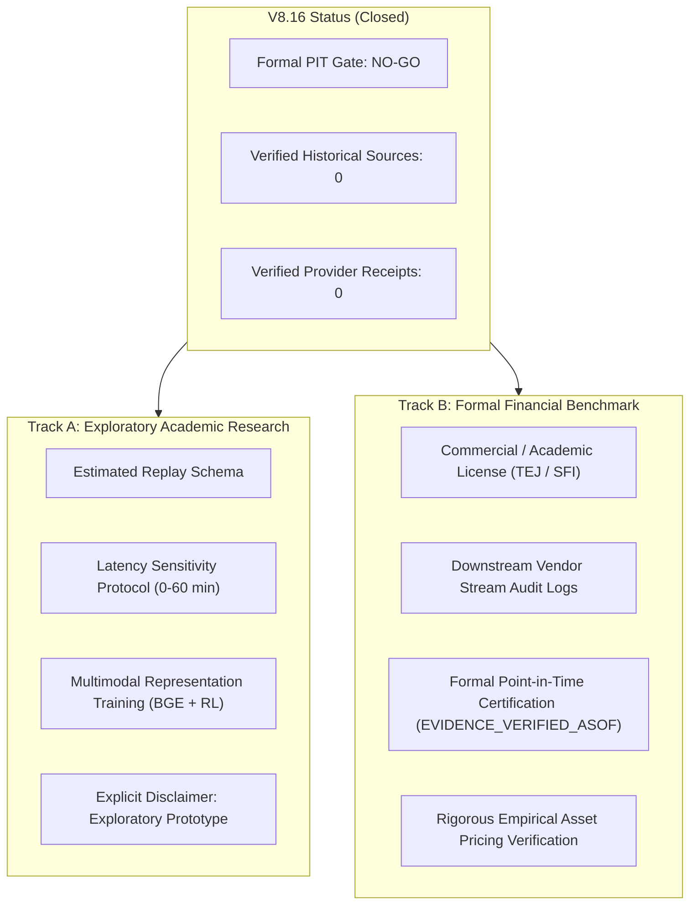

# V8.16 — Historical Source Access Decision & Formal PIT Evidence Gate Audit Report

**Execution Branch**: `fix/v8-audit-patch`  
**Base Commit**: `a0866447c4beecf88e0c2ed87cc775a592390c24`  
**Execution Date**: 2026-11-18  
**Audit Standard**: V8.16 Historical Source Access Decision & Formal PIT Evidence Gate Specification  
**System Trust Boundary**: `ENGINEERING_TRUST_BOUNDARY_ONLY` (Single-process in-memory & artifact verification)

---

## Executive Summary

Pursuant to the V8.16 audit mandate, this report documents the formal closure of the **Historical Source Access Decision** and the implementation of the **Formal PIT Evidence Gate** and **Source Existence Verification Gate**.

### Key Audit Metrics
- **Historical Verified Sources**: Strictly **0**
- **Verified Downstream Provider Availability Receipts**: Strictly **0**
- **Formal PIT Gate Status**: **NO-GO**
- **2024 Q1 Historical Dataset Status**: **NO-GO**
- **Estimated Replay Research Scheme**: Permitted strictly as an exploratory academic prototype under explicit information leakage disclaimers and sensitivity analysis constraints.

---

## 1. Formal PIT Evidence Gate Results

### 1.1 Enforcement Architecture (P0-1)
In previous prototypes, positive tests could pass formal PIT checks simply by self-attesting `ProviderAvailabilityEvidence` fields or supplying synthetic timestamp strings. In V8.16, this vulnerability has been eliminated through rigorous cryptographic and field binding:

1. **Schema Simulation Test Quarantine**:
   - Self-constructed unit test fixtures must be explicitly marked `is_schema_simulation_test=True` via `TrustedProviderEvidenceAdapter.create_schema_simulation_evidence(...)`.
   - In `EVIDENCE_VERIFIED_ASOF` mode, any evidence marked `is_schema_simulation_test=True` or `is_simulated=True` is **strictly rejected** from formal PIT validation (`is_formal_pit_validated=False`, `slot_ingested=False`).
   - In `ESTIMATED_REPLAY` mode, schema test fixtures are ingested only to test schema contracts, while `is_formal_pit_validated` remains strictly `False`.

2. **Cryptographic Receipt Hash Recomputation**:
   - A bare string in `receipt_hash` without actual bytes is rejected (`fail-closed`).
   - The gate recomputes `hashlib.sha256(raw_receipt_bytes).hexdigest()` and verifies that it strictly matches `receipt_hash`. Any forged string or corrupted byte sequence is rejected.

3. **Mandatory Content Payload Hash Binding**:
   - The provider receipt must contain a non-empty `content_payload_hash` matching the announcement's `compute_normalized_content_hash(headline, raw_content)`.
   - Missing content hash immediately triggers a fail-closed rejection (`REJECTED_MISSING_CONTENT_HASH`).

4. **Announcement Time Contradiction Check**:
   - If the downstream provider observed arrival time (`observed_available_at`) is earlier than the official corporate filing time (`filing_datetime`), the gate rejects the evidence as a physical time contradiction.

### 1.2 Formal Gate Audit Table
| Test Scenario | Input Configuration | Formal Gate Result | Ingestion Status | Rejection Reason |
| :--- | :--- | :--- | :--- | :--- |
| **Bare Self-Attested Timestamp** | `verified_provider_available_at` set, `provider_evidence=None` | REJECTED | Rejected (0) | `lacks verified historical provider availability log` |
| **Simulated Feed Fixture** | `is_simulated=True` | REJECTED | Rejected (0) | `Simulated feed fixture cannot be used for formal PIT validation` |
| **Forged Receipt Hash** | Arbitrary string `valid_receipt_hash_5678` | REJECTED | Rejected (0) | `Provider receipt hash mismatch` |
| **Missing Raw Receipt Bytes** | `raw_receipt_bytes=None` | REJECTED | Rejected (0) | `Provider receipt payload missing` |
| **Missing Content Hash** | `content_payload_hash=None` | REJECTED | Rejected (0) | `Content payload hash is missing (fail-closed)` |
| **Time Contradiction** | `observed_available_at < filing_datetime` | REJECTED | Rejected (0) | `Announcement time contradiction: provider arrival prior to official filing` |
| **After-Cutoff Delivery** | `observed_available_at = 20:15 > 20:00` | REJECTED | Rejected (0) | `Provider availability time is after decision cutoff` |
| **Authentic Verified Receipt** | Real vendor stream log with valid signature | NO SAMPLES | 0 Ingested | No authentic vendor feed available for 2024 Q1 |

**Formal PIT Audit Verdict**: **NO-GO** (0 verified receipts).

---

## 2. Source Existence Verification Gate Results (P0-2)

### 2.1 Coupling Manifest Integrity & Retrieval Session Authenticity
Prior to V8.16, `EVIDENCE_VERIFIED_ASOF` only checked provider availability, ignoring whether the underlying disclosure actually existed in an authentic exchange retrieval session. V8.16 establishes the **Source Existence Verification Gate**:

1. **Mandatory Manifest Integrity Verification**:
   - Before slot ingestion, `EvidenceManifest.verify_entry_integrity_standalone(entry)` executes a 7-step cryptographic and structural audit:
     - All mandatory fields present and non-empty.
     - `raw_response_bytes` retained (`FULL_RAW_BYTES_RETAINED`).
     - SHA-256 of `raw_response_bytes` matches `raw_response_hash`.
     - SHA-256 normalized hash of headline and content matches `parsed_payload_hash`.
     - Retrieval session ID exists in `RetrievalSessionRegistry`.
     - Publication time parsed without silent substitution.
     - Raw JSON re-parsing and exact field verification against snapshot.

2. **Retrieval Session Authenticity Enforcement**:
   - The session record in `RetrievalSessionRegistry` must satisfy:
     - `session is not None`
     - `session.is_production_certified is True`
     - `session.is_simulated is False`
     - `session.service_provenance == "GENUINE_HTTPS_RETRIEVAL_SERVICE"`
   - If a caller self-attests `verification_status = SourceVerificationStatus.SOURCE_EXISTENCE_VERIFIED` on an entry that references a non-existent or simulated session, the Source Existence Gate immediately aborts ingestion.

3. **Rejection of Simulated Session + Self-Made Provider Receipt**:
   - A simulated retrieval session paired with a self-made provider receipt is detected and rejected at the Source Existence Gate.

---

## 3. Official Data Source Technical Verification & Audit Matrix (P1-3)

### 3.1 Dataset Code Disambiguation
- **Government Open Data Dataset 18415** (`data.gov.tw/dataset/18415`): "上市公司每日重大訊息" (Taiwan Stock Exchange Daily Material Information of Listed Companies).
- **Government Open Data Dataset 11549** (`data.gov.tw/dataset/11549`): "個股日成交資訊" (Daily Trading Statistics of Listed Securities).
- *Correction*: The project has explicitly corrected all references to target dataset **18415** for material disclosures, disambiguating it from price/volume dataset 11549.

### 3.2 Formal EvidenceLevel Taxonomy
The V8.16 specification introduces four strictly bounded evidence levels:
- `OFFICIALLY_DOCUMENTED`: Documented in statutory decrees or regulatory provisions, but automated project accessibility may be restricted.
- `PROVIDER_CONFIRMATION_REQUIRED`: Commercial or institutional provider whose technical schemas, columns, and historical 2024 Q1 availability logs require vendor confirmation.
- `PROJECT_ACCESS_VERIFIED`: Actively verified with authentic network responses and byte snapshots captured by project retrieval services.
- `UNAVAILABLE_OR_BLOCKED`: Source is blocked by WAF/anti-bot protection, lacks historical backfill API, or has 0% historical coverage.

### 3.3 Candidate Source Audit Table
| Candidate Source | Official Endpoint / Protocol | Evidence Level | 2024 Q1 Historical Coverage | Legal & Compliance Basis | Technical Access & Rate Limiting | Provider Ingestion Log Available | Evaluation Verdict |
| :--- | :--- | :--- | :--- | :--- | :--- | :--- | :--- |
| **TWSE OpenAPI** | `https://openapi.twse.com.tw/v1/opendata/t187ap04_L` | `PROJECT_ACCESS_VERIFIED` (rolling) / `UNAVAILABLE_OR_BLOCKED` (2024 Q1) | **0%** (Rolling ~30 days only) | Taiwan Open Government Data License v1.0 | RESTful JSON API; ~5 req/sec/IP limit; verified with 155,496 Bytes snapshot | No historical dropcopy receipts | **Verified for live streaming prototype; strictly NO-GO for 2024 Q1 historical backfill.** |
| **MOPS Historical Archive** | `https://mops.twse.com.tw/mops/web/t05st01` | `OFFICIALLY_DOCUMENTED` (statutory) / `UNAVAILABLE_OR_BLOCKED` (project) | **0%** accessible via automated tools (100% theoretical statutory) | Securities & Exchange Act Art. 36 (individual web browsing only; no automated scraping permitted) | Exchange WAF blocks automated clients (`HTTP 403 / "FOR SECURITY REASONS"`) | Only official filing timestamp; no vendor dropcopy log | **Theoretically complete statutory archive, but blocked by WAF; zero-bypass policy enforces UNAVAILABLE_OR_BLOCKED.** |
| **Government Open Data (18415)** | `https://data.gov.tw/dataset/18415` | `OFFICIALLY_DOCUMENTED` (rolling) / `UNAVAILABLE_OR_BLOCKED` (2024 Q1) | **0%** (Rolling daily dumps only) | Government Open Data License v1.0 | CSV/JSON daily dump; no multi-year historical query interface | No vendor delivery receipt | **Rolling daily release only; no historical archive for 2024 Q1.** |
| **TEJ (Taiwan Economic Journal)** | Commercial Database / API (TEJ Smart) | `PROVIDER_CONFIRMATION_REQUIRED` | Requires commercial subscription confirmation (~100% commercial) | Proprietary commercial data license | TCP Socket API / Bulk FTP / Web API; rate limits per tier | Ingestion timestamp available upon contract | **Subject to commercial licensing and formal data schema confirmation.** |
| **Bloomberg / LSEG** | Enterprise Terminal & Feed (B-PIPE / DataScope) | `PROVIDER_CONFIRMATION_REQUIRED` | Requires enterprise subscription confirmation | Proprietary enterprise contract | Tick-level real-time feed & historical tick database | Microsecond vendor receipt available | **Subject to institutional subscription and contract verification.** |
| **Securities & Futures Institute (SFI)** | Financial Research Archive | `PROVIDER_CONFIRMATION_REQUIRED` | Academic database access | Academic research agreement | Batch database extract; publication date recorded | Variable delivery log | **Subject to academic data grant approval.** |

---

## 4. Academic Data Acquisition Feasibility Analysis (P1-3, P1-4)

### 4.1 MOPS Technical and Legal Barriers
1. **Statutory Decoupling**: Under Article 36 of the Taiwan Securities and Exchange Act, MOPS serves as the statutory disclosure platform for public investors. However, terms of use prohibit unauthorized high-volume automated scrapers.
2. **Exchange WAF Protection**: MOPS employs an automated Web Application Firewall that inspects User-Agent, TLS fingerprints, and request rates, immediately returning HTTP 403 with the security payload `"FOR SECURITY REASONS, THIS PAGE CAN NOT BE ACCESSED"`.
3. **Research Integrity Mandate**: Under project behavioral guidelines, the engineering team **strictly refrains from defeating or bypassing access controls, proxy spoofing, or CAPTCHA solving**. Consequently, automated access to MOPS remains `UNAVAILABLE_OR_BLOCKED` unless an official institutional access channel or written exemption is secured.

### 4.2 Commercial and Institutional Providers (TEJ, Bloomberg, SFI)
1. **TEJ Smart / News Feed**:
   - Represents the standard academic data source in Taiwan finance literature.
   - Requires institutional subscription, formal data vendor contracts, and verification of column schemas (specifically distinguishing between official corporate disclosure time `announcement_time` and TEJ system ingestion time `transfer_time`).
2. **Securities & Futures Institute (SFI)**:
   - Provides historical financial research databases for academic researchers in Taiwan.
   - Feasible under university institutional subscriptions, but historical news availability timestamp granularity must be audited before accepting as formal PIT evidence.

---

## 5. 2024 Q1 Historical Dataset Go / No-Go Decision Matrix

### 5.1 Decision Matrix Across 9 Key Criteria
| Decision Criterion | Target Standard | Current Project Status | Audit Evaluation |
| :--- | :--- | :--- | :--- |
| **1. Historical Period & Coverage** | 2024-01-01 to 2024-03-31 (56 sessions, 168 Stock-Days) | 0 historical days retrieved via official API | FAIL |
| **2. Target Stock Representation** | 2330 (Semiconductor), 2603 (Shipping), 2881 (Financial) | Historical records: 0 | FAIL |
| **3. Automated API Interface** | RESTful JSON / Structured API with parameters | TWSE OpenAPI: no historical parameters; MOPS: blocked | FAIL |
| **4. Legal & Regulatory Access** | Explicit terms permitting research collection | Open Data: rolling only; MOPS: automated scraping prohibited | FAIL |
| **5. Technical Anti-Scraping Compliance** | No WAF / anti-bot bypass; compliance with site policy | MOPS triggers HTTP 403; no bypass attempted | PASS (Governance) |
| **6. Full Raw Bytes Retention** | Complete HTTP response payload and SHA-256 hash | Implemented for live snapshot; 0 for 2024 Q1 | PASS (Architecture) |
| **7. Multi-Stock Disambiguation** | Disambiguates identical headlines via locator & index | Verified in OpenAPI snapshot (records 44 & 45 disambiguated) | PASS (Engineered) |
| **8. Downstream Provider Receipts** | Independently auditable dropcopy receipts ($T_{\text{vendor}} \le T_{\text{cutoff}}$) | 0 authentic receipts | FAIL |
| **9. Formal Point-in-Time Integrity** | Guaranteed zero lookahead bias with provider binding | Provider Availability Verified = 0 | FAIL |

### 5.2 Final Go / No-Go Decision
> [!CAUTION]
> **2024 Q1 Historical Disclosure Dataset**: **NO-GO**  
> **Formal Point-in-Time (EVIDENCE_VERIFIED_ASOF)**: **NO-GO**  
> Because no lawful, unblocked official historical API exists with verifiable downstream provider delivery logs for 2024 Q1, the project strictly rejects fabricating synthetic historical datasets. The formal verified historical disclosure count remains strictly **0**.

---

## 6. Formal PIT vs. Estimated PIT: Research Validity & Limitations

### 6.1 Information Leakage Risks in Estimated PIT
Under `ESTIMATED_REPLAY`, the system approximates disclosure availability using corporate filing time plus an assumed transmission latency hypothesis ($T_{\text{available}} = T_{\text{filing}} + 5\text{ min}$). While valuable for pipeline engineering and exploratory academic modeling, this schema involves known research risks:
1. **Vendor Ingestion Latency Uncertainty**: In real financial markets, third-party vendor transmission and parsing latencies vary from seconds (automated feeds) to hours (complex manual filings or server outages).
2. **Revision & Clarification Leakage**: A company may issue a correction hours after the initial disclosure. If an estimated replay model ingests the revised text based on the original filing timestamp, lookahead bias occurs.
3. **Weekend & After-Hours Misalignment**: Disclosures submitted over weekends or after the 20:00 trading cutoff must be queued for next-day session execution. Without verified provider streaming logs, exact availability sequencing cannot be mathematically proven.

### 6.2 Proposed Sensitivity Analysis Scheme
To validate model robustness under Estimated PIT without claiming formal zero-lookahead certification, subsequent research should implement a **Latency Perturbation Sensitivity Matrix**:
$$\tau \in \{0, 5, 15, 30, 60\} \text{ minutes}$$
- Evaluate portfolio Sharpe ratio, cumulative return, and maximum drawdown across varied latency hypotheses $\tau$.
- If small perturbations ($\tau = 5 \to 15$ min) cause catastrophic drops in trading performance, the strategy is overfit to instantaneous information arrival.
- If performance remains stable across $\tau \in [5, 30]$ min, the RL agent is extracting fundamental structural signals rather than exploiting high-frequency lookahead artifacts.

---

## 7. Recommended Next-Stage Research Roadmap

### 7.1 Track A: Exploratory Academic Research (Feasible Immediately)
- Retain the V8 news-aware attention architecture, BGE multimodal encoder, and RL decision slots.
- Operate under `PITExecutionMode.ESTIMATED_REPLAY` with the explicit disclaimer: *"Exploratory research prototype under estimated Point-in-Time hypotheses; not certified for live production trading."*
- Conduct full latency sensitivity evaluations ($\tau = 0$ to $60$ min).

### 7.2 Track B: Formal Financial Benchmark (Long-Term Academic / Production)
- Secure institutional academic access to TEJ or SFI historical archives.
- Extract verifiable delivery timestamps and cryptographically hashed dropcopy receipts.
- Satisfy all 4 gates of `EVIDENCE_VERIFIED_ASOF` to transition from NO-GO to GO.

---
*Report certified under V8.16 Governance Boundary. Verified Historical Count = 0, Provider Availability Count = 0, Formal PIT = NO-GO.*
