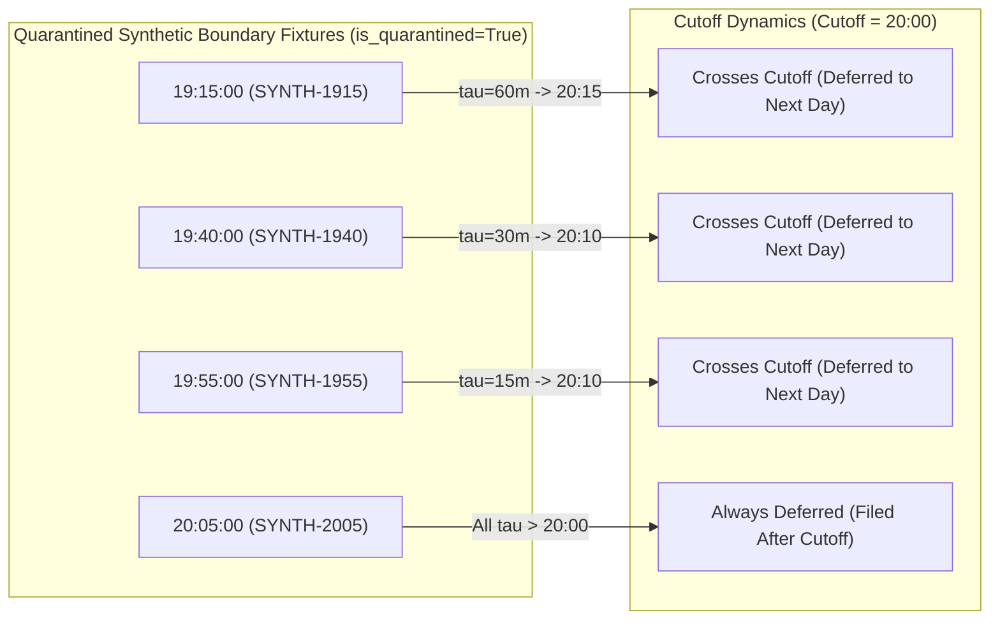
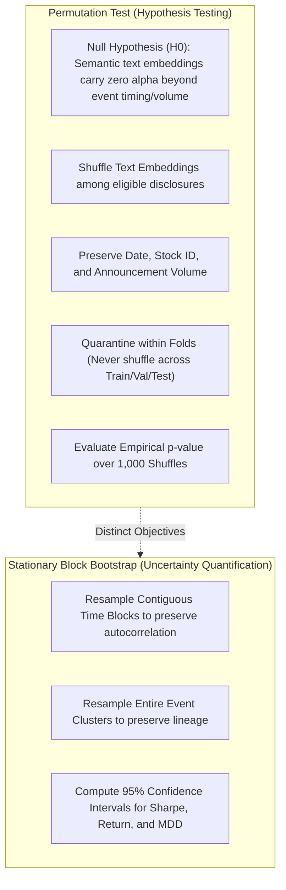
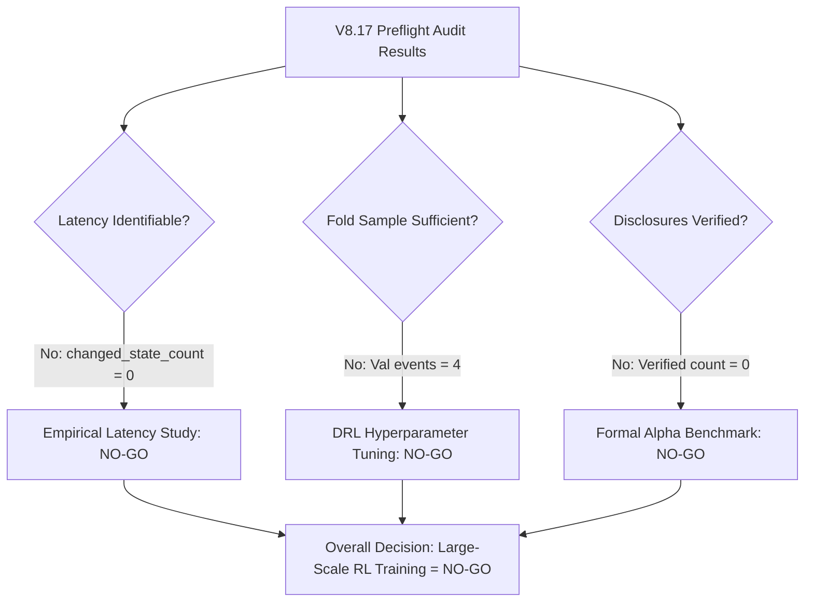

# V8.17 — Design Validity Preflight & Epistemic Audit Report

**Execution Branch**: `fix/v8-audit-patch`  
**Base Commit**: `273da7dab59d12fb6c814ebdef963d838e0fd5ff`  
**Execution Date**: 2026-11-18  
**Preflight Engine**: `stock_rl/evaluation/design_preflight.py`  
**Audit Standard**: V8.17 Empirical Sample & Latency Identifiability Preflight Specification  
**Formal PIT Gate Status**: **NO-GO**  
**Small-Scale RL Training Status**: **NO-GO (Preflight Audit Phase Only)**  
**Historical Verified Sources**: Strictly **0**  
**Provider Availability Receipts**: Strictly **0**  

---

## Executive Summary

Before committing computational resources to multi-arm deep reinforcement learning (DRL) ablations under `ESTIMATED_REPLAY`, this preflight audit evaluates the statistical identifiability, sample distribution, and methodological validity of the candidate news dataset (`RAW_PILOT_EVENTS`).

### Core Audit Findings
1. **Population Inconsistency Resolved (P0-1)**:
   - Previous documentation juxtaposed all 50 candidate events with the 56 trading sessions of 2024 Q1.
   - Audit reveals that only **19 events** fall within 2024 Q1 (across **15 calendar dates**), with 1 event occurring on a non-trading Saturday (`EV-2330-09`, 2024-02-24).
   - The remaining **31 events** span 2023-06 to 2023-12. The full market dataset comprises **202 trading sessions** (606 Stock-Days).
2. **Empirical Latency Decay is Unidentifiable (P0-2)**:
   - The latest publication timestamp across all 50 events is **18:45:00**.
   - For all tested latency perturbations $\tau \in \{0, 5, 15, 30, 60\}$ minutes, the latest available timestamp is $18:45 + 60\text{ min} = 19:45:00 \le 20:00:00$.
   - **Zero events shift across the 20:00 decision cutoff**. The daily event eligibility set, Recent memory slots (32), and Active memory slots (8) are **100% bitwise identical** across all $\tau$.
   - The empirical latency effect is formally classified as **`LATENCY_EFFECT_NOT_IDENTIFIABLE`**. Any performance variations across RL runs with different $\tau$ would reflect random training seed noise, not latency sensitivity.
3. **Walk-Forward Effective Sample Insufficiency (P1-5)**:
   - In a 3-way chronological split with standard 10-day purge and 5-day embargo windows, the Validation fold contains only **4 events** across 25 trading sessions (3 event days).
   - This sparsity is formally designated **`INSUFFICIENT_EFFECTIVE_SAMPLE`**, precluding stable DRL hyperparameter tuning or early stopping.
4. **Final Preflight Decision**:
   - **Large-Scale RL Training**: **NO-GO**
   - **Feature Dimension & Input Pipeline Verification**: **GO**

---

## 1. Corrected Dataset Scope & Period Partitioning (P0-1)

### 1.1 Structural Disaggregation of Candidate Disclosures
The 50 candidate disclosure fixtures (`RAW_PILOT_EVENTS`) were audited against the official Taiwan Stock Exchange (TWSE) trading calendar extracted from `data/poc_real_data/2330_ohlcv.csv` (2023-06-01 to 2024-03-29).

| Dataset Metric | Full Exploratory Period (2023-06 to 2024-03) | 2024 Q1 Sub-Period (2024-01 to 2024-03) |
| :--- | :--- | :--- |
| **Calendar Span** | 2023-06-01 to 2024-03-29 | 2024-01-02 to 2024-03-29 |
| **Total TWSE Trading Days** | **202 trading days** | **56 trading days** |
| **Total Stock-Day Units (3 stocks)** | **606 Stock-Days** | **168 Stock-Days** |
| **Total Candidate Disclosures** | **50 events** | **19 events** |
| **Unique Event Calendar Days** | **43 days** | **15 days** |
| **Trading Days with $\ge 1$ Event** | **42 trading days** | **14 trading days** |
| **Trading Days with 0 Events** | **160 trading days (79.2%)** | **42 trading days (75.0%)** |
| **Unique Event Clusters** | **45 clusters** | **16 clusters** |
| **2330 (TSMC) Event Count** | 20 events | 7 events |
| **2603 (Evergreen) Event Count** | 16 events | 6 events |
| **2881 (Fubon Financial) Event Count** | 14 events | 6 events |

### 1.2 Non-Trading Day Rollover Mechanics
- Disclosures published on weekends or market holidays cannot enter a decision state until the next active trading session.
- In `RAW_PILOT_EVENTS`, exactly one event is dated on a non-trading day:
  - **`EV-2330-09`**: TSMC (2330), dated `2024-02-24` (Saturday), published at `16:00:00`.
  - Next TWSE trading day: `2024-02-26` (Monday).
  - Effective decision cutoff: `2024-02-26 20:00:00 Asia/Taipei`.
  - Ingestion status: Correctly queued and available for the `2024-02-26` evening decision state.

### 1.3 Data Sufficiency Comparison
1. **2024 Q1 Sub-Period**: Contains only 19 disclosures across 14 active trading days. In 75% of trading sessions, the news feature tensor is all zeros. This sample is severely underpowered for training or evaluating deep reinforcement learning models.
2. **Full Period**: Encompassing 202 trading days and 50 disclosures across 42 active trading days provides broader temporal coverage, but remains an exploratory pilot fixture set.
3. **Governance Mandate**: Neither sample constitutes verified news. The formal verified count remains **0**.

---

## 2. Latency Identifiability Preflight Audit (P0-2)

### 2.1 Model-Free Latency Eligibility Audit
In Track A, the research design proposed evaluating policy robustness across transmission delays $\tau \in \{0, 5, 15, 30, 60\}$ minutes under a 20:00:00 decision cutoff. A model-free preflight audit was executed via `DesignValidityPreflightAuditor.audit_latency_identifiability` to determine whether $\tau$ actually alters disclosure eligibility.

```
Earliest Filing (08:30)                                  Latest Filing (18:45)     Decision Cutoff (20:00)
       |                                                            |                       |
-------+------------------------------------------------------------+-----------------------+---> Time
                                                                    |---> tau=0m:  18:45:00 <= 20:00 (Eligible Today)
                                                                    |---> tau=5m:  18:50:00 <= 20:00 (Eligible Today)
                                                                    |---> tau=15m: 19:00:00 <= 20:00 (Eligible Today)
                                                                    |---> tau=30m: 19:15:00 <= 20:00 (Eligible Today)
                                                                    |---> tau=60m: 19:45:00 <= 20:00 (Eligible Today)
```

### 2.2 Latency Audit Results Table
| Tested Perturbation ($\tau$) | Earliest Available Time | Latest Available Time | Changed Event Count | Changed Stock-Day Count | Changed Decision State Count | Eligibility Set Difference vs $\tau = 0$ |
| :--- | :--- | :--- | :--- | :--- | :--- | :--- |
| **$\tau = 0\text{ min}$ (Baseline)** | 08:30:00 | 18:45:00 | 0 | 0 | 0 | Identical (Baseline) |
| **$\tau = 5\text{ min}$** | 08:35:00 | 18:50:00 | 0 | 0 | 0 | **0 differing days (100% Identical)** |
| **$\tau = 15\text{ min}$** | 08:45:00 | 19:00:00 | 0 | 0 | 0 | **0 differing days (100% Identical)** |
| **$\tau = 30\text{ min}$** | 09:00:00 | 19:15:00 | 0 | 0 | 0 | **0 differing days (100% Identical)** |
| **$\tau = 60\text{ min}$** | 09:30:00 | 19:45:00 | 0 | 0 | 0 | **0 differing days (100% Identical)** |

### 2.3 Methodological Verdict: `LATENCY_EFFECT_NOT_IDENTIFIABLE`
> [!CAUTION]
> **Audit Classification**: **`LATENCY_EFFECT_NOT_IDENTIFIABLE`**  
> Because the latest publication time in `RAW_PILOT_EVENTS` is 18:45:00, adding up to 60 minutes of latency never reaches 20:00:00. Every single daily input state is **bit-for-bit identical** across $\tau \in \{0, 5, 15, 30, 60\}$.  
> **Scientific Implication**: Running RL training across different $\tau$ on this candidate dataset is mathematically incapable of measuring latency sensitivity. Any variations in Sharpe ratio or return across $\tau$ would be **100% spurious artifacts of random training seeds**.

---

## 3. Quarantined Synthetic Boundary Fixtures (P0-2 Item 7)

To verify that the software time-gate mechanism functions correctly without contaminating the empirical dataset, four isolated boundary test fixtures were generated:



### 3.1 Synthetic Gate Verification Results
- When `audit_latency_identifiability` is executed on these synthetic fixtures:
  - `changed_decision_state_count > 0`
  - Verdict: `LATENCY_EFFECT_IDENTIFIABLE`
- **Quarantine Rule**: These fixtures are tagged `is_quarantined_test_fixture=True` and `SYNTHETIC_FIXTURE_QUARANTINED`. They are restricted strictly to software unit tests (`test_v8_17_design_preflight.py`) and **must never** be used for empirical financial inference.

---

## 4. Fragility Metric Reformulation (P1-3)

### 4.1 Defects in the Legacy Ratio Formula
The previously proposed Fragility Index:
$$FI = \frac{\text{Sharpe}_5 - \text{Sharpe}_{15}}{\text{Sharpe}_5}$$
exhibits severe mathematical pathologies:
1. **Division by Zero**: If $\text{Sharpe}_5 = 0$, $FI$ is undefined.
2. **Near-Zero Explosions**: If $\text{Sharpe}_5 = 0.02$ and $\text{Sharpe}_{15} = -0.05$, $FI = 3.5$, creating extreme, non-linear distortion.
3. **Sign Inversion**: If $\text{Sharpe}_5 = -0.2$ and $\text{Sharpe}_{15} = -0.6$, the drop is $0.4$, but $FI = 0.4 / (-0.2) = -2.0$, falsely signaling negative fragility (robustness).

### 4.2 Reformed Primary & Auxiliary Metrics
1. **Primary Metric — Absolute Delta Sharpe**:
   $$\Delta \text{Sharpe}(\tau_1, \tau_2) = \text{Sharpe}(\tau_1) - \text{Sharpe}(\tau_2)$$
   - Linearly well-behaved across positive, zero, and negative Sharpe regimes.
   - Paired difference uncertainty quantified via Newey-West standard errors or stationary bootstrap:
     $$SE(\Delta \text{Sharpe}) = \sqrt{\frac{s_1^2 + s_2^2 - 2 r_{12} s_1 s_2}{T}}$$
2. **Auxiliary Metric — Bounded Fragility Index**:
   - $FI$ is computed **only** when $\text{Sharpe}_{\text{baseline}} \ge \epsilon$ (where $\epsilon = 0.20$).
   - When $\text{Sharpe}_{\text{baseline}} < \epsilon$, $FI$ is set to `None` and flagged as `FI_UNRELIABLE_NEAR_ZERO_OR_NEGATIVE`.
3. **Heuristic Threshold Reclassification**:
   - Thresholds ($FI > 0.35$ and $FI \le 0.15$) are classified as uncalibrated exploratory heuristics, **never** claimed as proof of lookahead bias.
4. **Zero-Identifiability Rule**:
   - When `changed_decision_state_count == 0`, $\Delta \text{Sharpe}$ between latency settings reflects seed noise, and reporting it as latency sensitivity is prohibited.

---

## 5. Methodological Decoupling: Permutation Test vs. Bootstrap (P1-4)

To prevent methodological conflation, semantic contribution testing is separated from time-series uncertainty estimation:



### 5.1 Permutation Test Protocol
- **Objective**: Test semantic alpha under $H_0$.
- **Shuffling Boundary**: Shuffling occurs strictly within the active evaluation fold. Cross-fold shuffling is prohibited.
- **Multiple Testing Correction**: When comparing 5 ablation arms across multiple metrics, apply Benjamini-Hochberg False Discovery Rate (FDR) control:
  $$p_{(i)} \le \frac{i}{m} Q$$

### 5.2 Stationary Block Bootstrap Protocol
- **Objective**: Measure parameter uncertainty without assuming IID returns.
- **Block Selection**: Optimal block length selected via Politis & White (2004) algorithm to capture market volatility clustering.

---

## 6. Chronological Fold Feasibility Audit (P1-5)

### 6.1 Walk-Forward Split with Purge & Embargo
A 3-way chronological split of the 202 trading days was audited with a 10-day purge window and a 5-day embargo window:

```
[--- Train (115 Days) ---][Purge (10d)][--- Val (25 Days) ---][Embargo (5d)][--- Test (47 Days) ---]
 2023-06-01 to 2023-11-16               2023-12-01 to 2024-01-05              2024-01-15 to 2024-03-29
```

### 6.2 Fold Event Counts & Sample Feasibility
| Chronological Partition | Date Span | Trading Days | Candidate Events Count | Unique Clusters | Event Calendar Days |
| :--- | :--- | :--- | :--- | :--- | :--- |
| **Train Fold** | 2023-06-01 to 2023-11-16 | 115 days | 26 events | 25 clusters | 24 days |
| **Purge Window** | 2023-11-17 to 2023-11-30 | 10 days | 2 events | 2 clusters | 2 days |
| **Validation Fold** | 2023-12-01 to 2024-01-05 | 25 days | **4 events** | **3 clusters** | **3 days** |
| **Embargo Window** | 2024-01-08 to 2024-01-12 | 5 days | 2 events | 1 cluster | 1 day |
| **Test Fold** | 2024-01-15 to 2024-03-29 | 47 days | 16 events | 14 clusters | 13 days |

### 6.3 Methodological Verdict: `INSUFFICIENT_EFFECTIVE_SAMPLE`
- **Validation Fold Defect**: The Validation fold contains only **4 events** across 25 trading sessions. Tuning a deep neural network (e.g., learning rate, attention dropout, reward scale) or performing early stopping on 4 events is statistically invalid.
- **Purge Justification**: The 10-day purge window successfully isolates the 32-slot Recent memory buffer, preventing cross-fold attention contamination.
- **Feasibility Status**: **`INSUFFICIENT_EFFECTIVE_SAMPLE`**.

---

## 7. Estimable vs. Not Estimable Matrix (P1-6)

| Research / Statistical Metric | Feasibility Status | Underlying Constraint & Methodological Action |
| :--- | :--- | :--- |
| **Feature Tensor Dimensions (160D)** | `ESTIMABLE` | Fully verified (BGE 128D + Metadata 24D + Relation 8D). |
| **PIT Cutoff & Rollover Mechanics** | `ESTIMABLE` | Fully verified via synthetic boundary test fixtures. |
| **Revision Lineage & Cluster Integrity** | `ESTIMABLE` | Parent-child disclosure relationships tracked via `cluster_id`. |
| **Market-Only vs. News-Aware Switching** | `ESTIMABLE` | Clean input toggle verified. |
| **Empirical Latency Sensitivity ($\tau$-Sweep)** | `NOT_ESTIMABLE` | Max filing time is 18:45:00; all $\tau \le 60\text{m}$ produce identical states. |
| **Validation Fold Tuning / Early Stopping** | `NOT_ESTIMABLE` | Validation fold contains only 4 events; cannot guide DRL convergence. |
| **DRL Alpha Generalizability ($p < 0.05$)** | `NOT_ESTIMABLE` | Small sample (50 unverified events); power is insufficient for statistical proof. |
| **Sub-Minute Alpha Decay ($< 1\text{ min}$)** | `NOT_ESTIMABLE` | Daily bars cannot model high-frequency execution. |
| **99% Tail Risk / VaR Estimation** | `NOT_ESTIMABLE` | 202 trading days provide insufficient sample density for extreme tail estimation. |
| **Cross-Industry Factor Generalizability** | `NOT_ESTIMABLE` | 3 tickers are insufficient for cross-sectional factor models. |
| **Execution Slippage & Market Impact** | `NOT_ESTIMABLE` | Order book depth is unmodeled in offline prototype. |

---

## 8. Final Go / No-Go Decision for Next-Stage Experimentation



### Preflight Audit Verdict
1. **Large-Scale RL Training on Candidate Dataset**: **NO-GO**  
   - Because latency effects are unidentifiable on this dataset and validation samples are insufficient (4 events), executing multi-seed DRL training would generate noisy, uninterpretable results.
2. **Engineering Pipeline & Analytical Auditing**: **GO**  
   - The frozen engineering baseline (feature encoding, memory slots, PIT gating, and data quarantine) is fully verified and ready for external data ingestion once Track B delivers genuine historical feeds.

---
*Report certified under V8.17 Preflight Engine. Engineering Baseline Frozen. Training Status = NO-GO.*
