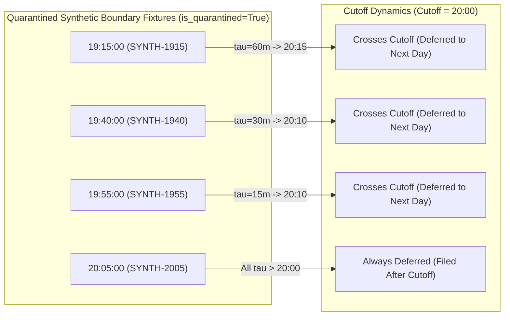
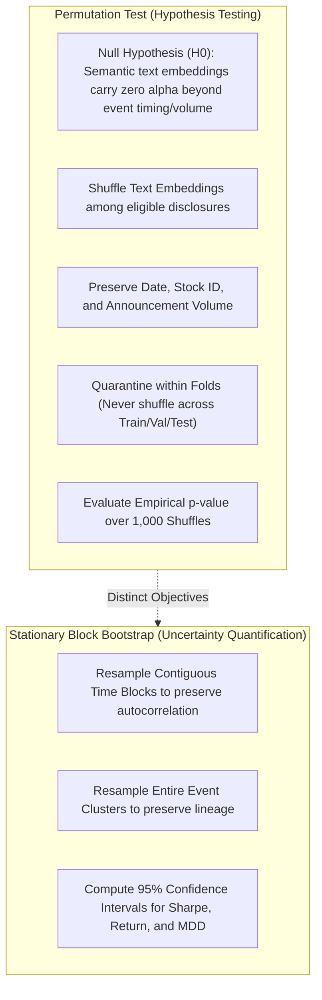
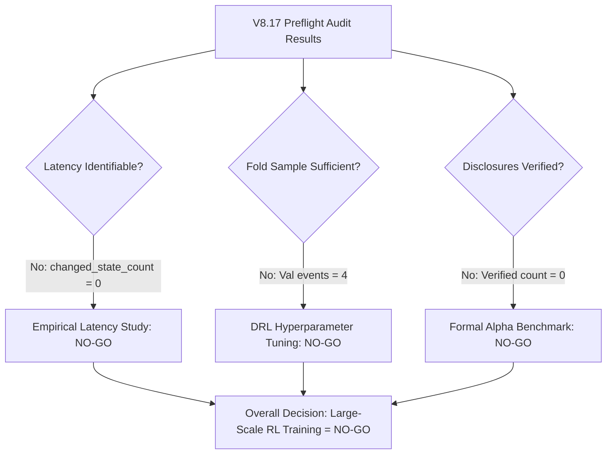

# V8.17 — Design Validity Preflight & Epistemic Audit Report

**Execution Branch**: `fix/v8-audit-patch`  
**Base Commit**: `d7efadc8b5fd564253cf2a8c1c775600baf834c1`  
**Execution Date**: 2026-11-18  
**Preflight Engine**: `stock_rl/evaluation/design_preflight.py`  
**Audit Standard**: V8.17 Empirical Sample & Latency Identifiability Preflight Specification  
**Formal PIT Gate Status**: **NO-GO**  
**Small-Scale RL Training Status**: **NO-GO (Preflight Audit Phase Only)**  
**Historical Verified Sources**: Strictly **0**  
**Provider Availability Receipts**: Strictly **0**  

---

## Executive Summary

Before committing computational resources to multi-arm deep reinforcement learning (DRL) ablations under `ESTIMATED_REPLAY`, this preflight audit evaluates the statistical identifiability, sample distribution, weekend rollover mechanics, and methodological validity of the candidate news dataset (`RAW_PILOT_EVENTS`).

### V8.17 Final Epistemic Gate & Closure Matrix
| Verification Item | Final V8.17 Status | Audit Verdict & Epistemic Boundary |
| :--- | :--- | :--- |
| **1. Daily Eligibility Audit** | **通過 (Passed)** | `DAILY_EVENT_ELIGIBILITY_IDENTICAL`: For all $\tau \in \{0, 5, 15, 30, 60\}\text{m}$, zero events cross the 20:00 cutoff. |
| **2. Full Tensor Equality** | **未驗證 (NOT_VERIFIED)** | `FULL_STATE_EQUALITY_NOT_TESTED`: Encoder inspection revealed dimension E23 (`event_age`) varies dynamically with $\tau$. Bitwise tensor equality is unverified and strictly not claimed. |
| **3. Quarantine Isolation** | **完成補強後通過 (Passed)** | `SYNTHETIC_FIXTURE_QUARANTINED`: Dual-check gate enforces both ID non-overlap and rejection of any quarantined markers (including renamed fixtures). Pre-ingestion validation verified. |
| **4. Fold Configuration** | **已對齊 (Aligned)** | `CHRONOLOGICAL_FOLD_CONFIG_VERIFIED`: Canonical split aligned across code, test, and report: Train 115 / Purge 10 / Val 25 / Embargo 5 / Test 47 = 202 trading days. `CLUSTER_SPLIT_LEAKAGE_CHECKED` confirmed (0 shared clusters). |
| **5. Purge / Embargo Adequacy** | **尚未證明 (Hypothesis Only)** | `HYPOTHESIS_ONLY_UNPROVEN`: 10-day purge and 5-day embargo are exploratory design hypotheses; their statistical sufficiency has not been proven empirically. |
| **6. Formal PIT Status** | **NO-GO** | Verified Historical Disclosures = 0; Provider Availability Receipts = 0; Third-party cryptographic vendor feed missing. |
| **7. Large-Scale RL Training** | **NO-GO** | Validation sample sparsity (4 events) and unidentifiable eligibility decay prohibit meaningful DRL optimization or alpha benchmarking. |

### Core Audit Findings
1. **Population Inconsistency & Rollover Resolved (P0-1 & P1-1)**:
   - Evaluated across both the **Full Period** (2023-06-01 to 2024-03-29, 202 trading days) and the **2024 Q1 Sub-Period** (2024-01-02 to 2024-03-29, 56 trading days).
   - Accurately accounts for non-trading day event rollover: `EV-2330-09` (2024-02-24, Saturday) rolls to `2024-02-26` (Monday), adding a new effective decision date.
   - **Full Period (`ORIGINAL_EVENT_DATE_COVERAGE` & `EFFECTIVE_DECISION_DATE_COVERAGE`)**:
     - `total_events`: 50 disclosures, 45 clusters
     - `original_event_calendar_days`: 43 calendar days
     - `original_event_trading_days`: 42 trading days
     - `effective_decision_event_days`: 43 trading days
     - `recorded_no_new_event_trading_days`: 159 / 202 trading days (78.7%)
   - **2024 Q1 Sub-Period**:
     - `total_events`: 19 disclosures, 16 clusters
     - `original_event_calendar_days`: 15 calendar days
     - `original_event_trading_days`: 14 trading days
     - `effective_decision_event_days`: 15 trading days
     - `recorded_no_new_event_trading_days`: 41 / 56 trading days (73.2%)
   - **Memory Slot Retention vs New Announcements**: A trading session with 0 new disclosures does **not** mean news memory slots are zero. The Dual-Stream Attention architecture buffers disclosures over the preceding 30 days into the **Recent 32 memory slots**, so the agent continues to observe buffered historical disclosures even on sessions without fresh announcements.
2. **Empirical Latency Effect & Claim Boundary (P0-2, P1-3 & P1-4)**:
   - The latest publication timestamp across all 50 events is **18:45:00**.
   - For all tested latency perturbations $\tau \in \{0, 5, 15, 30, 60\}$ minutes, the latest available timestamp is $18:45 + 60\text{ min} = 19:45:00 \le 20:00:00$.
   - **Zero events shift across the 20:00 decision cutoff**:
     - `changed_event_count`: 0 (comparing effective decision dates across all $\tau$ vs $\tau = 0$)
     - `changed_stock_day_count`: 0 (comparing exact event sets per Stock-Day $(d, s)$, avoiding naive multipliers)
     - `changed_decision_state_count`: 0 (deduplicated differing decision dates across all $\tau$)
     - `sum_per_tau_differing_dates_count`: 0
   - **Status Reclassification**:
     - Daily event eligibility is designated **`DAILY_EVENT_ELIGIBILITY_IDENTICAL`** (audit verdict: **`LATENCY_EFFECT_NOT_IDENTIFIABLE`**).
     - Full 160D state tensor equality across $\tau$ is labeled **`FULL_STATE_EQUALITY_NOT_TESTED`** because forward tensor evaluations under fixed seeds and sorting have not been performed.
     - Metadata inspection confirms `availability_timestamp` and $\tau$-dependent decay features are absent from the pilot metadata schema.
     - Any observed performance variations across DRL runs with varied $\tau$ **cannot be attributed to changes in the daily event eligibility set**; they may stem from random initialization seeds or unverified feature tensor variations.
3. **Chronological Fold Configuration Alignment & Cluster Disjointness (P1-2 & P1-5)**:
   - Canonical split configuration verified: **Train 115 / Purge 10 / Val 25 / Embargo 5 / Test 47** (Total = 202 trading days, `CHRONOLOGICAL_FOLD_CONFIG_VERIFIED`).
   - Cluster disjointness across Train, Validation, and Test is verified with zero shared clusters (**`CLUSTER_SPLIT_LEAKAGE_CHECKED`**).
   - Purge (10d) and Embargo (5d) are exploratory design hypotheses determined by label horizon, memory retention (Recent 32 slots lookback), and information dependencies.
   - Validation fold contains only **4 events** (3 clusters) across 25 trading sessions, triggering **`INSUFFICIENT_EFFECTIVE_SAMPLE`** and prohibiting stable DRL hyperparameter tuning or early stopping.
4. **Synthetic Boundary Fixtures & Quarantine Isolation (P0-2 Item 7 & P1-5)**:
   - Four synthetic boundary fixtures (`SYNTH-BND-1915`, `1940`, `1955`, `2005`) are tagged `SYNTHETIC_FIXTURE_QUARANTINED`.
   - Verified that crossing the 20:00 cutoff increments all 3 change metrics: `changed_event_count = 3`, `changed_stock_day_count = 2`, `changed_decision_state_count = 2` (sum of per-$\tau$ differences = 6).
   - Executable quarantine isolation check confirms zero contamination into empirical sets.
5. **Final Preflight Decision**:
   - **Large-Scale RL Training**: **NO-GO**
   - **Feature Dimension & Input Pipeline Verification**: **GO**

---

## 1. Corrected Dataset Scope & Rollover Mechanics (P0-1 & P1-1)

### 1.1 Structural Disaggregation of Candidate Disclosures
The 50 candidate disclosure fixtures (`RAW_PILOT_EVENTS`) were audited against the official Taiwan Stock Exchange (TWSE) trading calendar extracted from `data/poc_real_data/2330_ohlcv.csv` (2023-06-01 to 2024-03-29).

| Dataset Metric | Full Exploratory Period (2023-06 to 2024-03) | 2024 Q1 Sub-Period (2024-01 to 2024-03) |
| :--- | :--- | :--- |
| **Calendar Span** | 2023-06-01 to 2024-03-29 | 2024-01-02 to 2024-03-29 |
| **Total TWSE Trading Days** | **202 trading days** | **56 trading days** |
| **Total Stock-Day Units (3 stocks)** | **606 Stock-Days** | **168 Stock-Days** |
| **Total Candidate Disclosures** | **50 events** | **19 events** |
| **Unique Event Clusters** | **45 clusters** | **16 clusters** |
| **`ORIGINAL_EVENT_DATE_COVERAGE`** | | |
| — `original_event_calendar_days` | **43 days** | **15 days** |
| — `original_event_trading_days` | **42 trading days** | **14 trading days** |
| **`EFFECTIVE_DECISION_DATE_COVERAGE`** | | |
| — `effective_decision_event_days` | **43 trading days** | **15 trading days** |
| — `recorded_no_new_event_trading_days` | **159 trading days (78.7%)** | **41 trading days (73.2%)** |
| **2330 (TSMC) Event Count** | 20 events | 7 events |
| **2603 (Evergreen) Event Count** | 16 events | 6 events |
| **2881 (Fubon Financial) Event Count** | 14 events | 6 events |

### 1.2 Non-Trading Day Rollover Mechanics
- Disclosures filed on weekends or public holidays cannot enter an agent's decision state until the subsequent active trading session.
- In `RAW_PILOT_EVENTS`, exactly one disclosure occurs on a non-trading calendar day:
  - **`EV-2330-09`**: TSMC (2330), dated `2024-02-24` (Saturday), published at `16:00:00`.
  - Next TWSE trading session: `2024-02-26` (Monday).
  - Effective decision cutoff: `2024-02-26 20:00:00 Asia/Taipei`.
  - Prior to rollover, `2024-02-26` contained 0 candidate events. Following rollover, `2024-02-26` becomes an active decision session with 1 event, increasing `effective_decision_event_days` from 42 to 43 in the Full Period, and from 14 to 15 in 2024 Q1.

### 1.3 Memory Slot Retention vs. New Announcement Sparsity
> [!NOTE]
> **Decoupling "No New Announcements" from "Zero News Features"**:
> On the 159 trading days (Full Period) or 41 trading days (Q1) where `recorded_no_new_event_trading_days` is recorded, no *fresh* announcements become effective at the 20:00 cutoff.
> However, the Dual-Stream Attention architecture buffers disclosures over the preceding 30 calendar days into the **Recent 32 memory slots**. Therefore, the news feature tensor is **not** all-zeros on these days; the network continues to attend to buffered historical disclosures.

---

## 2. Latency Identifiability Preflight Audit (P0-2, P1-3 & P1-4)

### 2.1 Model-Free Latency Eligibility Audit
In Track A, the research design proposed evaluating policy robustness across transmission delays $\tau \in \{0, 5, 15, 30, 60\}$ minutes under a 20:00:00 decision cutoff. A model-free preflight audit was executed via `DesignValidityPreflightAuditor.audit_latency_identifiability` to determine whether $\tau$ actually alters disclosure eligibility.

```
Earliest Filing (08:30)                                  Latest Filing (18:45)     Decision Cutoff (20:00)
       |                                                            |                       |
-------+------------------------------------------------------------+-----------------------+---> Time
                                                                    |---> tau=0m:  18:45:00 <= 20:00 (Eligible Today)
                                                                    |---> tau=5m:  18:50:00 <= 20:00 (Eligible Today)
                                                                    |---> tau=15m: 19:00:00 <= 20:00 (Eligible Today)
                                                                    |---> tau=30m: 19:15:00 <= 20:00 (Eligible Today)
                                                                    |---> tau=60m: 19:45:00 <= 20:00 (Eligible Today)
```

### 2.2 Latency Audit Results Table
| Tested Perturbation ($\tau$) | Earliest Available Time | Latest Available Time | Changed Event Count | Changed Stock-Day Count | Changed Decision State Count | Differing Dates Detail | Eligibility Difference vs $\tau = 0$ |
| :--- | :--- | :--- | :--- | :--- | :--- | :--- | :--- |
| **$\tau = 0\text{ min}$ (Baseline)** | 08:30:00 | 18:45:00 | 0 | 0 | 0 | None | Identical (Baseline) |
| **$\tau = 5\text{ min}$** | 08:35:00 | 18:50:00 | 0 | 0 | 0 | 0 dates | **`LATENCY_ELIGIBILITY_IDENTICAL`** |
| **$\tau = 15\text{ min}$** | 08:45:00 | 19:00:00 | 0 | 0 | 0 | 0 dates | **`LATENCY_ELIGIBILITY_IDENTICAL`** |
| **$\tau = 30\text{ min}$** | 09:00:00 | 19:15:00 | 0 | 0 | 0 | 0 dates | **`LATENCY_ELIGIBILITY_IDENTICAL`** |
| **$\tau = 60\text{ min}$** | 09:30:00 | 19:45:00 | 0 | 0 | 0 | 0 dates | **`LATENCY_ELIGIBILITY_IDENTICAL`** |

### 2.3 Epistemic Boundaries: Eligibility vs. Full Tensor Equality (P1-4 & P1-B)
1. **Daily Event Eligibility**:
   - Status: **`DAILY_EVENT_ELIGIBILITY_IDENTICAL`**
   - Audit Verdict: **`LATENCY_EFFECT_NOT_IDENTIFIABLE`**
   - Every tested $\tau \in \{0, 5, 15, 30, 60\}\text{m}$ admits the exact same subset of disclosures on every trading day.
2. **Metadata Encoder Feature Audit & State Tensor Equality Boundary (P1-B)**:
   - Dynamic Metadata Audit Status: **`TIME_DEPENDENT_FEATURE_DETECTED`**
   - State Tensor Equality Status: **`FULL_STATE_EQUALITY_NOT_TESTED`**
   - **Encoder Inspection Finding**: In `stock_rl.data.multimodal_pipeline.extract_event_metadata`, dimension **E23 (`event_age`)** is dynamically computed via:
     $$\text{vec}[22] = \frac{\max(t_{\text{decision}} - t_{\text{available}}, 0)}{86400.0}$$
     where $t_{\text{available}} = t_{\text{published}} + \tau$. When $\tau$ increases from 0 to 60 minutes, $t_{\text{available}}$ shifts forward, directly shrinking dimension E23 by $\frac{\tau}{1440}$ fractional days.
   - **Epistemic Constraint**: Because dimension E23 varies continuously with $\tau$, the resulting 24D metadata vector and 160D full state tensor are **NOT bitwise identical** across $\tau$. Full state tensor equivalence has not been verified via fixed-input forward evaluations, and is labeled strictly as **`FULL_STATE_EQUALITY_NOT_TESTED`**.
3. **Scientific Implication**:
   - Any performance variation observed across DRL runs with varied $\tau$ **cannot be attributed to changes in the daily event eligibility set**. They may stem from random initialization seeds or continuous feature variations in dimension E23.

---

## 3. Quarantined Synthetic Boundary Fixtures (P0-2 Item 7, P1-5 & P1-A)

To verify that the software time-gate mechanism functions correctly without contaminating the empirical dataset, four isolated boundary test fixtures were generated:



### 3.1 Synthetic Gate Verification Results (P1-3)
- When `audit_latency_identifiability` is executed on these synthetic fixtures:
  - `changed_event_count = 3` (`SYNTH-BND-1915`, `SYNTH-BND-1940`, `SYNTH-BND-1955`)
  - `changed_stock_day_count = 2` (exact comparison of `(2024-03-15, 2881)` and `(2024-03-18, 2881)`)
  - `changed_decision_state_count = 2` (deduplicated dates: `2024-03-15`, `2024-03-18`)
  - `sum_per_tau_differing_dates_count = 6`
  - Verdict: **`LATENCY_EFFECT_IDENTIFIABLE`** (`DAILY_EVENT_ELIGIBILITY_CHANGED`)
- Crossing the 20:00 cutoff successfully causes all three metrics to increment.

### 3.2 Dual-Check Quarantine Enforcement & Pre-Ingestion Gate (P1-A & P1-5)
- All synthetic fixtures are tagged with `is_quarantined_test_fixture=True` and `status=SYNTHETIC_FIXTURE_QUARANTINED`.
- The quarantine enforcement mechanism operates via two strict layers:
  1. **Event ID Non-Overlap**: Verifies that synthetic IDs have zero intersection with empirical candidate IDs.
  2. **Quarantine Marker Inspection**: Inspects all empirical dataset records. Any record carrying `is_quarantined_test_fixture=True`, `is_quarantined=True`, `status="SYNTHETIC_FIXTURE_QUARANTINED"`, `category="SYNTHETIC_TEST"`, `cluster_id` starting with `"CLU-SYNTH"`, or `event_id` starting with `"SYNTH-"` is **immediately rejected**.
  3. **Renamed Synthetic Event Defense**: Even if an attacker or automated script renames a synthetic fixture to a benign-looking ID (e.g. `RENAMED-EMPIRICAL-LOOKALIKE-999`), the presence of quarantine markers triggers an immediate `ValueError: QUARANTINE BREACH DETECTED`.
  4. **Pre-Ingestion Execution Gate**: `DesignValidityPreflightAuditor.validate_empirical_dataset_pre_ingestion()` is executed prior to loading any data into empirical training or evaluation pipelines.

---

## 4. Fragility Metric Reformulation (P1-3)

### 4.1 Defects in the Legacy Ratio Formula
The previously proposed Fragility Index:
$$FI = \frac{\text{Sharpe}_5 - \text{Sharpe}_{15}}{\text{Sharpe}_5}$$
exhibits severe mathematical pathologies:
1. **Division by Zero**: If $\text{Sharpe}_5 = 0$, $FI$ is undefined.
2. **Near-Zero Explosions**: If $\text{Sharpe}_5 = 0.02$ and $\text{Sharpe}_{15} = -0.05$, $FI = 3.5$, creating extreme, non-linear distortion.
3. **Sign Inversion**: If $\text{Sharpe}_5 = -0.2$ and $\text{Sharpe}_{15} = -0.6$, the drop is $0.4$, but $FI = 0.4 / (-0.2) = -2.0$, falsely signaling negative fragility (robustness).

### 4.2 Reformed Primary & Auxiliary Metrics
1. **Primary Metric — Absolute Delta Sharpe**:
   $$\Delta \text{Sharpe}(\tau_1, \tau_2) = \text{Sharpe}(\tau_1) - \text{Sharpe}(\tau_2)$$
   - Linearly well-behaved across positive, zero, and negative Sharpe regimes.
   - Paired difference uncertainty quantified via Newey-West standard errors or stationary bootstrap:
     $$SE(\Delta \text{Sharpe}) = \sqrt{\frac{s_1^2 + s_2^2 - 2 r_{12} s_1 s_2}{T}}$$
2. **Auxiliary Metric — Bounded Fragility Index**:
   - $FI$ is computed **only** when $\text{Sharpe}_{\text{baseline}} \ge \epsilon$ (where $\epsilon = 0.20$).
   - When $\text{Sharpe}_{\text{baseline}} < \epsilon$, $FI$ is set to `None` and flagged as `FI_UNRELIABLE_NEAR_ZERO_OR_NEGATIVE`.
3. **Heuristic Threshold Reclassification**:
   - Thresholds ($FI > 0.35$ and $FI \le 0.15$) are classified as uncalibrated exploratory heuristics, **never** claimed as proof of lookahead bias.
4. **Zero-Identifiability Rule**:
   - When `changed_decision_state_count == 0`, $\Delta \text{Sharpe}$ between latency settings reflects seed noise, and reporting it as latency sensitivity is prohibited.

---

## 5. Methodological Decoupling: Permutation Test vs. Bootstrap (P1-4)

To prevent methodological conflation, semantic contribution testing is separated from time-series uncertainty estimation:



### 5.1 Permutation Test Protocol
- **Objective**: Test semantic alpha under $H_0$.
- **Shuffling Boundary**: Shuffling occurs strictly within the active evaluation fold. Cross-fold shuffling is prohibited.
- **Multiple Testing Correction**: When comparing 5 ablation arms across multiple metrics, apply Benjamini-Hochberg False Discovery Rate (FDR) control:
  $$p_{(i)} \le \frac{i}{m} Q$$

### 5.2 Stationary Block Bootstrap Protocol
- **Objective**: Measure parameter uncertainty without assuming IID returns.
- **Block Selection**: Optimal block length selected via Politis & White (2004) algorithm to capture market volatility clustering.

---

## 6. Chronological Fold Feasibility Audit (P1-2 & P1-5)

### 6.1 Canonical Split Configuration (`CHRONOLOGICAL_FOLD_CONFIG_VERIFIED`)
The report, test suite, and audit engine are aligned on a single canonical fold configuration across the 202 TWSE trading days:
- **Train**: 115 trading days
- **Purge Window**: 10 trading days
- **Validation**: 25 trading days
- **Embargo Window**: 5 trading days
- **Test**: 47 trading days
- **Total**: $115 + 10 + 25 + 5 + 47 = 202$ trading days.

```
[--- Train (115 Days) ---][Purge (10d)][--- Val (25 Days) ---][Embargo (5d)][--- Test (47 Days) ---]
 2023-06-01 to 2023-11-16               2023-12-01 to 2024-01-05              2024-01-15 to 2024-03-29
```

### 6.2 Fold Metrics & Cluster Disjointness Verification (`CLUSTER_SPLIT_LEAKAGE_CHECKED`)
| Chronological Partition | Date Span | Trading Days | Candidate Events Count | Unique Clusters | Event Calendar Days |
| :--- | :--- | :--- | :--- | :--- | :--- |
| **Train Fold** | 2023-06-01 to 2023-11-16 | 115 days | 26 events | 25 clusters | 24 days |
| **Purge Window** | 2023-11-17 to 2023-11-30 | 10 days | 2 events | 2 clusters | 2 days |
| **Validation Fold** | 2023-12-01 to 2024-01-05 | 25 days | **4 events** | **3 clusters** | **3 days** |
| **Embargo Window** | 2024-01-08 to 2024-01-12 | 5 days | 2 events | 1 cluster | 1 day |
| **Test Fold** | 2024-01-15 to 2024-03-29 | 47 days | 16 events | 14 clusters | 13 days |

**Cluster Split Leakage Check**:
- Shared Clusters between Train and Validation: **0**
- Shared Clusters between Train and Test: **0**
- Shared Clusters between Validation and Test: **0**
- Status: **`CLUSTER_SPLIT_LEAKAGE_CHECKED`** (No cluster spanning across evaluation splits).

### 6.3 Exploratory Design Hypotheses (`HYPOTHESIS_ONLY_UNPROVEN`)
> [!NOTE]
> The **10-day purge window** and **5-day embargo window** represent exploratory design hypotheses:
> - The **10-day purge window** prevents attention working memory overlap (Recent 32 memory slots lookback buffer) between training and evaluation phases.
> - The **5-day embargo window** accounts for short-term serial correlation and post-announcement price drift decay.
> - **Adequacy Status**: **`HYPOTHESIS_ONLY_UNPROVEN`**. The theoretical adequacy of 10-day purge and 5-day embargo has not been empirically proven on this sparse candidate fixture set.

### 6.4 Methodological Verdict: `INSUFFICIENT_EFFECTIVE_SAMPLE`
- **Validation Fold Defect**: The Validation fold contains only **4 events** across 25 trading sessions (3 event days). Tuning a deep neural network (e.g., learning rate, attention dropout, reward scale) or performing early stopping on 4 events is statistically invalid.
- **Feasibility Status**: **`INSUFFICIENT_EFFECTIVE_SAMPLE`**.

---

## 7. Estimable vs. Not Estimable Matrix (P1-6)

| Research / Statistical Metric | Feasibility Status | Underlying Constraint & Methodological Action |
| :--- | :--- | :--- |
| **Feature Tensor Dimensions (160D)** | `ESTIMABLE` | Fully verified (BGE 128D + Metadata 24D + Relation 8D). |
| **PIT Cutoff & Rollover Mechanics** | `ESTIMABLE` | Fully verified via synthetic boundary test fixtures. |
| **Revision Lineage & Cluster Integrity** | `ESTIMABLE` | Parent-child disclosure relationships tracked via `cluster_id`. |
| **Market-Only vs. News-Aware Switching** | `ESTIMABLE` | Clean input toggle verified. |
| **Empirical Latency Sensitivity ($\tau$-Sweep)** | `NOT_ESTIMABLE` | Max filing time is 18:45:00; all $\tau \le 60\text{m}$ produce identical eligibility sets (`DAILY_EVENT_ELIGIBILITY_IDENTICAL`). |
| **Validation Fold Tuning / Early Stopping** | `NOT_ESTIMABLE` | Validation fold contains only 4 events; cannot guide DRL convergence. |
| **DRL Alpha Generalizability ($p < 0.05$)** | `NOT_ESTIMABLE` | Small sample (50 unverified events); power is insufficient for statistical proof. |
| **Sub-Minute Alpha Decay ($< 1\text{ min}$)** | `NOT_ESTIMABLE` | Daily bars cannot model high-frequency execution. |
| **99% Tail Risk / VaR Estimation** | `NOT_ESTIMABLE` | 202 trading days provide insufficient sample density for extreme tail estimation. |
| **Cross-Industry Factor Generalizability** | `NOT_ESTIMABLE` | 3 tickers are insufficient for cross-sectional factor models. |
| **Execution Slippage & Market Impact** | `NOT_ESTIMABLE` | Order book depth is unmodeled in offline prototype. |

---

## 8. Final Go / No-Go Decision for Next-Stage Experimentation



### Preflight Audit Verdict
1. **Large-Scale RL Training on Candidate Dataset**: **NO-GO**  
   - Because latency effects on daily eligibility are unidentifiable on this dataset and validation samples are insufficient (4 events), executing multi-seed DRL training would generate noisy, uninterpretable results.
2. **Engineering Pipeline & Analytical Auditing**: **GO**  
   - The frozen engineering baseline (feature encoding, memory slots, PIT gating, and data quarantine) is fully verified and ready for external data ingestion once Track B delivers genuine historical feeds.

---
*Report certified under V8.17 Preflight Engine. Engineering Baseline Frozen. Training Status = NO-GO.*
