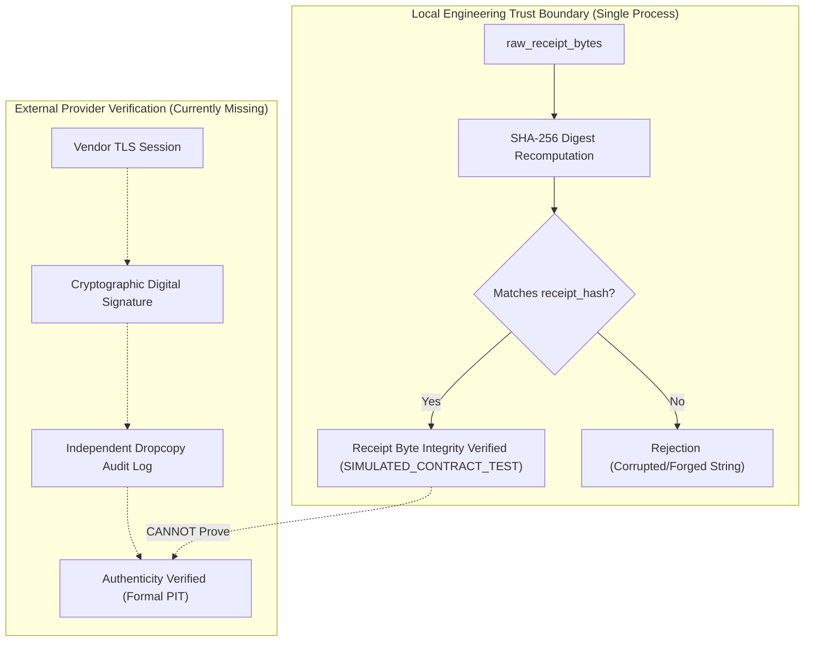
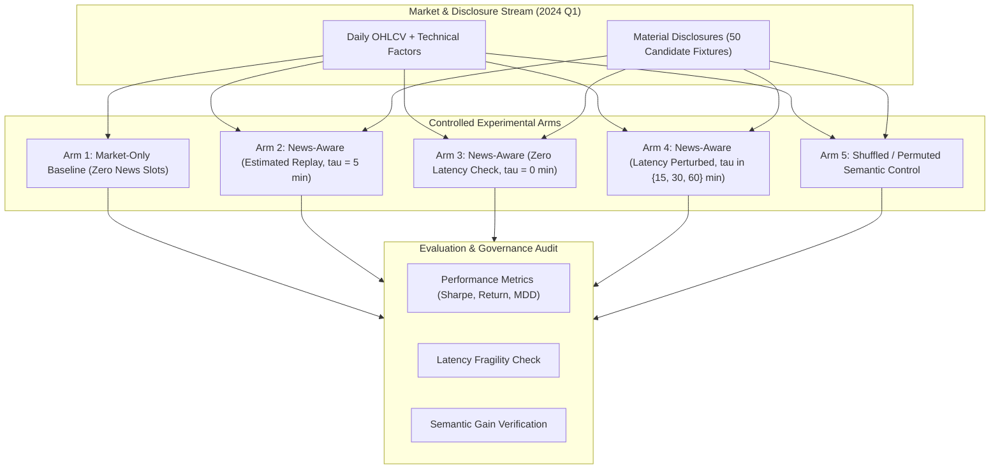
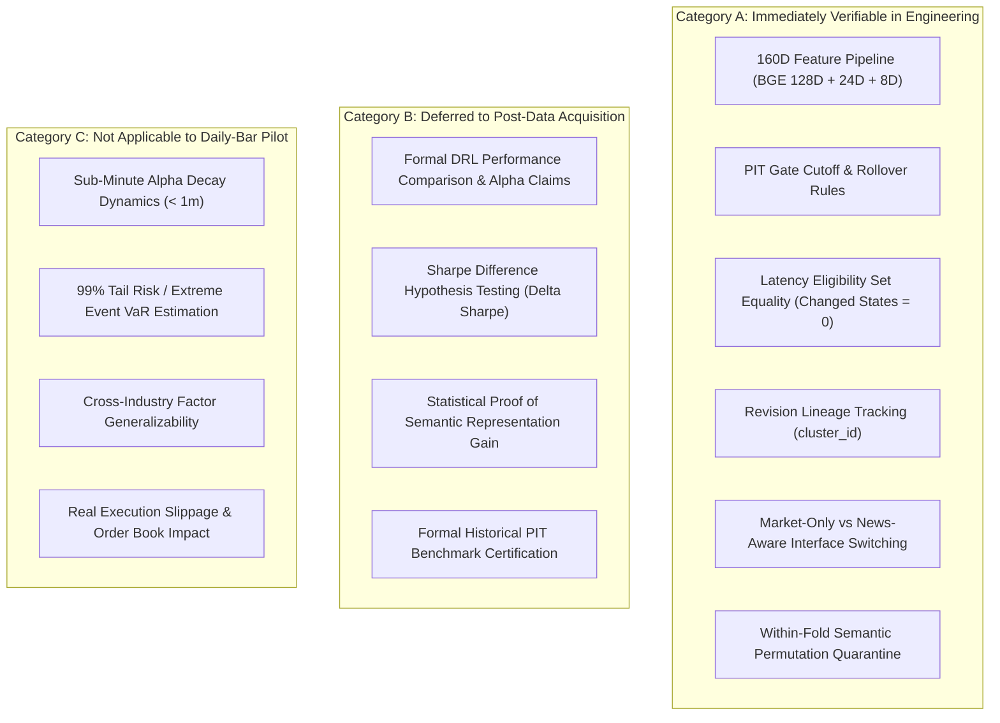

# V8.17 — Exploratory Replay Research Design & Baseline Freeze Specification

**Execution Branch**: `fix/v8-audit-patch`  
**Base Commit**: `9cf110b484cb1d91dedb47721133899514dea2f1`  
**Execution Date**: 2026-11-18  
**Audit Standard**: V8.17 Engineering Baseline Freeze & Exploratory Research Governance  
**Operational Status**: Research Design Phase (Zero Model Training / Purely Analytical)  
**Formal PIT Status**: **NO-GO**  
**Historical Verified Sources**: Strictly **0**  
**Provider Availability Verified**: Strictly **0**  

---

## Executive Summary

Following the formal closure of V8.16, this document establishes the **V8.16 Engineering Baseline Freeze** and delineates the complete research methodology for **Track A (Exploratory Replay Research)** and **Track B (External Data Acquisition Dependency)**. 

In strict adherence to research governance principles:
1. **No Large-Scale RL Training**: The engineering architecture is frozen; no DQN policy refactoring, attention head additions, or model hyperparameter retraining are conducted in this phase.
2. **Preservation of the Claim Boundary**: Without authentic third-party vendor streams, cryptographic zero-trust proofs cannot be claimed. Local test fixtures remain strictly `SIMULATED_CONTRACT_TEST`.
3. **Exploratory Scope Quarantine**: Research under `ESTIMATED_REPLAY` is classified strictly as exploratory feasibility research. Unverified disclosures cannot be used to claim proven financial alpha or semantic representation superiority.

---

## 1. Preservation of the Formal PIT Claim Boundary

Prior to outlining experimental protocols, the epistemic boundaries of the system's verification mechanisms must be explicitly established:



### 1.1 Five Epistemic Guardrails
1. **SHA-256 Digest Limitation**: SHA-256 consistency merely verifies that `raw_receipt_bytes` matches the recorded `receipt_hash`. It provides **zero mathematical proof** that the bytes originated from an authorized external vendor or market feed.
2. **Prohibition of "Authenticity Verified" Claims**: In the absence of an authenticated TLS session, asymmetric cryptographic signature (e.g., RSA/ECDSA from an exchange/vendor PKI), or immutable external audit trail, the system makes **zero claim of Authenticity Verified**.
3. **Receipt Content Binding Boundary**: Without a trusted external adapter that actively parses `raw_receipt_bytes` to cross-validate `provider_id`, `announcement_id`, `content_payload_hash`, and millisecond `observed_available_at`, **Receipt Content Binding is strictly unverified**.
4. **Local Positive Tests Quarantine**: All unit and integration test fixtures constructed locally are formally designated as `SIMULATED_CONTRACT_TEST`. They confirm schema contract compliance only, and are strictly barred from granting formal Point-in-Time status.
5. **Formal PIT Status**: In the absence of an operational, externally certified provider adapter, **Formal PIT remains strictly NO-GO**.

---

## 2. V8.16 Engineering Baseline Freeze

The engineering baseline achieved at Commit `9cf110b484cb1d91dedb47721133899514dea2f1` is formally **frozen**. The architecture is structured as follows:

| Subsystem Component | Frozen Specification | Invariance Constraint |
| :--- | :--- | :--- |
| **Source Evidence Manifest** | [EvidenceManifestEntry](file:///home/augustine/Desktop/News-Aware%20Attention-Based%20Deep%20Reinforcement%20Learning%20for%20Stock%20Trading/stock_rl/evaluation/official_source_collector.py#L221-L254) with 7-step integrity audit | No relaxation of required fields, hashes, or locators |
| **Retrieval Session Registry** | Strict isolation between Production and Simulated sessions | Production sessions require genuine HTTPS retrieval provenance |
| **Exact Source Locator** | Structured locator: `JSON_ARRAY_RECORD[stock_id,raw_array_index,matched_stock_index]` | Bidirectional 1-to-1 index consistency against snapshot |
| **Snapshot Hash Verification** | TWSE OpenAPI snapshot (155,496 Bytes; SHA-256: `949d1b51...`) | Snapshot file immutable; exact byte re-parsing |
| **Point-in-Time Modes** | `EVIDENCE_VERIFIED_ASOF` (Formal Gate) vs `ESTIMATED_REPLAY` (Exploratory) | Formal gate strictly fail-closed; Replay strictly exploratory |
| **Decision Cutoff Rule** | 20:00:00 Asia/Taipei Trading Day Cutoff | Disclosures filed after 20:00 queued for next trading day |
| **Semantic Text Encoder** | BGE-base-zh-v1.5 (512D) $\to$ Fixed Linear Projection (128D) | Fixed projection weights; frozen language model |
| **Metadata & Relation Vectors** | Metadata 24D + Stock/Event Relation 8D (Total 160D per disclosure) | Preserves categorical and relational event semantics |
| **Attention Working Memory** | Recent Slots (32) + Active Slots (8) | Memory slot dimensions and attention pooling frozen |
| **RL Policy Architecture** | Dual-Stream Q-Network (Market-State Stream + Attention-News Stream) | No DQN architectural redesign; no additional attention heads |

> [!IMPORTANT]
> Any future refactoring of DQN architectures, loss functions, reward clipping, or attention pooling mechanisms is deferred until data availability is resolved under Track B or formally simulated under Track A.

---

## 3. Track A: Exploratory Replay Research Design

Track A outlines a controlled academic investigation into the behavior of news-aware deep reinforcement learning agents under explicit Point-in-Time uncertainty.

### 3.1 Research Hypotheses
- **Null Hypothesis ($H_0$)**: Under strict chronological evaluation and market friction, incorporating unverified news disclosures under estimated availability ($T_{\text{filing}} + 5\text{ min}$) yields no statistically significant improvement in risk-adjusted returns (Sharpe ratio, Calmar ratio) over a pure Market-Only technical baseline.
- **Alternative Hypothesis ($H_1$)**: The structured multimodal attention mechanism extracts genuine semantic signals from material disclosures that improve downside risk protection (Maximum Drawdown reduction), exhibiting stability across moderate transmission latencies ($\tau \le 30\text{ min}$).

---

### 3.2 Controlled Ablation Architecture

To rigorously evaluate the incremental value of news features without conflating market trend momentum with semantic awareness, the experimental framework defines five strictly controlled systems:



1. **Arm 1: Market-Only Baseline ($S_{\text{market}}$)**:
   - State representation: Technical indicators (RSI, MACD, Bollinger Bands, ATR, Price Returns) + Portfolio State.
   - News slots: Disabled (zeroed out or bypassed).
   - Serves as the primary benchmark to determine whether news awareness delivers true incremental value.
2. **Arm 2: News-Aware Canonical Replay ($S_{\text{replay-5m}}$)**:
   - Full multimodal pipeline with estimated availability: $T_{\text{available}} = T_{\text{filing}} + 5\text{ min}$.
   - Cutoff: 20:00:00 Asia/Taipei.
3. **Arm 3: Zero-Latency Diagnostic ($S_{\text{zero-leak}}$)**:
   - Disclosures ingested instantaneously at $T_{\text{available}} = T_{\text{filing}}$.
   - Serves strictly as a diagnostic upper bound to quantify lookahead sensitivity.
4. **Arm 4: Latency Perturbed Replay ($S_{\text{perturbed}}$)**:
   - Disclosures delayed by discrete intervals $\tau \in \{15, 30, 60\}\text{ min}$.
5. **Arm 5: Permuted Semantic Control ($S_{\text{shuffled}}$)**:
   - News text embeddings are randomly permuted across trading days while preserving announcement volume and timing.
   - Tests whether performance gains originate from semantic content or merely from announcement frequency acting as an activity proxy.

---

### 3.3 Latency Sensitivity Protocol & Preflight Identifiability Audit (P0-2, P1-3)

The theoretical latency sweep proposes perturbing assumed provider transmission delays:
$$\tau \in \{0, 5, 15, 30, 60\} \text{ minutes}$$

```
Decision Cutoff (20:00)
       |
---[Filing: 19:40]------------------------------------> Time
       |---> tau = 0m:  Available at 19:40 <= 20:00 (Ingested Today)
       |---> tau = 5m:  Available at 19:45 <= 20:00 (Ingested Today)
       |---> tau = 15m: Available at 19:55 <= 20:00 (Ingested Today)
       |---> tau = 30m: Available at 20:10 >  20:00 (Queued to Tomorrow)
       |---> tau = 60m: Available at 20:40 >  20:00 (Queued to Tomorrow)
```

#### Empirical Identifiability Preflight: `LATENCY_EFFECT_NOT_IDENTIFIABLE` (P0-2, P1-3 & P1-4)
- **Preflight Audit Finding**: In `RAW_PILOT_EVENTS`, the latest recorded publication time across all 50 disclosures is **18:45:00**.
- Adding maximum latency ($\tau = 60\text{ min}$) yields an availability time of $18:45 + 60\text{ min} = 19:45:00$, which is **prior to the 20:00:00 decision cutoff**.
- **Changed Metrics Evaluated**:
  - `changed_event_count`: **0** (comparing effective decision dates per event across $\tau$ vs $\tau = 0$)
  - `changed_stock_day_count`: **0** (comparing exact event sets per Stock-Day $(d, s)$, avoiding naive multipliers)
  - `changed_decision_state_count`: **0** (deduplicated differing decision dates across all $\tau$)
  - `sum_per_tau_differing_dates_count`: **0**
- **Epistemic Classifications**:
  - Daily event eligibility is formally designated **`DAILY_EVENT_ELIGIBILITY_IDENTICAL`** (audit verdict: **`LATENCY_EFFECT_NOT_IDENTIFIABLE`**).
  - Full state tensor equality across all 160 dimensions remains **`FULL_STATE_EQUALITY_NOT_TESTED`**; bitwise equivalence of Recent/Active slots under fixed sorting and projections is not claimed without empirical forward evaluation.
  - Metadata inspection confirms `availability_timestamp` and $\tau$-dependent decay features are absent from the pilot metadata schema.
  - Scientific implication: Any observed performance differences across DRL runs with varied $\tau$ **cannot be attributed to changes in the daily event eligibility set**; they may stem from random initialization seeds or unverified feature tensor variations.
- **Quarantined Boundary Fixtures**: Synthetic boundary test fixtures (19:15, 19:40, 19:55, 20:05) are maintained strictly in unit test isolation (`is_quarantined_test_fixture=True`, `SYNTHETIC_FIXTURE_QUARANTINED`) to verify the time-gate mechanism. Crossing the 20:00 cutoff causes all 3 metrics to increment (`changed_event_count = 3`, `changed_stock_day_count = 2`, `changed_decision_state_count = 2`). Synthetic fixtures are strictly prohibited from empirical Alpha/Sharpe claims.

#### Reformed Fragility Metrics (P1-3)
1. **Primary Metric — Absolute Delta Sharpe**:
   $$\Delta \text{Sharpe}(\tau_1, \tau_2) = \text{Sharpe}(\tau_1) - \text{Sharpe}(\tau_2)$$
   - Well-behaved across positive, zero, and negative Sharpe regimes.
   - Paired difference uncertainty quantified via Newey-West standard errors or stationary bootstrap.
2. **Auxiliary Metric — Bounded Fragility Index**:
   $$FI = \frac{\text{Sharpe}_5 - \text{Sharpe}_{15}}{\text{Sharpe}_5} \quad (\text{Evaluated ONLY when } \text{Sharpe}_5 \ge 0.20)$$
   - If $\text{Sharpe}_5 < 0.20$, $FI$ is set to `None` and flagged as `FI_UNRELIABLE_NEAR_ZERO_OR_NEGATIVE`.
   - Thresholds ($FI > 0.35$ and $FI \le 0.15$) are classified as uncalibrated exploratory heuristics, never claimed as proof of lookahead bias.
   - When decision eligibility sets are identical, attributing random seed variance to latency fragility is strictly prohibited.

---

### 3.4 Event Revision Lineage & Timestamp Leakage Prevention

In corporate disclosure datasets, corrections and clarifications frequently occur hours or days after an initial filing.

```
Session T:    [Initial Filing: Dividend = $3.00] ----------> Ingested at T
Session T+1:  [Correction: Dividend revised to $2.50] ------> Ingested at T+1
```

#### Leakage Prevention Rules
1. **Cluster-Based Lineage Tracking**: Every entry carries `cluster_id`, `is_revision`, and `revised_announcement_id`.
2. **Strict Chronological Masking**:
   - At decision time $T$, the agent **must never** have access to text, hashes, or revision flags of disclosures filed at $T+k$.
   - Revisions must not back-propagate or retroactively overwrite earlier records in the Recent/Active memory slots.
3. **Purged Cluster Cross-Validation**:
   - In cross-validation or train/test splitting, entire event clusters must reside on one side of the split to prevent textual similarity leakage across folds.

---

### 3.5 Chronological Evaluation & Walk-Forward Feasibility (P1-2 & P1-5)

Standard $K$-Fold cross-validation is strictly prohibited in financial time-series due to serial correlation and textual overlap. Track A specifies **Purged and Embargoed Walk-Forward Cross-Validation** under the canonical configuration:
- **Train 115 / Purge 10 / Val 25 / Embargo 5 / Test 47** (Total 202 trading days, `CHRONOLOGICAL_FOLD_CONFIG_VERIFIED`).

```
[--- Train (115 Days) ---][Purge (10d)][--- Val (25 Days) ---][Embargo (5d)][--- Test (47 Days) ---]
 2023-06-01 to 2023-11-16               2023-12-01 to 2024-01-05              2024-01-15 to 2024-03-29
```

1. **Purge Window Justification**: A 10-day buffer isolates the Recent 32 memory slots, preventing cross-fold attention contamination.
2. **Embargo Window Justification**: A 5-day post-validation buffer prevents serial correlation leakage into the out-of-sample test split.
3. **Exploratory Design Hypotheses**: The 10-day purge and 5-day embargo are exploratory design hypotheses determined by label horizon, memory retention, and information dependencies.
4. **Walk-Forward Preflight Finding**: In the full 202-day period:
   - **Train Fold**: 26 events (25 clusters) across 24 event days (2023-06-01 to 2023-11-16, 115 trading days).
   - **Purge Window**: 2 events (2 clusters) across 2 event days (2023-11-17 to 2023-11-30, 10 trading days).
   - **Validation Fold**: **4 events (3 clusters) across 3 event days** (2023-12-01 to 2024-01-05, 25 trading days).
   - **Embargo Window**: 2 events (1 cluster) across 1 event day (2024-01-08 to 2024-01-12, 5 trading days).
   - **Test Fold**: 16 events (14 clusters) across 13 event days (2024-01-15 to 2024-03-29, 47 trading days).
5. **Cluster Split Leakage Check**: Shared clusters between Train, Val, and Test are strictly **0** (`CLUSTER_SPLIT_LEAKAGE_CHECKED`).
6. **Feasibility Verdict**: **`INSUFFICIENT_EFFECTIVE_SAMPLE`**. The validation fold contains only 4 candidate disclosures across 25 trading days. Such extreme sparsity cannot support stable DRL hyperparameter tuning or early stopping.

---

### 3.6 Decoupling Permutation Test from Bootstrap (P1-4) & Statistical Limits

To maintain statistical rigor, hypothesis testing is decoupled from uncertainty quantification:

#### 1. Permutation Test for Semantic Contribution (P1-4)
- **Null Hypothesis ($H_0$)**: Text embeddings provide zero incremental predictive value over timing and event frequency.
- **Protocol**: Shuffle semantic embeddings among eligible disclosures within each fold, holding date, stock ID, announcement frequency, and availability timestamps fixed.
- **Quarantine**: Permutations occur strictly within the active fold; cross-fold shuffling is prohibited.
- **Multiple Testing**: Apply Benjamini-Hochberg False Discovery Rate (FDR) control across ablation arms.

#### 2. Stationary Block Bootstrap for Parameter Uncertainty
- Resample contiguous time blocks (Politis & White) and atomic event clusters to preserve serial correlation and revision lineage.
- Estimate 95% confidence intervals for Sharpe ratio, cumulative returns, and maximum drawdown.

#### 3. Corrected Sample Population & Feasibility Matrix (P0-1, P1-1 & P1-6)
- **Sample Population Distinction**:
  - **Full Period (2023-06-01 to 2024-03-29)**:
    - 202 trading days, 606 Stock-Days, 50 events, 45 clusters.
    - `original_event_calendar_days`: 43 days.
    - `original_event_trading_days`: 42 trading days.
    - `effective_decision_event_days`: 43 trading days (accounting for weekend rollover).
    - `recorded_no_new_event_trading_days`: 159 / 202 trading days (78.7%).
  - **2024 Q1 Sub-Period (2024-01-02 to 2024-03-29)**:
    - 56 trading days, 168 Stock-Days, 19 events, 16 clusters.
    - `original_event_calendar_days`: 15 days.
    - `original_event_trading_days`: 14 trading days.
    - `effective_decision_event_days`: 15 trading days.
    - `recorded_no_new_event_trading_days`: 41 / 56 trading days (73.2%).
  - **Non-Trading Event**: `EV-2330-09` (2024-02-24, Saturday) rolls to 2024-02-26 (Monday).
  - **Memory Slots vs. Announcement Sparsity**: On days with 0 new announcements, Recent 32 memory slots are NOT zero because they buffer disclosures from the preceding 30 days.

| Performance / Statistical Metric | Feasibility Status | Methodological Limitation & Handling |
| :--- | :--- | :--- |
| **Feature Tensor Verification (160D)** | `ESTIMABLE` | Fully verified (BGE 128D + Metadata 24D + Relation 8D). |
| **PIT Cutoff & Rollover Mechanics** | `ESTIMABLE` | Verified via synthetic boundary test fixtures. |
| **Revision Lineage & Cluster Integrity** | `ESTIMABLE` | Parent-child disclosure relationships tracked via `cluster_id`. |
| **Cumulative Return & Annualized Return** | `ESTIMABLE` | Point estimates reportable; high variance due to small sample. |
| **Annualized Sharpe Ratio** | `ESTIMABLE` | Requires Newey-West standard error correction. |
| **Maximum Drawdown (MDD)** | `ESTIMABLE` | Trajectory MDD reportable with bootstrap confidence intervals. |
| **Permutation Test ($p$-value)** | `ESTIMABLE` | 1,000 within-fold semantic permutations. |
| **Empirical Latency Sensitivity ($\tau$-Sweep)** | `NOT_ESTIMABLE` | Max filing time is 18:45:00; all $\tau \le 60\text{m}$ produce identical eligibility sets (`DAILY_EVENT_ELIGIBILITY_IDENTICAL`). |
| **Validation Fold Hyperparameter Tuning** | `NOT_ESTIMABLE` | Validation fold contains only 4 events; cannot guide DRL convergence. |
| **DRL Alpha Generalizability ($p < 0.05$)** | `NOT_ESTIMABLE` | 50 unverified events provide insufficient power for statistical proof. |
| **High-Frequency Alpha Decay ($< 1\text{ min}$)** | `NOT_ESTIMABLE` | Daily bars cannot resolve sub-minute execution alpha. |
| **Cross-Industry Factor Generalizability** | `NOT_ESTIMABLE` | Only 3 tickers (Semiconductor, Shipping, Financial); insufficient for cross-sectional models. |
| **Tail-Risk Event VaR / CVaR ($99\%$)** | `NOT_ESTIMABLE` | 202 trading days provide insufficient density for extreme tail estimation. |
| **Market Impact & Execution Slippage** | `NOT_ESTIMABLE` | Order book depth is not modeled in offline prototype. |

> [!WARNING]
> Because candidate fixtures represent unverified pilot samples and empirical latency effects are unidentifiable on this dataset, any positive alpha or Sharpe improvement in Track A must be explicitly reported as **"Preliminary hypothesis-generating prototype evidence under Estimated Replay"**, and **never** claimed as proven production alpha.

---

### 3.7 Explicit Claim Boundaries (P1-6)

To maintain academic and research integrity, the project establishes three unambiguous claim categories:



## 4. Track B: External Data Acquisition Dependency Specification

Track B remains an independent, non-blocking data acquisition track. In accordance with audit instructions, the project maintains **Zero Presumption of Vendor Capability**: without physical data inspection, contract confirmation, and independent schema audits, no provider is presumed to possess compliant Point-in-Time feeds.

### 4.1 Data Vendor Preflight Audit Checklist

| Partner / Vendor Candidate | Target Historical Coverage | Required Publication Timestamp | Required Downstream Delivery Timestamp | Required Raw Retention Rights | Licensing Terms Needed | Target Verification Deliverable |
| :--- | :--- | :--- | :--- | :--- | :--- | :--- |
| **TEJ (Taiwan Economic Journal)** | 2024 Q1 (100% of 2330, 2603, 2881 disclosures) | `filing_datetime` exact to second | Millisecond Vendor Ingestion / Push Timestamp (`transfer_time`) | Right to retain and hash raw TCP/API response bytes | Academic Research & Laboratory License | Signed technical schema document & sample dropcopy audit log |
| **Securities & Futures Institute (SFI)** | 2024 Q1 Historical Disclosure Archive | Official exchange filing timestamp | Downstream release timestamp (if archived) | Right to store raw CSV/XML exports for audit reproducibility | Academic Data Grant Agreement | Dataset column specification confirming exact second timestamps |
| **Bloomberg / LSEG** | Enterprise Historical News Feed (B-PIPE / DataScope) | Millisecond wire publication time | Microsecond gateway ingest timestamp | Enterprise research license permitting persistent hash storage | Commercial Terminal / Feed Agreement | Sample PCAP or feed dropcopy with cryptographic verification |

### 4.2 Minimum Contractual Requirements for Formal PIT Transition
Before Track B can transition from **NO-GO** to **GO**, an external data provider must deliver:
1. **Unambiguous Timestamp Column Separation**: Clear distinction between `company_filing_time` (exchange submission) and `feed_publish_time` (vendor broadcast).
2. **Immutable Raw Payload Exports**: Provision of verbatim raw payloads allowing SHA-256 hash recomputation.
3. **Full Revision History**: Complete audit trail linking correction announcements to original filings with timestamps for both events.

---

## 5. Experimental Protocol & Governance Guardrails

To prevent premature claims or non-compliant actions during subsequent research phases:

1. **No Live Trading**: All experiments are conducted offline on historical bars. The software environment has no network connectivity to brokerage execution APIs.
2. **Strict Branch Quarantine**: All commits, documentation, and exploratory code must remain on `fix/v8-audit-patch`. Merging to `main` is strictly prohibited until formal empirical peer review and external data acquisition are completed.
3. **No Unsanctioned Scraping**: Automated requests to MOPS or other anti-bot-protected sites remain strictly disabled.
4. **Execution Decision Gate**: Before any RL training script is executed in future phases, the experimenter must verify:
   - `pit_mode == PITExecutionMode.ESTIMATED_REPLAY`
   - Explicit disclaimer printed in run logs: *"EXPLORATORY_PROTOTYPE_ONLY: Unverified pilot news fixtures in use; results cannot certify production alpha."*

---

## 6. Summary of Audit Metrics & Deliverables

- **Verified Historical Disclosures Count**: **0**
- **Verified Provider Availability Receipts Count**: **0**
- **Formal Point-in-Time Status**: **NO-GO**
- **2024 Q1 Historical Dataset Status**: **NO-GO**
- **Track A Status**: **DESIGN_FROZEN_PREFLIGHT_AUDITED_RL_TRAINING_NO_GO**
- **Track B Status**: **PENDING_EXTERNAL_PROVIDER_CONFIRMATION**
- **Primary Deliverables**:
  - [v8_16_historical_source_access_decision.md](file:///home/augustine/Desktop/News-Aware%20Attention-Based%20Deep%20Reinforcement%20Learning%20for%20Stock%20Trading/docs/reports/v8_16_historical_source_access_decision.md) (Updated with Section 1.3 Claim Boundary)
  - [v8_17_exploratory_replay_research_design.md](file:///home/augustine/Desktop/News-Aware%20Attention-Based%20Deep%20Reinforcement%20Learning%20for%20Stock%20Trading/docs/reports/v8_17_exploratory_replay_research_design.md) (Complete Research Design & Methodological Specification)
  - [v8_17_design_validity_preflight.md](file:///home/augustine/Desktop/News-Aware%20Attention-Based%20Deep%20Reinforcement%20Learning%20for%20Stock%20Trading/docs/reports/v8_17_design_validity_preflight.md) (Design Validity Preflight & Empirical Latency Audit Report)

---
*Report certified under V8.17 Research Governance Baseline. Engineering Baseline Frozen. Large-Scale RL Training = NO-GO.*
