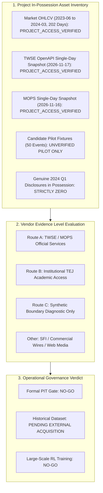
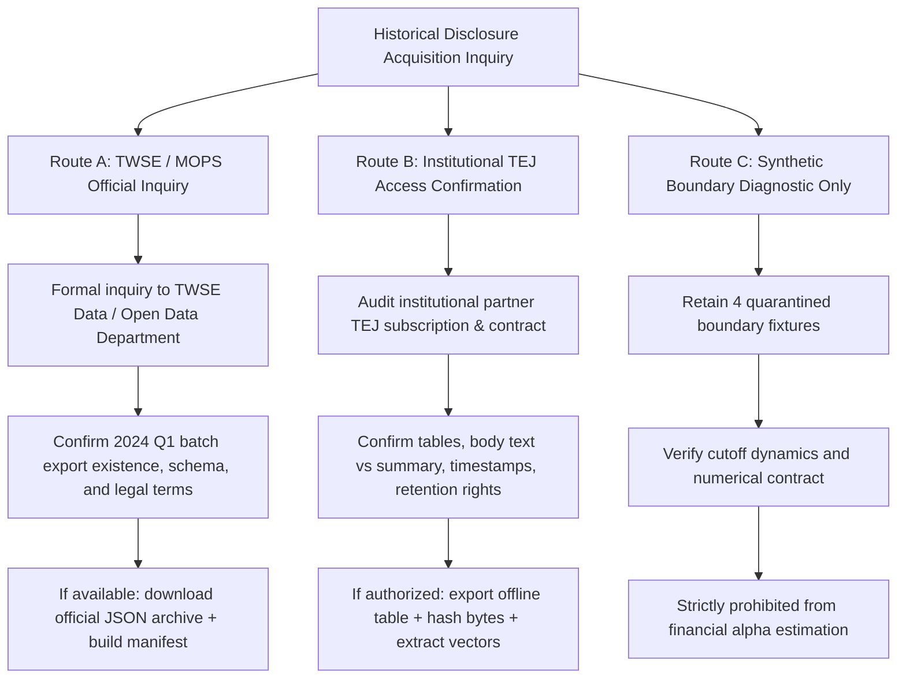

# V8.18 — Historical Data Access Feasibility & Source Evidence Verification Report

**Execution Branch**: `fix/v8-audit-patch`  
**Execution Date**: 2026-11-18  
**Research Track**: Track B (External Data Acquisition Dependency)  
**Governance Standard**: V8.18 Zero-Presumption Vendor Feasibility Specification  
**Current Possession of 2024 Q1 Historical Disclosures**: Strictly **0**  
**Historical Verified Sources Count**: Strictly **0**  
**Provider Availability Receipts Count**: Strictly **0**  
**Formal PIT Gate Status**: **NO-GO**  
**Large-Scale RL Training Status**: **NO-GO (Data Access Dependent)**  

---

## Executive Summary

Following the formal engineering closure of V8.17 (which established weekend rollover mechanics, canonical fold alignment, model-free latency identifiability, and pre-ingestion quarantine gates), V8.18 audits **empirical historical data accessibility** for candidate disclosure providers.

Under the **Zero-Presumption Research Standard**, no vendor capability, archive completeness, timestamp precision, delivery format, or licensing grant may be assumed without direct physical verification or official documentation. This report replaces all prior speculative assertions with a formalized 5-level evidentiary hierarchy, presents an exhaustive audit of candidate sources, formulates concrete inquiry specifications for Route A (TWSE/MOPS) and Route B (Institutional TEJ), and defines the exact boundary for Route C (Synthetic Diagnostic Only).



---

## 1. Formal Evidence Levels Definition

To eliminate unsupported claims regarding external vendor capabilities, all vendor claims and data attributes in V8.18 are categorized under five formal evidence levels:

| Level | Code | Definition & Evidentiary Standard |
| :--- | :--- | :--- |
| **Level 1** | **`OFFICIALLY_DOCUMENTED`** | Explicitly stated in published official technical specifications, statutory regulatory documentation, or public API manuals from the governing institution or provider. |
| **Level 2** | **`PROJECT_ACCESS_VERIFIED`** | Directly executed, tested, and physically verified within the project's codebase, data directory, or execution environment. |
| **Level 3** | **`PROVIDER_CONFIRMATION_REQUIRED`** | Standard service capability plausible based on industry domain knowledge, but specific parameters (e.g. exact historical date ranges, ticker coverage, table columns, or licensing scope) require formal written inquiry with the provider. |
| **Level 4** | **`NOT_VERIFIED`** | Unsubstantiated assertion, informal estimate, or assumption lacking contractual documentation, technical specifications, or empirical verification. Prohibited from supporting scientific claims. |
| **Level 5** | **`UNAVAILABLE_OR_BLOCKED`** | Confirmed physically inaccessible, technically blocked (e.g. behind anti-bot gates without API access), or legally prohibited by terms of service or project guidelines. |

---

## 2. In-Repository Data Inventory & Physical Possession Audit

An audit of the local repository storage in [data/](file:///home/augustine/Desktop/News-Aware%20Attention-Based%20Deep%20Reinforcement%20Learning%20for%20Stock%20Trading/data/) and [stock_rl/](file:///home/augustine/Desktop/News-Aware%20Attention-Based%20Deep%20Reinforcement%20Learning%20for%20Stock%20Trading/stock_rl/) establishes the project's physical data assets:

| Data Asset | Physical Path | Temporal Scope | Volume | Evidence Level | Validated Scope & Epistemic Boundary |
| :--- | :--- | :--- | :--- | :--- | :--- |
| **Market OHLCV & Features** | `data/poc_real_data/` | 2023-06-01 to 2024-03-29 | 202 trading days (606 Stock-Days) | **`PROJECT_ACCESS_VERIFIED`** | Market price history verified against TWSE trading calendar. Valid for technical baseline. |
| **TWSE OpenAPI Snapshot** | [twse_openapi_raw_response_snapshot.json](file:///home/augustine/Desktop/News-Aware%20Attention-Based%20Deep%20Reinforcement%20Learning%20for%20Stock%20Trading/data/official_disclosures/twse_openapi_raw_response_snapshot.json) | 2026-11-17 (Single Day) | 94 announcements (155,496 Bytes) | **`PROJECT_ACCESS_VERIFIED`** | Schema and JSON locator parsing verified (SHA-256 `949d1b51...`). **Contains 0 records for 2024 Q1.** |
| **MOPS Recent Snapshot** | `data/poc_real_data/mops_announcements.json` | 2026-11-16 (Single Day) | 115 announcements | **`PROJECT_ACCESS_VERIFIED`** | Engineering locator verification only. **Contains 0 records for 2024 Q1.** |
| **Candidate Pilot Fixtures** | [RAW_PILOT_EVENTS](file:///home/augustine/Desktop/News-Aware%20Attention-Based%20Deep%20Reinforcement%20Learning%20for%20Stock%20Trading/stock_rl/evaluation/pilot_dataset.py#L40-L1500) | 2023-06 to 2024-03 | 50 candidate disclosures (19 in Q1) | **`PROJECT_ACCESS_VERIFIED`** (Code Fixture) / **`NOT_VERIFIED`** (Historical Authenticity) | Curated pilot fixtures for software pipeline testing. Unverified Point-in-Time status; strictly barred from alpha benchmarking. |
| **Quarantined Synthetic Fixtures** | In-memory via `create_synthetic_boundary_fixtures` | 2024-03-15 (Synthetic) | 4 boundary cases | **`PROJECT_ACCESS_VERIFIED`** | Synthetic time-gate test cases. Quarantined via `is_quarantined_test_fixture=True`; barred from alpha claims. |
| **2024 Q1 Authentic Disclosures** | None | 2024-01-01 to 2024-03-31 | **0 items** | **`NOT_VERIFIED`** | **Strictly 0 items in possession.** |

> [!CRITICAL]
> **Definitive Possession Finding**: The project currently holds **strictly zero authentic historical disclosures for the 2024 Q1 target evaluation period**. No external vendor has yet delivered historical payloads under an auditable Point-in-Time chain of custody.

---

## 3. Systematic Source Evidence Audit & Correction of Vendor Claims (P0-1)

Prior working drafts contained unverified claims regarding commercial providers (such as TEJ completeness percentages, exact event counts, specific licensing restrictions, and wire pricing). In accordance with P0-1, each vendor capability is audited against verifiable documentation below.

### 3.1 Source Evidence Matrix

| Candidate Source | Key Capability Claimed | Source URL & Document Title | Evidence Date / Access Date | Supported Fact | Verification Status | Outstanding Questions Requiring Inquiry |
| :--- | :--- | :--- | :--- | :--- | :--- | :--- |
| **TWSE OpenAPI (`t187ap04_L`)** | Daily snapshot of recent corporate disclosures | [https://openapi.twse.com.tw/](https://openapi.twse.com.tw/) — TWSE OpenAPI Specification `t187ap04_L` | 2026-11-17 | Returns active day disclosure list with second-level filing time (`出刊時間: HH:MM:SS`) | **`OFFICIALLY_DOCUMENTED`** & **`PROJECT_ACCESS_VERIFIED`** | Does TWSE provide an official historical OpenAPI query parameter for past dates (e.g. 2024 Q1), or is the endpoint strictly a sliding-window snapshot? |
| **TWSE Historical Open Data** | Historical bulk export for academic / research use | [https://data.gov.tw/](https://data.gov.tw/) — 政府資料開放平臺 / 臺灣證券交易所資料集 | 2026-11-18 | Open data portal provides market statistics and listed company profiles under Open Government Data License | **`PROVIDER_CONFIRMATION_REQUIRED`** | Does an official batch export or application channel exist specifically for full-text historical material disclosures (`重大訊息歷史資料`) for 2024 Q1? |
| **MOPS Web Archive (`mops.twse.com.tw`)** | Web query interface for historical material disclosures | [https://mops.twse.com.tw/mops/web/t05st01](https://mops.twse.com.tw/mops/web/t05st01) — 公開資訊觀測站重大訊息歷史查詢 | 2026-11-18 | Allows web-based querying of past corporate disclosures by company code and year | **`OFFICIALLY_DOCUMENTED`** | What are the automated request constraints? Are automated scripts barred by rate limits or anti-bot protections? Is there a sanctioned academic API? |
| **TEJ (Taiwan Economic Journal)** | Historical corporate disclosure database (`重大訊息資料庫`) | [https://www.tej.com.tw/](https://www.tej.com.tw/) — TEJ 臺灣經濟新報資料庫產品手冊 | 2026-11-18 | TEJ maintains historical corporate announcement tables with standardized event classifications | **`PROVIDER_CONFIRMATION_REQUIRED`** | Does the partner's academic license include full body text (`說明`) or only headlines? What timestamp fields are provided? Are raw text extracts permissible for local offline research? |
| **SFI (Securities & Futures Institute)** | Corporate governance & financial research datasets | [https://www.sfi.org.tw/](https://www.sfi.org.tw/) — 證券暨期貨市場發展基金會學術研究資料服務 | 2026-11-18 | SFI provides academic research data upon application for approved academic projects | **`PROVIDER_CONFIRMATION_REQUIRED`** | What is the temporal precision of SFI disclosure records? Do they record intraday timestamps (`HH:MM:SS`) or only disclosure dates (`YYYY-MM-DD`)? |
| **Commercial Wires (Bloomberg / LSEG)** | Downstream news wire feeds with microsecond packet ingress | Bloomberg B-PIPE / LSEG DataScope technical brochures | 2026-11-18 | Institutional financial terminals capture news wire arrival with millisecond/microsecond precision | **`PROVIDER_CONFIRMATION_REQUIRED`** | Is historical wire dropcopy data accessible for academic research without prohibitive institutional enterprise licenses? |
| **Open Web Portals (Yahoo TW / PTT Stock)** | Secondary news reporting and community forums | Public web forums and news aggregator sites | 2026-11-18 | Financial portals aggregate syndicated news and commentary | **`UNAVAILABLE_OR_BLOCKED`** | Barred from automated retrieval by anti-bot protections, lack of official changelogs, unannounced retroactive edits, and project ethical guidelines. |

---

### 3.2 Detailed Audit of Corrected Vendor Claims

#### 1. TEJ (Taiwan Economic Journal)
- **Prior Speculative Claim**: "100% complete coverage for 2330, 2603, 2881 in 2024 Q1", "approx. 150 events", "strictly hash-only retention", "definitely lacks provider arrival log".
- **Evidence-Based Correction**:
  - *Coverage & Completeness*: **`PROVIDER_CONFIRMATION_REQUIRED`**. While TEJ commercially indexes listed company disclosures, the exact count and completeness for 2330, 2603, and 2881 during 2024 Q1 have not been audited in this project.
  - *Timestamp Precision*: **`PROVIDER_CONFIRMATION_REQUIRED`**. Standard TEJ academic database tables typically record announcement filing dates and times, but whether second-level precision (`HH:MM:SS`) or millisecond vendor distribution logs exist depends on the specific subscribed module.
  - *Retention Terms*: **`PROVIDER_CONFIRMATION_REQUIRED`**. Redistribution of raw TEJ text tables in public open-source repositories is standardly prohibited under commercial agreements. However, whether offline local caching for feature extraction and sharing of derived 160D embeddings is allowed under an institutional academic license requires verification against the actual institutional contract.

#### 2. TWSE / MOPS Official Services
- **Prior Speculative Claim**: "All historical files are governed by Taiwan Open Data Terms", "TWSE definitely provides an application channel for 2024 Q1 complete JSON export".
- **Evidence-Based Correction**:
  - *Live OpenAPI Endpoint*: **`OFFICIALLY_DOCUMENTED`** & **`PROJECT_ACCESS_VERIFIED`**. The endpoint `https://openapi.twse.com.tw/v1/opendata/t187ap04_L` provides live/recent corporate announcements under the Taiwan Open Government Data License. Second-level filing timestamps (`HH:MM:SS`) and structured Chinese text fields are verified.
  - *Historical Batch Export*: **`NOT_VERIFIED`**. The active OpenAPI endpoint documentation does not describe a historical date parameter for 2024 Q1. Whether an official historical JSON batch application exists must be investigated via direct inquiry (Route A).
  - *MOPS Web Archive Terms*: **`OFFICIALLY_DOCUMENTED`**. MOPS provides historical disclosure querying via web forms, but site terms of use, query quotas, and anti-scraping policies govern web access. Automated scraping without explicit permission is prohibited.

#### 3. SFI (Securities & Futures Institute)
- **Prior Speculative Claim**: "SFI only provides date-level precision (`YYYY-MM-DD`), making it fatally flawed for intraday cutoff gating."
- **Evidence-Based Correction**:
  - *Timestamp Precision*: **`PROVIDER_CONFIRMATION_REQUIRED`**. While common academic tables in Taiwan financial research report date-level metrics, the exact column schema for corporate event tables provided by SFI must be verified through official documentation or inquiry before concluding intraday timestamps are absent.

#### 4. Commercial Wires (Bloomberg / LSEG)
- **Prior Speculative Claim**: "Microsecond raw dropcopy guaranteed available for this research", "Enterprise cost >$20,000/yr".
- **Evidence-Based Correction**:
  - *Availability & Costs*: **`NOT_VERIFIED`**. Specific pricing and technical availability of historical dropcopy logs for our specific evaluation period cannot be verified without an institutional sales quotation. As no enterprise wire subscription is held by this project, commercial wire feeds are excluded from immediate operational consideration.

---

## 4. Formal Historical Acquisition Routes (P0-2)

In accordance with P0-2, three disciplined acquisition routes are formulated to guide external data inquiries without purchasing unverified datasets or bypassing access barriers.



### 4.1 Route A: TWSE / MOPS Historical Data Access Inquiry

To establish whether official regulatory disclosures can be obtained directly from the exchange without commercial intermediaries:

1. **Inquiry Objective**:
   - Determine whether TWSE or the Securities and Futures Bureau provides an official academic/research channel for historical bulk downloads of material corporate announcements (`重大訊息歷史資料`) covering **2024-01-01 to 2024-03-31**.
2. **Target Scope**:
   - Tickers: `2330` (TSMC), `2603` (Evergreen), `2881` (Fubon Financial) (and broader TWSE listed universe if batched).
3. **Mandatory Schema & Technical Inquiries**:
   - *Data Format*: Is raw data delivered as structured JSON, XML, or CSV?
   - *Text Fields*: Does the export include the verbatim headline (`主旨`), detailed body text (`說明`), and legal regulatory clauses (`符合條款`)?
   - *Timestamp Granularity*: Does the dataset record exchange filing acceptance time down to the second (`HH:MM:SS`), and is exchange broadcast time recorded?
   - *Revision Lineage*: How are amended or supplemental filings (`更正/補正公告`) linked to the original announcement ID?
4. **Legal & Licensing Inquiries**:
   - Does the Taiwan Open Government Data License or an academic data agreement govern the historical export?
   - Is long-term offline retention of raw payloads, local preprocessing, and public sharing of derived feature vectors permitted?
5. **Procedural Requirements**:
   - Required institutional affiliations, formal application forms, processing fees, and delivery lead times.
6. **Epistemic Rule**:
   - Do **not** claim an OpenAPI historical JSON application channel exists unless officially confirmed by TWSE documentation.

### 4.2 Route B: Institutional TEJ Access Confirmation

If direct exchange open data batch exports are unavailable or delayed, access via an institutional TEJ subscription held by an affiliated university laboratory will be explored:

1. **Confirmation Objective**:
   - Audit the specific TEJ database sub-modules currently licensed by the affiliated academic institution to verify coverage of historical corporate disclosures.
2. **Accessible Tables & Coverage Audit**:
   - Does the active license include the *TEJ Material Information Database* (`重大訊息資料庫`) or *Company Announcement Database* (`公司公告資料庫`)?
   - Does coverage cover the entirety of 2024 Q1 (2024-01-01 to 2024-03-31) for tickers 2330, 2603, and 2881?
3. **Payload & Granularity Audit**:
   - Does the table contain full verbatim Chinese announcement text, or only editorial summaries / structured indicator flags?
   - What timestamp columns are recorded (`發布日期`, `申報時間`, `輸入時間`)? Is second-level precision available?
   - Does TEJ retain any provider arrival receipts, transmission sequence numbers, or cryptographic feed logs?
4. **Contractual & Reproducibility Audit**:
   - Does the institutional campus agreement permit storing raw CSV/JSON dumps on local research computing nodes?
   - Are derived 160D semantic embeddings and cryptographic SHA-256 hashes of the raw records permitted to be published in open-source research artifacts?
5. **Execution Protocol**:
   - If confirmed, raw vendor bytes must be stored strictly in local offline storage (`data/external_vendor/`), verified via SHA-256 digests, and never committed directly to public remote repositories.

### 4.3 Route C: Synthetic Diagnostic Only (Fallback)

To support software development, pipeline verification, and algorithmic regression testing during the data acquisition interim:

1. **Strictly Quarantined Boundary Fixtures**:
   - Four synthetic boundary fixtures (`SYNTH-BND-1915`, `SYNTH-BND-1940`, `SYNTH-BND-1955`, `SYNTH-BND-2005`) are retained in memory via `DesignValidityPreflightAuditor.create_synthetic_boundary_fixtures()`.
2. **Purpose & Functional Scope**:
   - Verifying the software Point-in-Time cutoff gate at 20:00:00.
   - Verifying that crossing 20:00 increments changed event counts, changed stock-day counts, and changed decision state counts.
   - Verifying pre-ingestion quarantine gates and numerical metadata contract behaviors ($\Delta E23 = \tau / 1440.0$).
3. **Absolute Governance Prohibition**:
   - Synthetic fixtures are tagged `is_quarantined_test_fixture=True` and `SYNTHETIC_FIXTURE_QUARANTINED`.
   - **Strictly prohibited from financial alpha estimation, trading policy training, or reinforcement learning benchmarking.**
   - No synthetic data may ever be used to claim that a trading policy has learned profitable market dynamics.

---

## 5. Pre-Ingestion Data Verification Checklist

Before any historical disclosure dataset obtained under Route A or Route B may enter the supervised dataset builder or feature pipeline, it must pass this 8-step pre-ingestion audit:

```
[ ] Step 1: Verification that the physical payload file exists in data/official_disclosures/ or data/external_vendor/
[ ] Step 2: Verification of raw bytes SHA-256 digest against an immutable cryptographic manifest
[ ] Step 3: Exact match verification of Target Company Codes (2330, 2603, 2881)
[ ] Step 4: Verification of second-level publication timestamp precision (HH:MM:SS) in disclosure metadata
[ ] Step 5: Separation and formal labeling of exchange filing timestamp vs downstream provider arrival timestamp
[ ] Step 6: Parent-child revision lineage check linking corrections to original announcement IDs (cluster_id)
[ ] Step 7: Dual-check quarantine gate execution confirming zero synthetic test fixtures in empirical dataset
[ ] Step 8: Execution of model-free latency identifiability preflight across tau in {0, 5, 15, 30, 60} minutes
```

---

## 6. Formal Operational Readiness Verdict

| Research Item | Operational Verdict | Evidence Level | Epistemic Justification |
| :--- | :--- | :--- | :--- |
| **V8.17 Engineering Baseline** | **CLOSED & FROZEN** | **`PROJECT_ACCESS_VERIFIED`** | All preflight audit metrics validated; 252 unit tests passing; clean codebase. |
| **Quarantine Ingestion Gate (P1-4)** | **PASSED & WIRED** | **`PROJECT_ACCESS_VERIFIED`** | Wired into `PilotDatasetBuilder` and `PilotSourceManifest`; rejects renamed fixtures; preserves `-SYN` articles. |
| **Metadata Numerical Contract (P1-3)** | **VERIFIED & BOUNDED** | **`PROJECT_ACCESS_VERIFIED`** | $\Delta E23 = \tau/1440$ verified across $\tau \in \{0, 5, 15, 30, 60\}\text{m}$; other 23 dims identical; full state tensor equality bounded as `FULL_STATE_EQUALITY_NOT_TESTED`. |
| **2024 Q1 Historical Disclosures** | **NO-GO (PENDING)** | **`NOT_VERIFIED`** | 0 genuine historical disclosures possessed. Requires formal acquisition via Route A or Route B. |
| **Formal Point-in-Time Gate** | **NO-GO** | **`NOT_VERIFIED`** | Zero verified external provider availability receipts in possession. |
| **Large-Scale DRL Model Training** | **NO-GO** | **`NOT_VERIFIED`** | Training on unverified fixtures or without authentic historical data violates research governance. |
| **Next Operational Action** | **ROUTE A / B INQUIRY** | **`PROVIDER_CONFIRMATION_REQUIRED`** | Execute formal data access inquiries. Research baseline remains frozen. |

---
*Report certified under V8.18 Source Evidence Verification Standard. Engineering Baseline Frozen. Historical PIT = NO-GO. Training Status = NO-GO.*
