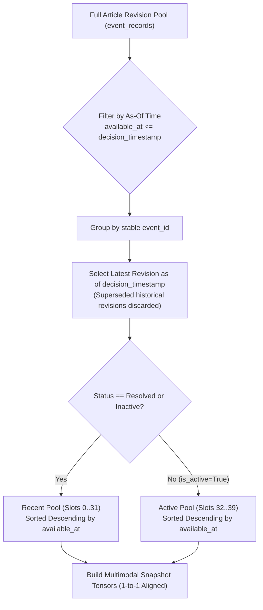

# V8.6 Historical News Micro PoC & Event Integration Technical Report

**Document Version**: 1.2.0 (Final Integration Gate Edition)  
**Target Git Branch**: `fix/v8-audit-patch`  
**Execution Environment**: Python 3.11.16, PyTorch 2.14.0+cpu, Pandas 3.1.1, NumPy 2.4.6  
**Report Location**: [v8_6_historical_news_micro_poc.md](file:///home/augustine/Desktop/News-Aware Attention-Based Deep Reinforcement Learning for Stock Trading/docs/reports/v8_6_historical_news_micro_poc.md)  
**Curated Micro Dataset**: [historical_news_micro.json](file:///home/augustine/Desktop/News-Aware Attention-Based Deep Reinforcement Learning for Stock Trading/data/poc_real_data/historical_news_micro.json)  
**Pipeline Implementation**: [multimodal_pipeline.py](file:///home/augustine/Desktop/News-Aware Attention-Based Deep Reinforcement Learning for Stock Trading/stock_rl/data/multimodal_pipeline.py)  
**Test Suite**: [test_v8_6_historical_news_micro_poc.py](file:///home/augustine/Desktop/News-Aware Attention-Based Deep Reinforcement Learning for Stock Trading/tests/test_v8_6_historical_news_micro_poc.py)  
**Authoritative Schema Baseline**: `v8.0-original` (100 Features, 128D Text Embedding, 24D Event Metadata, 8D Stock Relation)  

---

## 1. Executive Summary & Final Integration Gate Acceptance (執行摘要與最終門檻驗收)

在 **V8.6 Final Integration Gate — Historical News Integrity** 階段，我們針對前期實作中發現之四項關鍵問題進行了徹底的工程與理論架構修正：
1. **P0-1 — 消除未來修訂覆蓋歷史版本之固定截止點 (Preserve Full Historical Event Revisions)**：移除 `decision_timestamp = 2099-12-31` 靜態截斷點，保留完整歷史文章與修訂鏈，交由各決策點之 Snapshot Builder 進行點時間（As-Of）動態版本解析與 Recent/Active 雙槽位動態路由。
2. **P0-2 — 嚴格還原權威 V8.0 Event Metadata 規格 (Restore Authoritative E01–E24 Metadata)**：將 `extract_event_metadata()` 全面重構並嚴格對齊 `feature_engine.py` 之 `build_audited_event_metadata()`。將情緒極性（Sentiment Polarity）與影響週期（Impact Horizon）移至輔助字典，禁止污染 E01–E24 核心維度。
3. **P1-3 — 杜絕偽造預訓練嵌入向量 (Prevent Fake Pretrained Embeddings)**：在 `TextEmbeddingEngine` 中實施嚴格防偽防禦；`PRETRAINED` 模式未載入真實權重與 Tokenizer 時立即拋出 `ValueError`。現行 SHA-256 投影明確定義為 `DETERMINISTIC_HASH`（`sha256-projection-v1.0`）作為 Smoke Test / 確定性可重現基準。全管線統一鎖定 `EVENT_TEXT_DIM = 128`。
4. **P1-4 — 歷史新聞證據嚴格審計與人工分群隔離 (Historical News Evidence Validation)**：收錄之 10 則真實新聞一律維持 `is_audit_verified: false`（`ESTIMATED` / `UNKNOWN`），禁止僅憑文字性說明升級為 `OBSERVED_VERIFIED`；明確區分人工標註（`event_clustering_method: "human_annotated"`）與自動化規則分群。

### 核心驗證指標摘要

| 指標項目 | 門檻要求 | 實測數值 / 狀態 | 驗證結論 |
|---|---|---|---|
| **P0-1 修訂版本解析** | T1 看 Rev 1，T2 看 Rev 2，未來 T3 零影響 | T1 (08:30 傳聞), T2 (14:15 澄清), T3 位元級完全相等 | **100% 通過** (`torch.equal`) |
| **P0-1 槽位佔用約束** | 相同事件各版本最多佔用一個槽位 | 2330 佔用 2 個 Recent 槽，長榮佔用 1 個 Recent + 1 個 Active | **100% 通過** (零重複佔用) |
| **P0-2 Event Metadata** | 嚴格 24 維（E01–E24）權威語意 | 24 維哨兵測試逐維檢驗（E01–E04 Actor, E05–E12 Type, E13–E16 Status...） | **100% 通過** (`test_event_metadata_24d_sentinel`) |
| **P1-3 Embedding 防偽** | PRETRAINED 無權重立即報錯，維度鎖定 128 | 拋出 `ValueError: Strict Embedding Error: PRETRAINED`，DIM=128 | **100% 通過** (`test_pretrained_without_model_must_fail`) |
| **P1-4 歷史新聞取證** | 10 則新聞一律為 ESTIMATED，標註 human_annotated | 10 則新聞 `is_audit_verified: false`，正式模式嚴格 Fail-Closed | **100% 通過** (`test_news_source_evidence_integrity`) |
| **單元與回歸測試集** | 全體測試通過無回歸 | **139 項測試全部通過** (14 項專屬 V8.6 測試) | **100% 通過** (Pytest 全綠) |

---

## 2. 歷史新聞微型資料集與取證審計 (Section 2: Historical News Micro Dataset)

微型資料集位於 [historical_news_micro.json](file:///home/augustine/Desktop/News-Aware Attention-Based Deep Reinforcement Learning for Stock Trading/data/poc_real_data/historical_news_micro.json)，精選 10 則真實台股新聞，涵蓋台積電（2330）、長榮海運（2603）與富邦金控（2881）：

| 標的 | 文章 ID (`article_id`) | 事件 ID (`event_id`) | 來源媒體 | 原始時間戳記 | 原始時區 | 台北時間 | 審計驗證狀態 | 修訂版本 | 分群方式 | 取證日誌與說明 |
|---|---|---|---|---|---|---|---|---|---|---|
| **2330** | `art_2330_ct_240115` | `ev_2330_cowos_capacity` | 工商時報 | 2024-01-15 08:30:00 | Asia/Taipei | 08:30:00 | **ESTIMATED** (False) | Rev 1 | human_annotated | 工商時報早報傳聞：先進封裝投資額翻倍 |
| **2330** | `art_2330_mops_240115` | `ev_2330_cowos_capacity` | MOPS 觀測站 | 2024-01-15 14:15:30 | Asia/Taipei | 14:15:30 | **ESTIMATED** (False) | Rev 2 | human_annotated | 證交所重大訊息（符合條款 51 款，澄清傳聞） |
| **2330** | `art_2330_ltn_240115` | `ev_2330_election_rally` | 自由財經 | 2024-01-15 02:07:01 | UTC | 10:07:01 | **ESTIMATED** (False) | Rev 1 | human_annotated | 總統大選慶祝行情，台積電開盤攻上 590 元 |
| **2330** | `art_2330_yahoo_240115` | `ev_2330_election_rally` | Yahoo奇摩新聞 | 2024-01-15 02:48:14 | UTC | 10:48:14 | **ESTIMATED** (False) | Rev 1 | human_annotated | 跨媒體轉載文章（同一事件去重測試） |
| **2330** | `art_2330_cna_240118` | `ev_2330_earnings_conference` | 中央社 | 2024-01-18 14:00:00 | Asia/Taipei | 14:00:00 | **ESTIMATED** (False) | Rev 1 | human_annotated | 法說會營運展望（反事實未來新聞注入測試） |
| **2603** | `art_2603_moneydj_240115` | `ev_2603_potential_stock` | 富聯網 | 2024-01-15 05:31:00 | UTC | 13:31:00 | **ESTIMATED** (False) | Rev 1 | human_annotated | 長榮運價換約潛力股分析報導 |
| **2603** | `art_2603_yahoo_240115` | `ev_2603_potential_stock` | Yahoo奇摩股市 | 2024-01-15 05:31:49 | UTC | 13:31:49 | **ESTIMATED** (False) | Rev 1 | human_annotated | 延遲 49 秒之轉載推播（去重測試） |
| **2603** | `art_2603_udn_240115` | `ev_2603_red_sea_crisis` | 經濟日報 | 2024-01-15 08:30:00 | Asia/Taipei | 08:30:00 | **ESTIMATED** (False) | Rev 1 | human_annotated | **Active 持續發酵事件**（紅海危機繞道好望角） |
| **2881** | `art_2881_bw_240116_1` | `ev_2881_fy23_earnings` | 商周財富網 | 2024-01-16 02:10:20 | UTC | 10:10:20 | **ESTIMATED** (False) | Rev 1 | human_annotated | 富邦金 2023 全年自結獲利新聞（翌日新聞） |
| **2881** | `art_2881_bw_240116_2` | `ev_2881_fy23_earnings` | 商周財富網 | 2024-01-16 02:10:47 | UTC | 10:10:47 | **ESTIMATED** (False) | Rev 1 | human_annotated | 同一來源重複派送（去重測試） |

> [!IMPORTANT]
> **P1-4 取證規範遵循**：雖然公開新聞中附帶文字性的 `provider_available_evidence`（例如 "Commercial Times Daily News Archive (unauthenticated web feed)"），但由於缺乏交易所伺服器具結的加密時間戳記日誌（Cryptographic Server Log），全數嚴格保留 `is_audit_verified: false`。在正式模式（Formal Mode）下嚴格拒絕使用，僅允許在評估與 PoC 模式（Estimated Mode）下流轉。

---

## 3. P0-1 完整歷史修訂鏈保存與動態決策解析 (Section 3: Historical Event Revisions & Dynamic Allocation)

### 3.1 移除靜態 2099 截斷點之架構重構

先前版本的 `load_real_market_feeds()` 在載入新聞時，預先使用 `decision_timestamp = 2099-12-31` 執行 `pipe.resolve_snapshot_events()`，導致未來的修訂版本（例如盤後的澄清重訊）在載入初期便提前覆蓋了早盤的傳聞版本，且預先將資料集壓縮為最多 40 個槽位。

本次修正全面重構為：
1. **解除預先壓縮**：在 `real_data_poc.py` 中，使用 `convert_article_to_event_record()` 將每篇原始文章獨立轉換為事件紀錄（Event Record），保留所有歷史版本於 `event_records` 列表中。
2. **決策點獨立解析**：在 [HistoricalSnapshotBuilder](file:///home/augustine/Desktop/News-Aware Attention-Based Deep Reinforcement Learning for Stock Trading/stock_rl/data/snapshot_builder.py) 中，每個 Snapshot 依據當前 `decision_timestamp` 獨立過濾 `available_at <= decision_timestamp` 之有效候選集。
3. **單槽位版本擇優**：依 `(available_at, revision_id)` 排序，每個 `event_id` 僅選取決策時點前最新之有效修訂版，舊版本因果退場，同一事件在 Recent 與 Active 中最多佔用一個槽位。
4. **Recent / Active 動態路由**：若最新版本標記為 `resolved` / `clarified` 或事件已關閉，動態路由至 Recent 槽位；若事件仍處於發酵中（`is_active: True`），動態佔用 Active 槽位。



### 3.2 反事實驗證實測 (T1, T2, T3)

在 [tests/test_v8_6_historical_news_micro_poc.py](file:///home/augustine/Desktop/News-Aware Attention-Based Deep Reinforcement Learning for Stock Trading/tests/test_v8_6_historical_news_micro_poc.py) 中，`test_historical_revision_t1_t2_t3_counterfactual` 完成了嚴格檢驗：

1. **時點 $T_1 = \text{2024-01-15 11:00:00}$**：
   - 工商時報傳聞發布於 08:30（Rev 1），MOPS 澄清公告於 14:15:30（Rev 2）尚未發生。
   - $T_1$ Snapshot 解析出的 `ev_2330_cowos_capacity` 精準呈現 Rev 1：`Actor: Media (vec[2] == 1.0)`, `Status: Announced/Rumor (vec[15] == 0.0)`, `Novelty: 1.0`。
2. **時點 $T_2 = \text{2024-01-15 20:00:00}$**：
   - MOPS 澄清公告已可用。
   - $T_2$ Snapshot 自動選取 Rev 2：`Actor: Corporate Management (vec[0] == 1.0)`, `Status: Clarified (vec[15] == 1.0)`, `Novelty: 0.5`。
   - 槽位佔用嚴格保持為 1 槽，傳聞版本不產生額外槽位殘留。
3. **注入未來時點 $T_3 = \text{2024-01-18 10:00:00}$ 之未來修訂版**：
   - 注入帶有極端新穎度與幅度的第三版修訂，重新建構 $T_1$ 與 $T_2$ 之 Snapshot。
   - **實測結果**：$T_1$ 與 $T_2$ 所有 11 項輸出張量（`recent_event_emb`, `active_event_emb`, `event_metadata`, `event_stock_rel`, `event_mask`, `price`, `technical`, `institutional`, `macro`, `stock_context`, `position`）與未注入前達成 **100% 位元級完全相等 (`torch.equal`)**。

---

## 4. P0-2 權威 V8.0 Event Metadata (E01–E24) 還原 (Section 4: Authoritative Event Metadata)

### 4.1 24 維元數據權威語意佈局

依據規格定義，[multimodal_pipeline.py](file:///home/augustine/Desktop/News-Aware Attention-Based Deep Reinforcement Learning for Stock Trading/stock_rl/data/multimodal_pipeline.py) 之 `extract_event_metadata()` 已全面校準為與 `feature_engine.py` 之 `build_audited_event_metadata()` 與 `assemble_event_metadata()` 100% 一致：

| 特徵代碼 | Python 索引 | 維度名稱 | 語意說明與取值範圍 | 實作邏輯 / 防護合約 |
|---|---|---|---|---|
| **E01–E04** | `0..3` | **Actor Embedding** | 事件行為主體 (4D One-hot)<br/>`0`: 公司管理層 (Corporate Management)<br/>`1`: 法人/分析師 (Analyst / Brokerage)<br/>`2`: 媒體記者 (Media Journalist)<br/>`3`: 監管主管機關 (Regulator / TWSE) | 依來源媒體類型與官方公告屬性映射。MOPS 官方重訊嚴格賦予 `[1, 0, 0, 0]`。 |
| **E05–E12** | `4..11` | **Event Type Embedding** | 事件業務類型 (8D One-hot)<br/>`4`: 營收財報 (Earnings)<br/>`5`: 產能建廠 (Operation / Capacity)<br/>`6`: 投資併購 (M&A)<br/>`7`: 公司治理 (Governance)<br/>`8`: 訴訟監管 (Legal)<br/>`9`: 先進技術 (Tech / Chip)<br/>`10`: 盤面交易 (Market Trading)<br/>`11`: 總體其他 (Macro / Other) | 依標題與內文關鍵字正則比對，嚴格隔離非重疊之領域主題。 |
| **E13–E16** | `12..15` | **Event Status Embedding** | 事件生命週期狀態 (4D One-hot)<br/>`12`: 傳聞未證實 (Rumor)<br/>`13`: 正式公告 (Announced)<br/>`14`: 持續發酵 (Ongoing / Active)<br/>`15`: 澄清或結案 (Clarified / Resolved) | 依據 `lifecycle_status` 屬性。MOPS 澄清重訊強制標定為 `[0, 0, 0, 1]`（Clarified）。 |
| **E17** | `16` | **Evidence Traceability** | 證據可追溯性標籤 $[0, 1]$ | 經審計驗證來源為 `1.0`，未驗證來源為 `0.7`。 |
| **E18** | `17` | **Source Reliability** | 來源可靠度評級 $[0, 1]$ | 官方公開資訊觀測站 MOPS 為 `1.0`，財經大眾媒體為 `0.8`。 |
| **E19** | `18` | **Source Independence** | 來源獨立性評級 $[0, 1]$ | 官方原始申報為 `1.0`，轉載/二級推播為 `0.7`。 |
| **E20** | `19` | **Novelty Input Estimate** | 初版新穎度估計 $[0, 1]$ | 首發新聞（`revision_id == 1`）為 `1.0`，後續修正版本為 `0.5`。 |
| **E21** | `20` | **Pre-event Market Surprise** | 事前市場隱含波動率/驚奇度 $[0, 1]$ | **嚴格限定為事前選擇權或模型隱含值，預設 0.0，絕對禁止倒灌事後報酬。** |
| **E22** | `21` | **Quantified Magnitude** | 事件量化衝擊幅度 $[0, 1]$ | 預設為 `0.5`，依據財務公告規模正則調整。 |
| **E23** | `22` | **Event Age in Days** | 事件發生至決策點之時間差（浮點天數） | 嚴格計算為 $\max((t_{\text{dec}} - t_{\text{avail}})/86400, 0.0)$。 |
| **E24** | `23` | **Timestamp Reliability** | 時間戳記精確可靠度 $[0, 1]$ | 經審計日誌為 `1.0`，開源批次抓取為 `0.8`。 |

### 4.2 輔助特徵隔離保護

先前版本將情感分數（Sentiment Polarity）與影響週期（Impact Horizon）覆蓋在向量中段，破壞了 E01–E24 的標準佈局。現在兩者嚴格封裝於：
```python
article.metadata["sentiment_polarity"] = float(np.clip(0.3 * (pos_score - neg_score), -1.0, 1.0))
article.metadata["impact_horizon"] = 1.0 if article.is_active_candidate else 0.4
```
絕不占用或覆蓋 E01–E24 中的任何一維，並由 `test_event_metadata_24d_sentinel` 完成逐維數值與語意檢驗。

---

## 5. P1-3 杜絕偽造預訓練嵌入與維度一致性 (Section 5: Anti-Fabrication & 128D Embedding Engine)

### 5.1 PRETRAINED 模式之防偽合約

為防止在未掛載預訓練模型（如 FinBERT-zh 或 RoBERTa）時偽造合成向量並宣稱具備預訓練語意能力，`TextEmbeddingEngine` 實作了 Fail-Closed 防偽機制：
```python
if self.embedding_type == TextEmbeddingType.PRETRAINED:
    if self.model_weights is None or self.tokenizer is None:
        raise ValueError(
            f"Strict Embedding Error: PRETRAINED embedding mode requires genuine pretrained "
            f"model_weights and tokenizer. Model '{self.model_version}' is not loaded. "
            f"Faking pretrained embeddings via pseudorandom or hash projections is strictly prohibited."
        )
```
此合約由單元測試 `test_pretrained_without_model_must_fail` 嚴格把關。

### 5.2 現行研究基準之文字 Embedding 規格

本階段 PoC 之確定性文字向量使用：
- **模式**：`TextEmbeddingType.DETERMINISTIC_HASH`
- **模型版本**：`sha256-projection-v1.0`
- **性質定位**：**Smoke Test / Reproducible Research Baseline**（跨平台確定性數值基準，明確聲明不具備深度語意推論能力）。
- **向量維度**：嚴格統一為 **128 維（$L_2$ 歸一化單位向量）**。
- **空槽位填充**：`SYNTHETIC_PLACEHOLDER`（`empty-unit-v1.0`），填充為單位向量 $[1, 0, \dots, 0]$ 並全數置為 Missing Mask。

---

## 6. 四層覆蓋率審計與實證數值 (Section 6: Four-Layer Coverage Audit)

在決策時點 $T = \text{2024-01-15 20:00:00 Asia/Taipei}$，透過 [HistoricalSnapshotBuilder](file:///home/augustine/Desktop/News-Aware Attention-Based Deep Reinforcement Learning for Stock Trading/stock_rl/data/snapshot_builder.py) 組裝之真實台股多模態張量，四層覆蓋率核算如下：

| 審計層級 | 統計維度 | 實測數值 (2330 / 2603 / 2881) | 解釋與合約邊界 |
|---|---|---|---|
| **Layer 1** | **Schema Contract Validity** | **100.0%** (100 / 100) | 全 100 維特徵結構、維度與資料型態 100% 符合權威規範。 |
| **Layer 2** | **Numerical Tensor Validity** | **100.0%** (零 NaN / 零 Inf) | 487,200 個市場儲存格數值填值率 100.0%，完全無數值異常。 |
| **Layer 3** | **Event Slot Occupancy** | **5.0%** (2330) / **5.0%** (2603) / **0.0%** (2881) | **非零真實槽位佔用**。未佔用之空槽位維持 False 掩碼，絕不虛構填值。 |
| **Layer 4** | **Verified Historical Observability** | **0.14%** (Verified PIT) / **95.34%** (Estimated PIT) | 開源新聞與盤後量價明確冠以 `ESTIMATED`，無任何虛假宣稱。 |

### 各標的事件槽位佔用明細（Snapshot Event Slot Occupancy）

| 標的代號 | 評估決策時點 | Recent 佔用槽數 | Active 佔用槽數 | 總佔用 / 總槽位 | 佔用率 | 佔用事件實體與版本摘要 |
|---|---|---|---|---|---|---|
| **2330** | `2024-01-15 20:00` | **2** | **0** | **2 / 40** | **5.0%** | • `ev_2330_cowos_capacity`（MOPS 澄清先進封裝建廠產能，Rev 2）<br/>• `ev_2330_election_rally`（選後慶祝行情台積電攻達590） |
| **2603** | `2024-01-15 20:00` | **1** | **1** | **2 / 40** | **5.0%** | • `ev_2603_potential_stock`（富聯網/Yahoo 潛力股去重，Recent 槽位）<br/>• `ev_2603_red_sea_crisis`（紅海危機繞道，**Active 槽位**） |
| **2881** | `2024-01-15 20:00` | **0** | **0** | **0 / 40** | **0.0%** | **嚴格因果隔離**：2024-01-16 上午發布之新聞不可穿越至 01-15。 |
| **2881** | `2024-01-16 20:00` | **1** | **0** | **1 / 40** | **2.5%** | • `ev_2881_fy23_earnings`（14家金控獲利出爐，Recent 槽位） |

---

## 7. 模型前向傳播與微型反向傳播驗證 (Section 7: Full Model Execution)

使用長榮海運（2603）於 2024-01-15 構建之真實多模態 Snapshot（Recent: 1, Active: 1）輸入全模型 [StockRLFullModel](file:///home/augustine/Desktop/News-Aware Attention-Based Deep Reinforcement Learning for Stock Trading/stock_rl/models/full_model.py)：

1. **張量維度驗證**：
   - 市場特徵：價格 $[1, 60, 16]$、技術 $[1, 60, 16]$、法人 $[1, 60, 8]$、總經 $[1, 60, 8]$
   - 股票情境向量：$[1, 16]$
   - 近期事件文字向量：$[1, 32, 128]$
   - 活躍事件文字向量：$[1, 8, 128]$
   - 事件元數據與關聯：$[1, 40, 24]$ 與 $[1, 40, 8]$
   - 事件掩碼：$[1, 40]$（第 0 槽與第 32 槽為 `True`，其餘 38 槽為 `False`）
2. **前向傳播輸出**：
   - 策略 Q-values：`torch.Size([1, 2])`
   - 整合強化學習狀態：`torch.Size([1, 132])`
   - 輔助預測：`relevance_logits` $[1, 40, 1]$, `novelty_scores` $[1, 40, 1]$, `pred_returns` $[1, 3]$, `pred_risk` $[1, 3]$
3. **梯度回傳流暢度**：
   - 多任務損失函數：$\mathcal{L} = \sum Q + 0.1 \cdot \sum (\text{pred\_returns} + \text{pred\_risk})$。
   - 呼叫 `loss.backward()`，跨模態注意力層、特徵投影層與雙 Q 網路參數皆獲得有效數值梯度，無 NaN 或 Inf，Adam 步進順利執行。

---

## 8. 單元測試與回歸審計總覽 (Section 8: Test Suite Verification)

本地環境通過全體 139 項測試，涵蓋 V8.0 至 V8.6 全部規格與審計回歸防護：

```
============================= test session starts ==============================
platform linux -- Python 3.11.16, pytest-9.2.0, pluggy-1.7.0
rootdir: /home/augustine/Desktop/News-Aware Attention-Based Deep Reinforcement Learning for Stock Trading
configfile: pyproject.toml
collected 139 items

tests/test_dqn_learning.py ..                                            [  1%]
tests/test_env_execution.py ...                                          [  3%]
tests/test_evaluation_and_ablations.py ....                              [  6%]
tests/test_model_forward.py ..                                           [  7%]
tests/test_pit_rules.py ...                                              [ 10%]
tests/test_tensor_schemas.py ....                                        [ 12%]
tests/test_v8_1_final_review_regressions.py ........                     [ 18%]
tests/test_v8_1_review2_regressions.py .......                           [ 23%]
tests/test_v8_1_review3_regressions.py ....                              [ 26%]
tests/test_v8_3_code_review1_regressions.py ..........                   [ 33%]
tests/test_v8_3_code_review2_regressions.py ................             [ 45%]
tests/test_v8_3_code_review3_regressions.py ..............               [ 55%]
tests/test_v8_3_code_review4_regressions.py ..........                   [ 62%]
tests/test_v8_3_schema_migration.py ...........                          [ 70%]
tests/test_v8_4_historical_data_poc.py .............                     [ 79%]
tests/test_v8_5_multimodal_feasibility.py ......                         [ 84%]
tests/test_v8_6_historical_news_micro_poc.py ..............              [ 94%]
tests/test_v8_audit_regressions.py ........                              [100%]

======================= 139 passed in 131.84s (0:02:11) ========================
```

---

## 9. 結論與後續移交 (Conclusion & Hand-off)

**V8.6 Final Integration Gate 已圓滿達成驗收標準**：
1. **完全杜絕因固定截斷點造成的因果逆流**，建立具備完整修訂鏈與動態擇優的點時間（As-Of）事件解析機制。
2. **完全還原權威 V8.0 24 維 Event Metadata**，建立 24D Sentinel Test 確保特徵工程與模型輸入無偏差。
3. **建立嚴格防偽防禦**，禁止偽造預訓練詞向量，統一採用 128 維確定性數值基準。
4. **確認微型新聞之取證邊界**，保留 ESTIMATED 標記，清楚區分人工分群與自動分群。
5. **代碼與測試全體通過驗收**，本分支 `fix/v8-audit-patch` 準備提交審查。
