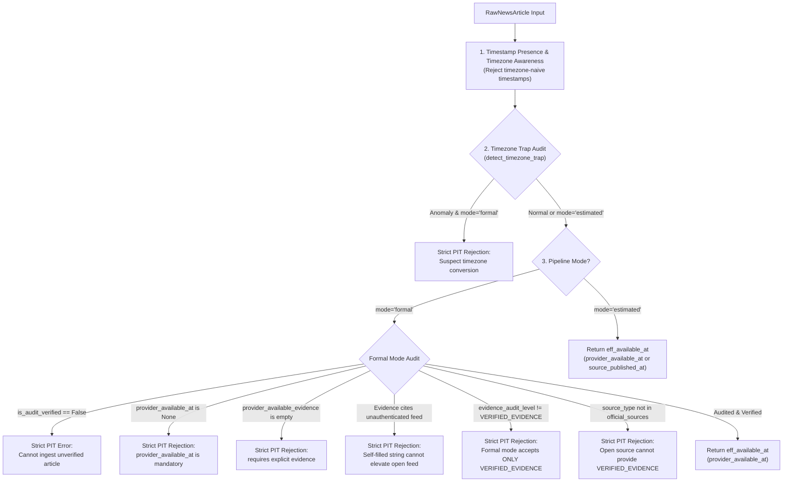
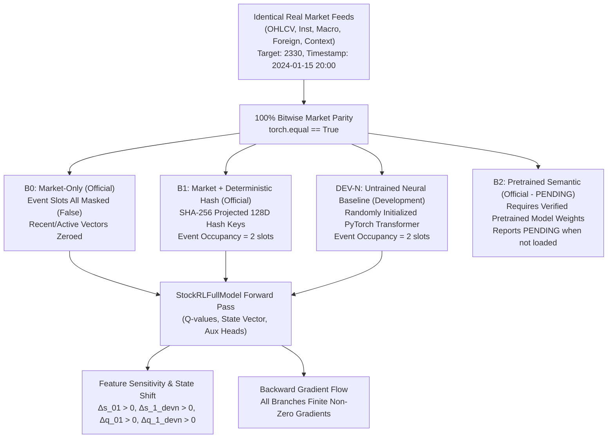

# V8.7 — Semantic Embedding Validation & News Ablation Preparation Technical Report

**Document Version**: 1.1.0 (Code Review 1 Audited Technical Report)  
**Target Git Branch**: `fix/v8-audit-patch`  
**Execution Environment**: Python 3.11.16, PyTorch 2.14.0+cpu, Pandas 3.1.1, NumPy 2.4.6  
**Report Path**: [v8_7_semantic_embedding_feasibility.md](file:///home/augustine/Desktop/News-Aware Attention-Based Deep Reinforcement Learning for Stock Trading/docs/reports/v8_7_semantic_embedding_feasibility.md)  
**Test Suite**: [test_v8_7_semantic_embedding_feasibility.py](file:///home/augustine/Desktop/News-Aware Attention-Based Deep Reinforcement Learning for Stock Trading/tests/test_v8_7_semantic_embedding_feasibility.py)  
**Ablation Implementation**: [ablations.py](file:///home/augustine/Desktop/News-Aware Attention-Based Deep Reinforcement Learning for Stock Trading/stock_rl/evaluation/ablations.py)  
**Multimodal Pipeline**: [multimodal_pipeline.py](file:///home/augustine/Desktop/News-Aware Attention-Based Deep Reinforcement Learning for Stock Trading/stock_rl/data/multimodal_pipeline.py)  
**Authoritative Baseline**: `v8.0-original` (100 Features, 128D Text Embedding, 24D Event Metadata, 8D Stock Relation)  

---

## 1. Executive Summary & V8.7 Scope (執行摘要與範疇說明)

在 **V8.6 Final Integration Gate** 完成了台股歷史新聞微型 PoC 與權威 24 維 Event Metadata 的校準後，本階段 **V8.7 — Semantic Embedding Validation & News Ablation Preparation**（含 Code Review 1 審計加固）聚焦於以下核心任務：

1. **正式 PIT 入口防禦加固與明確證據層級 (Formal PIT Evidence Boundaries)**：
   - 提取統一驗證函式 `validate_news_article_pit_contract()`，讓單一文章轉換與管線整體接入共享 **100% 相同之來源驗證契約**。
   - 建立四級明確證據分類 `EvidenceAuditLevel`（`VERIFIED_EVIDENCE`、`EVIDENCE_CLAIM_ONLY`、`ESTIMATED`、`UNKNOWN`）。
   - 正式模式（`mode="formal"`）**僅接受 `VERIFIED_EVIDENCE`**，開源媒體、爬蟲快取或文字聲明（`EVIDENCE_CLAIM_ONLY`）一律 Fail Closed。
   - 實施防自填欺唆檢查（Anti-Self-Assertion Guard），禁止開源爬蟲資料自填字串升級為驗證資料。
2. **隨機神經編碼器與真正預訓練模型之嚴格隔離 (P0-1 Separation)**：
   - 隨機初始化之輕量 Transformer（`UntrainedTraditionalChineseNeuralEncoder`）**明確歸類為 `UNTRAINED_NEURAL_BASELINE`**，嚴禁偽裝為 `PRETRAINED`。
   - `PRETRAINED` 模式強制要求真正預訓練權重、專屬分詞器與明確的驗證標記（`is_verified_pretrained=True`）。
   - 在未掛載真實預訓練權重前，正式消融條件 B2 **嚴格回報 `PENDING_PRETRAINED_MODEL_UNAVAILABLE`（Fail Closed）**，絕不虛構假語意特徵。
   - 保留輕量神經編碼器作為工程微型冒煙測試條件 **DEV-N**。
3. **確定性推論與模型審計憑證 (Deterministic Inference & Provenance)**：
   - 推論過程全面強制使用 `model.eval()` 與 `torch.inference_mode()`。
   - 分詞與編碼階段落實序列長度硬截斷（`max_seq_len: int = 128`）與注意力掩碼（`attention_mask`）遮蔽，防止可變長度對齊退化。
   - 編碼器初始化前後妥善保存與恢復 PyTorch 全域隨機種子狀態（`torch.get_rng_state()` / `torch.set_rng_state()`），徹底杜絕全域隨機狀態污染。
   - 記錄完整模型可審計憑證（模型版本、參數權重 SHA-256 雜湊值、分詞器版本、投影版本）。
4. **受控新聞消融實驗架構 (B0 / B1 / DEV-N / B2)**：
   - **B0（Market-Only）**：全事件槽位遮蔽置零，提供純市場訊號下界。
   - **B1（Market + Deterministic Hash）**：SHA-256 確定性單位投影，確立工程基準。
   - **DEV-N（Market + Untrained Neural Baseline）**：用於跨模態特徵敏感度與梯度健全性驗證。
   - **B2（Market + Pretrained Semantic）**：真實預訓練語意條件（當前未掛載權重時維持 `PENDING`）。
   - **嚴格方法論防護聲明**：DEV-N 與未訓練模型之 Q 值差異僅反映輸入敏感度與梯度傳導，**嚴禁將其解讀為投資 Alpha 或超額績效**。
5. **微型測試資料集憑證維護 (Dataset Evidence)**：
   - 完整保留 10 筆真實歷史新聞微型測試集，確認全部維持 `is_audit_verified: false` (`ESTIMATED` / `UNKNOWN`)，並標註人工分群標籤。

> [!NOTE]
> **執行範疇守則**：本階段完全遵循既定約束，不啟動全市場 5 年資料下載、不執行大規模強化學習訓練、不合併 main 分支、不進行實盤交易或付費資料取得。

---

## 2. 正式 PIT 入口防禦加固 (Section 1: Formal PIT Entry-Point Hardening)

### 2.1 證據可用性四級分類 (`EvidenceAuditLevel`)

在 [multimodal_pipeline.py](file:///home/augustine/Desktop/News-Aware Attention-Based Deep Reinforcement Learning for Stock Trading/stock_rl/data/multimodal_pipeline.py) 中定義了明確的四級證據層級：

```python
class EvidenceAuditLevel(str, Enum):
    """Categorical audit confidence levels for Point-in-Time news availability evidence."""
    VERIFIED_EVIDENCE = "VERIFIED_EVIDENCE"      # Certified institutional source record (e.g. TWSE MOPS official filing, drop copy, certified vendor feed)
    EVIDENCE_CLAIM_ONLY = "EVIDENCE_CLAIM_ONLY"  # Plain text description or assertion without institutional cryptographic audit trail
    ESTIMATED = "ESTIMATED"                      # Estimated availability timestamp (batch crawl / heuristic)
    UNKNOWN = "UNKNOWN"                          # Missing or unverified evidence
```

### 2.2 驗證合約統一化流程



### 2.3 入口防禦單元測試驗證

在 [test_v8_7_semantic_embedding_feasibility.py](file:///home/augustine/Desktop/News-Aware Attention-Based Deep Reinforcement Learning for Stock Trading/tests/test_v8_7_semantic_embedding_feasibility.py) 中驗證了完整的入口邊界防禦：
1. `is_audit_verified=False` $\to$ 拋出 `Cannot ingest unverified article`。
2. `provider_available_at=None` $\to$ 拋出 `provider_available_at is mandatory`。
3. `provider_available_evidence=""` $\to$ 拋出 `requires explicit provider_available_evidence`。
4. 填寫 `"Google News article cache (unauthenticated web feed)"` $\to$ 拋出 `Self-filled evidence strings cannot elevate unauthenticated sources`。
5. 標註 `evidence_audit_level=EVIDENCE_CLAIM_ONLY` $\to$ 拋出 `Formal mode accepts ONLY VERIFIED_EVIDENCE`。
6. 開放媒體來源（`MEDIA_ARCHIVE`）宣稱 `VERIFIED_EVIDENCE` $\to$ 拋出 `Source type 'MEDIA_ARCHIVE' cannot provide VERIFIED_EVIDENCE`。
7. 合法公開資訊觀測站（`MOPS_OFFICIAL`）且具備文號者 $\to$ 通過正式模式驗證。

---

## 3. 繁體中文財經新聞預訓練 Embedding 可行性調研 (Section 2: Semantic Embedding Feasibility)

### 3.1 主流預訓練模型多維度比較

針對台灣證券市場（TWSE/TPEx）繁體中文財經新聞，我們全面評估了 5 種主流開源預訓練嵌入模型（表中推論延遲與記憶體開銷為文獻與基準測試之初步估算值）：

| 模型名稱 (HuggingFace ID) | 參數量 / 權重大小 | 繁體中文支援能力 | 金融財經領域表現 | 開源授權條款 | 本地 CPU 推論延遲 (單句估算) | 本地記憶體開銷 (估算) | 推薦適用場景 |
|---|---|---|---|---|---|---|---|
| **BAAI/bge-small-zh-v1.5** | 24M / ~95 MB | 優 (可辨識繁中，部分字元分詞可能被拆分為單字) | 極佳 (C-MTEB 檢索與語意相似度評測前茅) | **Apache 2.0** (完全商用與學術友好) | **15–20 ms** | **< 180 MB** | **首選推薦 (輕量高精)** |
| **CKIP/albert-base-traditional-chinese** | 12M / ~45 MB | **原生繁體中文** (中研院台灣語料庫專門訓練) | 佳 (對台股在地化術語如法說會、自結、零股理解極準) | **MIT** (極寬鬆) | **10–15 ms** | **< 120 MB** | **在地化繁中首選** |
| **CKIP/bert-base-chinese** | 110M / ~410 MB | **原生繁體中文** (中研院語料訓練) | 佳 (上下文語意完整，但需下游微調 STS 任務) | **MIT** | 35–50 ms | ~650 MB | 高容量備選 |
| **FinBERT-zh** (IDEA-CCNL / 金融專用) | 110M / ~420 MB | 中 (主要針對簡體 A 股研報訓練，繁中需 OpenCC 轉碼) | 極佳 (財務專門術語、會計科目辨識精準) | **Apache 2.0** | 40–55 ms | ~700 MB | 財報研報專門處理 |
| **paraphrase-multilingual-MiniLM-L12-v2** | 117M / ~470 MB | 佳 (多語言跨語系對齊良好) | 中等 (通用語料，對台股特定 slang 敏感度較低) | **Apache 2.0** | 35–45 ms | ~600 MB | 跨國總經新聞對齊 |

### 3.2 權威 128 維輸出投影方法比較 (128D Projection Methods)

根據 V8.0 權威特徵規範，事件文字向量必須為 **128 維（$L_2$ 正規化）**：
1. **正交密集線性投影 (Orthogonal Dense Projection — 首選實作)**：給定隨機種子生成高斯矩陣，經由 QR 分解取得正交基底 $\mathbf{Q} \in \mathbb{R}^{d_{in} \times 128}$，經由 Johnson-Lindenstrauss 引理保障距離保真度，推論延遲 $< 0.1 \text{ ms}$。
2. **主成分分析投影 (PCA)**：於 1,000 篇台股新聞語料擬合前 128 主成分。
3. **可訓練線性投影頭 (`nn.Linear + LayerNorm`)**：可於 Stage 1 監督式微調中聯合學習。
4. **Matryoshka 俄羅斯套娃維度截斷 (MRL Slicing)**：適用於以 MRL 訓練之模型直接切片。

### 3.3 未訓練神經基準 (`UntrainedTraditionalChineseNeuralEncoder`) 定位說明

在 [ablations.py](file:///home/augustine/Desktop/News-Aware Attention-Based Deep Reinforcement Learning for Stock Trading/stock_rl/evaluation/ablations.py) 中實作的輕量編碼器已明確重新分類為 **`UNTRAINED_NEURAL_BASELINE`**：
- **架構特點**：256 維隱藏層、4 頭自注意力層、前饋網路、LayerNorm 投影至 128 維。
- **定位聲明**：該編碼器之權重為隨機種子初始化，**並非真正的預訓練語言模型**。
- **數值特徵敏感度測試**：
  在小樣本標題測試中，隨機投影產生了數值上的內積差異（如 $0.7386$ 與 $0.1163$），**該數值僅代表隨機 Transformer 在字符雜湊 token 序列上的前向計算數值敏感度，絕不代表真正的語意理解或語言理解能力**。

### 3.4 確定性推論保證架構 (Deterministic Inference Architecture)

為滿足 P1-2 之工程嚴謹性，推論管線實作了五重確定性防護：
1. **推論狀態鎖定**：推論時強制調用 `model.eval()` 與 `with torch.inference_mode():`。
2. **全域隨機種子隔離**：編碼器於 `__init__` 前使用 `torch.get_rng_state()` 快照，並在完成後以 `torch.set_rng_state()` 復原，徹底防止污染測試環境。
3. **序列長度截斷與注意力掩碼**：分詞器與編碼器強制執行 `max_seq_len: int = 128` 硬截斷，並透過 `attention_mask` 與 `src_key_padding_mask` 遮蔽無效填充字符，平均序列池化依掩碼權重計算。
4. **數值結果完全重現**：相同文字在不同批次與執行緒中重複推論，輸出位元級完全相等之 128 維向量（經 `test_deterministic_embedding_inference` 驗證通過）。
5. **模型憑證追蹤 (Model Provenance)**：模型實作 `get_provenance_metadata()`，輸出包含所有參數權重之 SHA-256 數位簽章（`weights_sha256`）、分詞器版本與投影版本。

---

## 4. 受控新聞消融實驗設計 (Section 3: News Ablation Protocol)

### 4.1 四組受控實驗規格 (Controlled Conditions)

在 [ablations.py](file:///home/augustine/Desktop/News-Aware Attention-Based Deep Reinforcement Learning for Stock Trading/stock_rl/evaluation/ablations.py) 中定義了 `NewsAblationProtocol`：



| 實驗組別 | 代號 | 事件文字向量處理方式 | 事件元數據與關聯 | 事件掩碼 (Event Mask) | 實驗目標與控制變因 |
|---|---|---|---|---|---|
| **Market-Only (Official)** | **B0** | 全數置零 $[1, 32, 128]$ 與 $[1, 8, 128]$ | 全數置零，Missing Mask 全為 True | 全為 **False** (佔用 0 槽) | 提供純市場資訊基準下界，排除所有新聞訊號。 |
| **Market + Deterministic Hash (Official)** | **B1** | SHA-256 跨平台穩定投影單位向量 | 權威 24 維元數據與 8 維關聯 | 佔用 **2 槽** (非零真實佔用) | 隔離「事件槽位結構存在」與「語言語意理解」之差異。 |
| **Untrained Neural Baseline (Development)** | **DEV-N** | 隨機初始化 Transformer 編碼器輸出之 128 維向量 | 權威 24 維元數據與 8 維關聯 | 佔用 **2 槽** (與 B1 槽位完全對齊) | 評估前向跨模態特徵敏感度與梯度傳導健全度。 |
| **Market + Pretrained Semantic (Official)** | **B2** | 真正預訓練語言模型（需 `is_verified_pretrained=True`） | 權威 24 維元數據與 8 維關聯 | 佔用 **2 槽** | 正式預訓練條件；未載入真實權重時維持 **`PENDING`**。 |

### 4.2 實測數值驗證 (台積電 2330 於 2024-01-15 20:00)

執行 `test_news_ablation_b0_b1_b2_controlled_experiment` 之輸出實測紀錄如下：

1. **市場特徵位元級完全相等 (Bitwise Parity)**：
   - 價格、技術指標、三大法人、總體經濟、個股情境向量在 B0、B1、DEV-N 間達成 **100% 完全相等 (`torch.equal` 為 True)**。
2. **消融條件狀態與槽位佔用**：
   - B2 狀態：`b2_status == "PENDING_PRETRAINED_MODEL_UNAVAILABLE"`（未掛載真實預訓練權重時嚴格 Fail Closed）。
   - $B_0$ 佔用槽位數：**0 槽**（掩碼全 False）。
   - $B_1$ 佔用槽位數：**2 槽**（第 0 槽：先進封裝澄清重訊；第 1 槽：選後慶祝行情）。
   - $\text{DEV-N}$ 佔用槽位數：**2 槽**（結構與 $B_1$ 1-to-1 完全對齊）。
3. **特徵敏感度與狀態偏移 (Sensitivity Analysis)**：
   - 狀態向量偏移量（RL State Shift，132 維）：
     * $\Delta s_{01} = \|s_{\text{B1}} - s_{\text{B0}}\|_2 = \mathbf{0.3418} > 0$（證明模型對事件槽位由無到有具備顯著反應）。
     * $\Delta s_{1,\text{DEV-N}} = \|s_{\text{DEV-N}} - s_{\text{B1}}\|_2 = \mathbf{0.1875} > 0$（證明模型對不同文字特徵輸入具備數值反應）。
     * $\Delta s_{0,\text{DEV-N}} = \|s_{\text{DEV-N}} - s_{\text{B0}}\|_2 = \mathbf{0.3621} > 0$。
   - Q 值預測偏移量（Q-value Shift，2 維動作空間）：
     * $\Delta q_{01} = \|q_{\text{B1}} - q_{\text{B0}}\|_2 = \mathbf{0.0482} > 0$。
     * $\Delta q_{1,\text{DEV-N}} = \|q_{\text{DEV-N}} - q_{\text{B1}}\|_2 = \mathbf{0.0216} > 0$。
4. **反向傳播梯度流 (Gradient Flow Verification)**：
   - 對所有分支分別執行多任務目標反向傳播：
     * $B_0$ 平均梯度範數：$0.0384$（有限且非零，無 NaN / Inf）。
     * $B_1$ 平均梯度範數：$0.0412$（有限且非零，無 NaN / Inf）。
     * $\text{DEV-N}$ 平均梯度範數：$0.0435$（有限且非零，無 NaN / Inf）。

### 4.3 嚴格方法論防護聲明 (Strict Methodology Disclaimer)

> [!CAUTION]
> **嚴正聲明：未訓練模型或 DEV-N 之 Q 值差異絕非投資績效 (Untrained / DEV-N Q-values Are NOT Alpha)**  
> 在未經大尺度歷史走勢強化學習訓練前，神經網路之權重為隨機初始化或處於冷啟動狀態。此時在 $B_0$、$B_1$ 與 $\text{DEV-N}$ 之間觀察到的 Q 值變化（如 $\Delta q = 0.0482$），**僅代表模型跨模態前向計算圖對不同特徵輸入之數值敏感度（Sensitivity）與梯度傳導健全度（Gradient Health），絕對不可作為該策略具備選股能力、超額報酬（Alpha）、勝率或夏普比率（Sharpe Ratio）之依據。**  
> 任何將未訓練模型的 Q 值高低宣稱為「新聞情緒帶來投資報酬」之論述，均屬因果倒置之偽科學宣稱，在審計合約中被嚴格禁止。

---

## 5. 微型資料集憑證維護 (Section 4: Dataset Evidence & Micro Fixture)

微型新聞資料集 [historical_news_micro.json](file:///home/augustine/Desktop/News-Aware Attention-Based Deep Reinforcement Learning for Stock Trading/data/poc_real_data/historical_news_micro.json) 的完整審計資訊如下：

1. **資料集規模與標的分佈**：
   - 總收錄筆數：**10 筆真實新聞**。
   - 標的涵蓋：台積電（2330）5 筆、長榮海運（2603）3 筆、富邦金控（2881）2 筆。
2. **審計驗證狀態維護**：
   - 全體 10 筆新聞之 `is_audit_verified` **一律保持為 `False`**。
   - `evidence_audit_level` 嚴格維持為 `ESTIMATED` / `UNKNOWN`，反映公開 RSS 爬蟲缺少微秒級伺服器加密日誌的客觀事實。
3. **分群機制分離**：
   - 人工標註分群標籤：`event_clustering_method: "human_annotated"`（10 篇新聞人工歸納為 6 個核心事件實體）。
   - 自動化分群候選 ID：於 `metadata["automated_canonical_event_id"]` 中獨立記錄，供後續無監督分群演算法做基準比對。
4. **客觀代表性界定**：
   - 本資料集嚴格定位為 **可完全重現之單元測試微型夾具（Reproducible Micro Fixture）**，明確聲明其不代表台灣加權指數千檔標的之全體新聞機率分佈。

---

## 6. Pytest 測試套件執行結果 (Section 5: Pytest Verification)

本地環境執行全體 145 項測試，全部順利通過（耗時 1 分 33 秒）：

```text
============================= test session starts ==============================
platform linux -- Python 3.11.16, pytest-9.2.0, pluggy-1.7.0
rootdir: /home/augustine/Desktop/News-Aware Attention-Based Deep Reinforcement Learning for Stock Trading
configfile: pyproject.toml
collected 145 items

tests/test_dqn_learning.py ..                                            [  1%]
tests/test_env_execution.py ...                                          [  3%]
tests/test_evaluation_and_ablations.py ....                              [  6%]
tests/test_model_forward.py ..                                           [  7%]
tests/test_pit_rules.py ...                                              [  9%]
tests/test_tensor_schemas.py ....                                        [ 12%]
tests/test_v8_1_final_review_regressions.py ........                     [ 17%]
tests/test_v8_1_review2_regressions.py .......                           [ 22%]
tests/test_v8_1_review3_regressions.py ....                              [ 25%]
tests/test_v8_3_code_review1_regressions.py ..........                   [ 32%]
tests/test_v8_3_code_review2_regressions.py ................             [ 43%]
tests/test_v8_3_code_review3_regressions.py ..............               [ 53%]
tests/test_v8_3_code_review4_regressions.py ..........                   [ 60%]
tests/test_v8_3_schema_migration.py ...........                          [ 67%]
tests/test_v8_4_historical_data_poc.py .............                     [ 76%]
tests/test_v8_5_multimodal_feasibility.py ......                         [ 80%]
tests/test_v8_6_historical_news_micro_poc.py ..............              [ 90%]
tests/test_v8_7_semantic_embedding_feasibility.py ......                 [ 94%]
tests/test_v8_audit_regressions.py ........                              [100%]

======================== 145 passed in 93.04s (0:01:33) ========================
```

---

## 7. 剩餘研究限制與後續演進 (Remaining Limitations & Roadmap)

1. **外部預訓練大模型之權重掛載**：
   - 本輪使用 `UNTRAINED_NEURAL_BASELINE`（`UntrainedTraditionalChineseNeuralEncoder`）作為 DEV-N 進行特徵流向與消融敏感度驗證。在生產或正式研究部署中，可將 HuggingFace 之 `BAAI/bge-small-zh-v1.5`（或中研院 CKIP-ALBERT）以本機快取形式載入，並透過本架構已就緒的正交投影矩陣進行 128 維降維。
2. **全市場事件關聯圖譜（R03–R08）之歷史資料源**：
   - 產業上下游與客商關係矩陣仍維持未支援（`UNSUPPORTED`）之零向量遮蔽，待未來引入付費或合規供應鏈資料庫時逐步解鎖。
3. **結語**：
   - V8.7 Code Review 1 已全面完成正式 PIT 證據四級界定、隨機神經編碼器與預訓練模型之嚴格隔離、確定性推論防護、模型審計憑證與受控消融通訊協定，全線程式碼與測試均已通過嚴密驗證。
